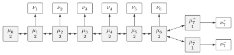
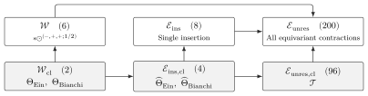

import Link from '@docusaurus/Link';
import styles from './styles.module.css';

[← Papers archive](/papers)

**R. Fisher** · Braid Dynamics Applied Research Group · [ORCID: 0009-0006-2441-3282](https://orcid.org/0009-0006-2441-3282)

**November 17, 2026** · Technical Note

**Licenses:** [Text and figures: CC BY 4.0](https://creativecommons.org/licenses/by/4.0/) · [Software: MIT](https://opensource.org/license/mit). The source archive includes both full license texts and a README defining their scope.

## Publication and verification files

| Material | Read or download |
|:--|:--|
| Technical note | [PDF](pathname:///papers/geometric-unity/downloads/fisher-geometric-unity-2026-11-17.pdf) · [Markdown](pathname:///papers/geometric-unity/downloads/fisher-geometric-unity-2026-11-17.md) · Full text below |
| Computational supplement | [Complete code in Markdown](pathname:///papers/geometric-unity/downloads/fisher-geometric-unity-2026-11-17-computational-supplement.md) |
| Code guide | [Online](/papers/geometric-unity/code-guide) · [PDF](pathname:///papers/geometric-unity/downloads/fisher-geometric-unity-2026-11-17-code-guide.pdf) · [Markdown](pathname:///papers/geometric-unity/downloads/fisher-geometric-unity-2026-11-17-code-guide.md) |
| Source archive | [ZIP](pathname:///papers/geometric-unity/downloads/fisher-geometric-unity-2026-11-17-code.zip) |

The computational supplement contains all 40 Lean files, the Python verification program, and the three project configuration files. The code guide describes every file and explains how to run the extracted archive.

## Abstract

We examine the Clifford-algebra contractions and variational structure of the bosonic sector in Eric Weinstein's 2021 working draft of *Geometric Unity*. We classify equivariant curvature contractions, identify one that recovers the Einstein tensor in the Levi-Civita limit, and derive the associated covariant divergence identities.

Unconstrained variation of a corresponding first-order action produces an additional quadratic term in the augmented torsion. An explicit Clifford-algebra example and finite-difference tests show that this term can be nonzero. We compare the reconstructed action and operator with the printed equations under stated bracket and coefficient conventions.

## 1. Introduction {#sec-introduction}

The first-order bosonic action in Weinstein's *Geometric Unity* [\[Wei\]](#ref-wei) is formulated on a 14-dimensional split-signature space associated with the bundle of metrics over a four-dimensional manifold. It pairs augmented torsion with a dressed Clifford contraction of adjoint-valued curvature. The draft calls this contraction a Shiab operator. It uses a gauge rotation $B$ of a Levi-Civita spin connection and an independent connection $A$, with augmented torsion $T=A-B$. Equations (9.7) and (9.8) of [\[Wei\]](#ref-wei) give a connection equation consisting of a curvature contraction and a term linear in $T$.

Which curvature contractions have zero divergence on every closed adjoint-valued two-form? Which recover the Einstein tensor on Levi-Civita curvature? Section 3 answers the first question by classifying Bianchi-compatible contractions in three spaces. The classifications in [Eq. (19)](#eq:six-operator-classification), [Eq. (27)](#eq:single-insertion-classification) and [Eq. (30)](#eq:unrestricted-classification) give $2$ out of $6$ in the nested-bracket ansatz, $4$ out of $8$ for a single Clifford insertion, and $96$ out of $200$ among all pointwise equivariant maps. Section 4 then evaluates the compatible single-insertion maps on Riemann curvature. The distinction matters when reading equation (9.3) of [\[Wei\]](#ref-wei). One of the bracket assignments in [Eq. (66)](#eq:nested-components) gives the negative Einstein tensor on Riemann curvature but fails the Bianchi test on general closed forms.

The remaining question is whether varying the reconstructed action gives the proposed connection equation. At fixed metric, unconstrained variation gives [Eq. (55)](#eq:einstein-euler), which contains an additional term quadratic in the augmented torsion. The explicit torsion configuration in Proposition 5.3 makes this term nonzero. Section 7 compares the result with the printed equations under stated bracket and coefficient conventions. [Appendix A](#app-notation) lists the main symbols and points to their definitions.

## 2. Clifford and adjoint conventions {#sec-clifford}

Let $(V,\eta)$ be real of dimension $14$ with signature $(7,7)$, and realize $\mathrm{Cl}_{\mathbb C}(V,\eta)$ as $\operatorname{Mat}_{128}(\mathbb C)$. Write $\{\gamma_a,\gamma_b\}=2\eta_{ab}I$, where $\{X,Y\}=XY+YX$ and $[X,Y]=XY-YX$. Blades $\gamma^{a_1\cdots a_k}=\gamma^{[a_1}\cdots\gamma^{a_k]}$ use normalized antisymmetrization. Indices are raised with $\eta$, and repeated indices are summed over $0,\dots,13$. Use an orthonormal basis with the positive directions $0,\dots,6$. In the matrix representation used here the positive generators are Hermitian and the negative generators are skew-Hermitian.

One realization starts from the Hermitian Pauli matrices $X,Y,Z$, each squaring to the identity and anticommuting with the other two. For $0\le j\le 6$, the Euclidean generators in slots $2j$ and $2j+1$ are $Z^{\otimes j}\otimes X\otimes I_2^{\otimes(6-j)}$ and $Z^{\otimes j}\otimes Y\otimes I_2^{\otimes(6-j)}$. Two generators from the same pair anticommute at the $X,Y$ position. Two generators from different pairs anticommute at the first position where one contains $X$ or $Y$ and the other contains $Z$. All other positions commute. Multiplying generators $7$ through $13$ by $i$ changes their squares to $-I$ without changing anticommutation.

For an index set $\mathcal I$, write $\gamma_{\mathcal I}$ for the product of the lower orthonormal generators in increasing order. If $\mathcal I$ has positive even size, conjugation by a generator in $\mathcal I$ negates $\gamma_{\mathcal I}$ by $|\mathcal I|-1$ interchanges. If $|\mathcal I|$ is odd, a generator outside $\mathcal I$ exists and negates it by $|\mathcal I|$ interchanges. Thus $\operatorname{Tr}\gamma_{\mathcal I}=0$ for $\mathcal I\ne\varnothing$. For $\mathcal I\ne\mathcal J$, the product $\gamma_{\mathcal I}^{-1}\gamma_{\mathcal J}$ reduces, by cancellation of the common generators, to a nonzero scalar times $\gamma_{\mathcal I\mathbin{\triangle}\mathcal J}$ and has trace zero. For $\mathcal I=\mathcal J$ it is the identity matrix and has trace $128$. Testing a linear relation against each $\gamma_{\mathcal I}^{-1}$ therefore gives zero for every coefficient. The $2^{14}=128^2$ products form a matrix basis. They also span the abstract Clifford algebra by moving repeated indices together and sorting the remaining ones. This identifies the exterior-degree decomposition as a vector-space decomposition of the matrix algebra.

**Proposition 2.1.** Set $J=i\gamma_0\cdots\gamma_6$, $\Gamma_*=\gamma_0\cdots\gamma_{13}$ and $J'=iJ\Gamma_*$. Then

<Link id="eq:adjoint-involutions" />

$$
\begin{gathered}
J^\dagger=J,\qquad J^2=I,\qquad
\Gamma_*^\dagger=\Gamma_*,\qquad \Gamma_*^2=I,\qquad
J\Gamma_*=-\Gamma_*J,\\
(J')^\dagger=J',\qquad (J')^2=I,\qquad
\gamma_a^\dagger J'=-J'\gamma_a.
\end{gathered}
\tag{1}
$$

The generator relation in [Eq. (1)](#eq:adjoint-involutions) gives the sign $(-1)^{k(k+1)/2}$ of a real $k$-blade under $X^\#=(J')^{-1}X^\dagger J'$. Thus $\mathfrak g=\mathfrak u(64,64)=\{X:X^\#=-X\}$ has real exterior grades $\Lambda^k V$ for $k\equiv 1,2\pmod 4$ and $i\Lambda^k V$ for $k\equiv 0,3\pmod 4$, as in equation (3.27) of [\[Wei\]](#ref-wei).

*Proof.* Write $P=\gamma_0\cdots\gamma_6$. Reversing a product of $k$ distinct generators takes $\sum_{j=1}^{k-1}j=k(k-1)/2$ interchanges. The same interchange count brings together the identical factors in its square. Hence

<Link id="eq:adjoint-square-signs" />

$$
\begin{aligned}
P^\dagger&=(-1)^{21}P,& P^2&=(-1)^{21}I,\\
\Gamma_*^\dagger&=(-1)^7(-1)^{91}\Gamma_*=\Gamma_*,
&\Gamma_*^2&=(-1)^{91}(-1)^7I=I,\\
J^\dagger&=-iP^\dagger=iP,& J^2&=-P^2=I.
\end{aligned}
\tag{2}
$$

For $\gamma_a$ in $P$, its six interchanges with the other factors give $\gamma_aP=P\gamma_a$. For an index outside $P$, there are seven interchanges and $\gamma_a^\dagger=-\gamma_a$. Both cases give $\gamma_a^\dagger J=J\gamma_a$. Each generator anticommutes with $\Gamma_*$ by the thirteen interchanges with the other generators. Consequently $\Gamma_*P=(-1)^7P\Gamma_*$, and

<Link id="eq:conjugation-adjoint" />

$$
\begin{aligned}
(J')^\dagger&=-i\Gamma_*J=iJ\Gamma_*=J',\\
(J')^2&=-J(\Gamma_*J)\Gamma_*=J^2\Gamma_*^2=I,\\
\gamma_a^\dagger J'&=iJ\gamma_a\Gamma_*=-iJ\Gamma_*\gamma_a=-J'\gamma_a .
\end{aligned}
\tag{3}
$$

If $J'v=\lambda v$ with $\lambda=\pm1$, then $J'(\Gamma_*v)=-\lambda\Gamma_*v$. Since $\Gamma_*^{-1}=\Gamma_*$, the two eigenspaces have equal dimension and their dimensions sum to $128$. This proves the claimed signature. For a blade $C=\gamma_{a_1}\cdots\gamma_{a_k}$, the adjoint reverses products, so

<Link id="eq:blade-adjoint-sign" />

$$
C^\#=(-\gamma_{a_k})\cdots(-\gamma_{a_1})
=(-1)^{k+k(k-1)/2}C.
\tag{4}
$$

The signs for $k$ modulo four, in order $0,1,2,3$, are $+,-,-,+$. Since $(iC)^\#=-iC^\#$, the skew-adjoint coefficients on the first and last of those grades are imaginary and the coefficients on the other two are real. With $\Lambda^k V$ embedded by real blades, this gives the real form in equation (3.27) of [\[Wei\]](#ref-wei).

<Link id="eq:real-grading" />

$$
\boxed{\displaystyle
\mathfrak g=\bigoplus_{\substack{0\le k\le14\\k\equiv 1,2\ (4)}}\Lambda^k V
\;\oplus\;i\!\bigoplus_{\substack{0\le k\le14\\k\equiv 0,3\ (4)}}\Lambda^k V .}
\tag{5}
$$

The same reversal calculation with $J$ in place of $J'$ has no generator minus signs and gives $(-1)^{k(k-1)/2}$.

**Proposition 2.2.** The Cartan decomposition of $\mathfrak g$ consists of matrices commuting and anticommuting with $J'$, respectively. In a basis diagonalizing $J'$, the commuting block has algebra $\mathfrak u(64)\oplus\mathfrak u(64)$, with derived algebra $\mathfrak{su}(64)\oplus\mathfrak{su}(64)$ of dimension $8190$ and center spanned by $iI$ and $iJ'$. The trace form is negative on the commuting block and positive on the anticommuting block.

*Proof.* In the basis with $J'=\operatorname{diag}(I_{64},-I_{64})$, the condition $X^\dagger=-J'XJ'$ on the four blocks reads

<Link id="eq:cartan-blocks" />

$$
X=\begin{pmatrix}U&C\\D&W\end{pmatrix},\qquad
\begin{pmatrix}U^\dagger&D^\dagger\\C^\dagger&W^\dagger\end{pmatrix}
=\begin{pmatrix}-U&C\\D&-W\end{pmatrix}.
\tag{6}
$$

Thus $U,W$ are independently skew-Hermitian, and $D=C^\dagger$. The diagonal part is the $+1$ eigenspace and the off-diagonal part is the $-1$ eigenspace of the involution $X\mapsto J'XJ'$. The traces of their squares are

<Link id="eq:cartan-trace-signs" />

$$
\begin{aligned}
\operatorname{Tr}\begin{pmatrix}U&0\\0&W\end{pmatrix}^{\!2}
&=-\operatorname{Tr}(U^\dagger U)-\operatorname{Tr}(W^\dagger W),\\
\operatorname{Tr}\begin{pmatrix}0&C\\C^\dagger&0\end{pmatrix}^{\!2}
&=\operatorname{Tr}(CC^\dagger)+\operatorname{Tr}(C^\dagger C)
=2\sum_{j,k}|C_{jk}|^2 .
\end{aligned}
\tag{7}
$$

In a skew-Hermitian block, the $64$ imaginary diagonal entries and two real parameters for each of the $\binom{64}{2}$ upper entries give dimension $64+64\cdot63=4096$. A commutator is traceless. Conversely, for $j\ne k$ put $U_{jk}=E_{jk}-E_{kj}$ and $W_{jk}=i(E_{jk}+E_{kj})$ in matrix units. Multiplication $E_{ab}E_{cd}=\delta_{bc}E_{ad}$ gives $[iE_{jj},U_{jk}]=W_{jk}$, $[iE_{jj},W_{jk}]=-U_{jk}$ and $[U_{jk},W_{jk}]=2i(E_{jj}-E_{kk})$. The first two types span the off-diagonal part of a skew-Hermitian block and the third spans its traceless diagonal part. The derived dimension is therefore $2(4096-1)=8190$. A central matrix in each block commutes with all $iE_{jj}$ and is diagonal. For a diagonal matrix $i\operatorname{diag}(d_1,\ldots,d_{64})$, the commutator with $U_{jk}$ is $(d_j-d_k)W_{jk}$. Thus every $d_j$ equals every $d_k$, and the center of the diagonal algebra is spanned by $iI$ and $iJ'$.

For the Killing form, complexify to all matrices and write $\operatorname{ad}_X=L_X-R_X$ for left and right multiplication. On the matrix units, $\operatorname{tr}(L_XL_Y)=\operatorname{tr}(R_XR_Y)=128\operatorname{Tr}(XY)$, since each acts on $128$ columns or rows. The diagonal coefficient of $L_XR_Y(E_{jk})=XE_{jk}Y$ at $E_{jk}$ is $X_{jj}Y_{kk}$. Summation gives $\operatorname{tr}(L_XR_Y)=\operatorname{Tr}X\operatorname{Tr}Y$, and similarly for $R_XL_Y$. Thus

<Link id="eq:killing-form" />

$$
\begin{aligned}
K(X,Y)&=256\operatorname{Tr}(XY)-2\operatorname{Tr}X\operatorname{Tr}Y,\\
K(iI,Y)&=256i\operatorname{Tr}Y-2(128i)\operatorname{Tr}Y=0,\\
K(iJ',iJ')&=256\operatorname{Tr}(-I)-2(0)^2=-32768.
\end{aligned}
\tag{8}
$$

## 3. Equivariant curvature contractions {#sec-contractions}

For $F=\tfrac12 F_{bc}e^b\wedge e^c$ with coefficients in $\mathfrak g$, a constant-coefficient map $\Theta(F)_a$ is **Bianchi-compatible** if $\partial^a\Theta(F)_a=0$ for every $F$ with $dF=0$ on the flat model. The definition tests the first-order symbol. Write $\gamma_a{}^{bc}=\eta_{ad}\gamma^{dbc}$.

**Lemma 3.1.** Moving a generator across two factors using the Clifford relation gives

<Link id="eq:vector-bivector" />

$$
\begin{aligned}
\gamma_a\gamma^{bc}&=\gamma_a{}^{bc}+\delta_a^b\gamma^c-\delta_a^c\gamma^b,\\
\gamma^{bc}\gamma_a&=\gamma_a{}^{bc}-\delta_a^b\gamma^c+\delta_a^c\gamma^b .
\end{aligned}
\tag{9}
$$

For two bivectors, [Eq. (10)](#eq:bivector-brackets) gives a grade-two commutator and an anticommutator with grade-four and scalar terms.

<Link id="eq:bivector-brackets" />

$$
\begin{aligned}
[\gamma^{bc},\gamma^{de}]
&=2(\eta^{cd}\gamma^{be}-\eta^{ce}\gamma^{bd}
-\eta^{bd}\gamma^{ce}+\eta^{be}\gamma^{cd}),\\
\{\gamma^{bc},\gamma^{de}\}
&=2\gamma^{bcde}+2(\eta^{cd}\eta^{be}-\eta^{ce}\eta^{bd})I.
\end{aligned}
\tag{10}
$$

*Proof.* For an ordered list of distinct orthonormal indices $i_1,\ldots,i_k$, the product of $\gamma^r$ with their blade has two cases. If $r$ is absent, the product is the alternating $(k+1)$-blade and every metric contraction vanishes. If $r=i_j$, the $(k+1)$-blade vanishes. Moving the leading generator to position $j$ takes $j-1$ interchanges, and contracting the two identical generators leaves $\eta^{ri_j}$ times the blade with $i_j$ deleted. Alternation extends the result in the listed indices, so

<Link id="eq:left-blade-product" />

$$
\gamma^r\gamma^{i_1\cdots i_k}
=\gamma^{r i_1\cdots i_k}
+\sum_{j=1}^k(-1)^{j-1}\eta^{ri_j}\gamma^{i_1\cdots\widehat{i_j}\cdots i_k}.
\tag{11}
$$

The hat denotes omission. For $k=2$ this gives the first line of [Eq. (9)](#eq:vector-bivector). Reversing the product changes the signs of both two- and three-blades, and leaves a single generator fixed. Multiplying the reversed identity by $-1$ gives the second line. For two bivectors, [Eq. (11)](#eq:left-blade-product) gives

<Link id="eq:bivector-product" />

$$
\begin{aligned}
\gamma^{bc}\gamma^{de}
&=\gamma^b(\gamma^{cde}+\eta^{cd}\gamma^e-\eta^{ce}\gamma^d)
   -\eta^{bc}\gamma^{de}\\
&=\gamma^{bcde}-\eta^{bd}\gamma^{ce}+\eta^{be}\gamma^{cd}
   +\eta^{cd}\gamma^{be}-\eta^{ce}\gamma^{bd}\\
&\quad+(\eta^{cd}\eta^{be}-\eta^{ce}\eta^{bd})I .
\end{aligned}
\tag{12}
$$

Here the $\eta^{bc}\gamma^{de}$ term from $\gamma^b\gamma^{cde}$ cancels the subtracted term on the first line. Reversal sends this product to $\gamma^{de}\gamma^{bc}$ and acts on grades $4,2,0$ with signs $+,-,+$. The difference retains twice the grade-two terms, and the sum retains twice the grade-four and scalar terms, giving [Eq. (10)](#eq:bivector-brackets).

### 3.1. The six bracket contractions {#sec-brackets}

Let $\mathcal W$ be the span of the six operators below. The indices $c$ and $a$ in their subscripts label the commutator and $i$-scaled anticommutator, respectively, with the outer bracket listed first. Set $S_c=[\gamma^{bc},F_{bc}]$ and $S_a=i\{\gamma^{bc},F_{bc}\}$, where the subscript on $S_a$ is a label.

<Link id="eq:six-brackets" />

$$
\begin{aligned}
O_{1,c}(F)_a&=[\gamma^b,F_{ba}],&
O_{1,a}(F)_a&=i\{\gamma^b,F_{ba}\},\\
O_{2,cc}(F)_a&=[\gamma_a,S_c],&
O_{2,ca}(F)_a&=[\gamma_a,S_a],\\
O_{2,ac}(F)_a&=i\{\gamma_a,S_c\},&
O_{2,aa}(F)_a&=i\{\gamma_a,S_a\}.
\end{aligned}
\tag{13}
$$

The coefficients are $\mathfrak g$-valued. Indeed, if $P^\#=-P$ and $X^\#=-X$, then $[P,X]^\#=XP-PX=-[P,X]$ and $(i\{P,X\})^\#=-i(XP+PX)=-i\{P,X\}$. Both the grade-one and grade-two insertions are skew-adjoint by [Eq. (5)](#eq:real-grading), so the same check applies at each bracket in [Eq. (13)](#eq:six-brackets).

**Proposition 3.2.** The six operators are independent. Their Bianchi-compatible subspace has basis

<Link id="eq:three-blade-contractions" />

$$
\begin{aligned}
\Theta_{\mathrm{Ein}}(F)_a
&=\big[O_{1,c}+\tfrac14(O_{2,cc}-O_{2,aa})\big](F)_a
=\tfrac12\{\gamma_a{}^{bc},F_{bc}\},\\
\Theta_{\mathrm{Bianchi}}(F)_a
&=\big[O_{1,a}+\tfrac14(O_{2,ca}+O_{2,ac})\big](F)_a
=\tfrac i2[\gamma_a{}^{bc},F_{bc}].
\end{aligned}
\tag{14}
$$

*Proof.* With summation over $b,c$ understood, abbreviate $P=\gamma_a$, $Q=\gamma^{bc}$ and $X=F_{bc}$ in the products below. The two scaled anticommutators in $O_{2,aa}$ give $i^2=-1$. The mixed terms are

<Link id="eq:nested-bracket-expansion" />

$$
\begin{aligned}
[P,[Q,X]]&=PQX-PXQ-QXP+XQP,\\
-\{P,\{Q,X\}\}&=-PQX-PXQ-QXP-XQP,\\
[P,\{Q,X\}]&=PQX+PXQ-QXP-XQP,\\
\{P,[Q,X]\}&=PQX-PXQ+QXP-XQP.
\end{aligned}
\tag{15}
$$

Subtracting the second line of [Eq. (15)](#eq:nested-bracket-expansion) from the first gives $2(PQX+XQP)$. Adding the last two lines and multiplying by $i$ gives $2i(PQX-XQP)$. In [Eq. (9)](#eq:vector-bivector) write $L_a{}^{bc}=\delta_a^b\gamma^c-\delta_a^c\gamma^b$. The contractions of this part on the left and right of $F$ are

<Link id="eq:vector-part-contractions" />

$$
\begin{aligned}
L_a{}^{bc}F_{bc}
&=\gamma^cF_{ac}-\gamma^bF_{ba}=-2\gamma^b F_{ba},\\
F_{bc}L_a{}^{bc}
&=F_{ac}\gamma^c-F_{ba}\gamma^b=-2F_{ba}\gamma^b .
\end{aligned}
\tag{16}
$$

Using $\gamma_a\gamma^{bc}=\gamma_a{}^{bc}+L_a{}^{bc}$ and $\gamma^{bc}\gamma_a=\gamma_a{}^{bc}-L_a{}^{bc}$ yields

<Link id="eq:nested-bracket-reduction" />

$$
\begin{aligned}
(O_{2,cc}-O_{2,aa})(F)_a
&=2\{\gamma_a{}^{bc},F_{bc}\}-4[\gamma^b,F_{ba}],\\
(O_{2,ca}+O_{2,ac})(F)_a
&=2i[\gamma_a{}^{bc},F_{bc}]-4i\{\gamma^b,F_{ba}\}.
\end{aligned}
\tag{17}
$$

Division by four and addition of $O_{1,c}$ or $O_{1,a}$ cancels the last term in its respective line. This gives [Eq. (14)](#eq:three-blade-contractions). Each divergence contracts $\partial_a F_{bc}$ against a blade alternating in $a,b,c$. The cyclic permutations of $a,b,c$ are even, so each divergence is one third of the same contraction against $(dF)_{abc}=\partial_a F_{bc}+\partial_b F_{ca}+\partial_c F_{ab}$. It vanishes for closed $F$.

For the converse let $F=x^0M\,e^0\wedge e^1$. Then $dF=M\,e^0\wedge e^0\wedge e^1=0$ and $\partial^a\Theta(F)_a=\partial_0\Theta(F)_0$, since $0$ is positive and the other derivatives vanish. Set $x=\gamma^0$, $y=\gamma^1$, and $q=xy$. From $x^2=y^2=I$ and $yx=-xy$ one gets $q^2=xyxy=-xxyy=-I$, $qx=xyx=-y$, $xq=xxy=y$, $qy=xyy=x$ and $yq=yxy=-x$. At the differentiated input $F_{01}=M$, $F_{10}=-M$, the first brackets are $-[y,M]$ and $-i\{y,M\}$. The inner contractions are $S_c=2[q,M]$ and $S_a=2i\{q,M\}$. The needed products with $y$ and $q$ are

| $M$ | $[y,M]$ | $\{y,M\}$ | $[q,M]$ | $\{q,M\}$ |
|:--|:--|:--|:--|:--|
| $iI$ | $0$ | $2iy$ | $0$ | $2iq$ |
| $y$ | $0$ | $2I$ | $2x$ | $0$ |
| $x$ | $-2q$ | $0$ | $-2y$ | $0$ |
| $q$ | $-2x$ | $0$ | $0$ | $-2I$ |

For $M=iI$, only $S_a=-4q$ survives, and $[x,-4q]=-8y$ while $i\{x,-4q\}=0$. For $M=y$, $S_c=4x$ gives $[x,4x]=0$ and $i\{x,4x\}=8iI$. For $M=x$, $S_c=-4y$ gives $[x,-4y]=-8q$ and $i\{x,-4y\}=0$. For $M=q$, $S_a=-4iI$ gives $[x,-4iI]=0$ and $i\{x,-4iI\}=8x$. Combined with the first brackets these are the nonzero divergence entries.

| $M$ | First bracket | Nested bracket |
|:--|:--|:--|
| $iI$ | $O_{1,a}: 2\gamma^1$ | $O_{2,ca}: -8\gamma^1$ |
| $\gamma^1$ | $O_{1,a}: -2iI$ | $O_{2,ac}: 8iI$ |
| $\gamma^0$ | $O_{1,c}: 2\gamma^{01}$ | $O_{2,cc}: -8\gamma^{01}$ |
| $\gamma^{01}$ | $O_{1,c}: 2\gamma^0$ | $O_{2,aa}: 8\gamma^0$ |

Writing $u_c,u_a$ for the two first-bracket coefficients and $v_{cd}$ for the nested coefficients with $c,d\in\{c,a\}$, the four rows impose

<Link id="eq:closed-jet-equations" />

$$
\begin{aligned}
2u_a-8v_{ca}=0,\qquad &-2u_a+8v_{ac}=0,\\
2u_c-8v_{cc}=0,\qquad &2u_c+8v_{aa}=0 .
\end{aligned}
\tag{18}
$$

Solving [Eq. (18)](#eq:closed-jet-equations) gives $(v_{cc},v_{ca},v_{ac},v_{aa})=(u_c,u_a,u_a,-u_c)/4$. The resulting operator is $u_c\Theta_{\mathrm{Ein}}+u_a\Theta_{\mathrm{Bianchi}}$. For an input with sole independent component $F_{12}=iI$, the pair of outputs at $a=0$ is $(\{\gamma^{012},iI\},i[\gamma^{012},iI])=(2i\gamma^{012},0)$. For $F_{12}=\gamma^3$, one has $\gamma^3\gamma^{012}=-\gamma^{0123}$, giving outputs $(0,2i\gamma^{0123})$. Hence a zero operator forces $u_c=u_a=0$ and then all four $v$'s to vanish. This proves independence of the six original operators as well as the claimed classification. With $\mathcal W_{\mathrm{cl}}$ denoting the subspace with zero divergence on every closed input,

<Link id="eq:six-operator-classification" />

$$
\boxed{\mathcal W_{\mathrm{cl}}
=\operatorname{span}_{\mathbb R}\{\Theta_{\mathrm{Ein}},\Theta_{\mathrm{Bianchi}}\},
\qquad \dim_{\mathbb R}\mathcal W_{\mathrm{cl}}=2.}
\tag{19}
$$

### 3.2. A single Clifford insertion {#sec-insertion}

**Theorem 3.3.** Two-sided single-insertion maps $\Lambda^2 V^*\otimes\mathfrak g\to V^*\otimes\mathfrak g$ span an eight-dimensional real space. Four are $O_{1,c}, O_{1,a}, \Theta_{\mathrm{Ein}},\Theta_{\mathrm{Bianchi}}$. The four hatted counterparts insert $\Gamma_*$ on the right of the blade inside the bracket. The Bianchi-compatible space has basis $\Theta_{\mathrm{Ein}},\Theta_{\mathrm{Bianchi}},\widehat{\Theta}_{\mathrm{Ein}},\widehat{\Theta}_{\mathrm{Bianchi}}$.

*Proof.* Here a two-sided single insertion has the form

<Link id="eq:single-insertion" />

$$
L_a{}^{bc}F_{bc}+F_{bc}R_a{}^{bc},
\tag{20}
$$

with invariant tensors $L$ and $R$ and complex coefficients. We first decompose the index representation. For $U_{abc}=-U_{acb}$ define

<Link id="eq:symbol-projections" />

$$
\begin{aligned}
(\operatorname{Alt}U)_{abc}&=\tfrac13(U_{abc}+U_{bca}+U_{cab}),\\
(\operatorname{tr}_\eta U)_c&=\eta^{ab}U_{abc},&
(j_\eta v)_{abc}&=\tfrac1{13}(\eta_{ab}v_c-\eta_{ac}v_b).
\end{aligned}
\tag{21}
$$

The inclusion of a three-form $H$ has $\operatorname{Alt}H=H$ and $\operatorname{tr}_\eta H=0$. For $j_\eta v$, the numerator of its cyclic sum is
$(\eta_{ab}v_c-\eta_{ac}v_b)+(\eta_{bc}v_a-\eta_{ba}v_c)+(\eta_{ca}v_b-\eta_{cb}v_a)=0$.
Its trace is $(\eta^{ab}\eta_{ab}v_c-\eta^{ab}\eta_{ac}v_b)/13=(14v_c-v_c)/13=v_c$. Consequently $U=\operatorname{Alt}U+j_\eta(\operatorname{tr}_\eta U)+U_0$, with $U_0$ in the joint kernel. Applying the two projections to a zero sum forces the first two summands to vanish and then $U_0=0$, so the sum is direct. These maps commute with the spin action because they only permute indices or contract with the invariant metric. The kernel has dimension $14\binom{14}{2}-\binom{14}{3}-14=1274-364-14=896$.

To identify the kernel over $\mathbb C$, use a null basis with weight vectors $u_i$ and $v_i$ of weights $e_i$ and $-e_i$, where $\eta(u_i,v_j)=\delta_{ij}$ and like-sign pairings vanish. A positive root $e_i-e_j$ for $i<j$ sends $u_j$ to $u_i$ and $v_i$ to $-v_j$. The root $e_i+e_j$ sends $v_j$ to $u_i$ and $v_i$ to $-u_j$, with other basis vectors killed. We identify covariant and contravariant indices by the metric. The vector $u_1\otimes(u_1\wedge u_2)$ lies in the kernel because its alternation repeats $u_1$ and all its metric contractions vanish. The raising operators either kill the factors or insert a second $u_1$ in the wedge. Its highest weight is $(2,1,0,0,0,0,0)$.

For a dominant weight $\mu$ in these coordinates use the $D_7$ Weyl dimension formula

<Link id="eq:weyl-dimension" />

$$
d(\mu)=\prod_{1\le i<j\le7}
\frac{(\rho_i+\mu_i)^2-(\rho_j+\mu_j)^2}{\rho_i^2-\rho_j^2},
\qquad \rho=(6,5,4,3,2,1,0).
\tag{22}
$$

For the kernel weight only pairs involving the first two coordinates contribute. The pair $(1,2)$ gives $28/11$. For the other pairs with second coordinate $t=4,3,2,1,0$ in $\rho$, the two factors combine to $(64-t^2)/(25-t^2)$. Thus the dimension is

<Link id="eq:hook-dimension" />

$$
\frac{28}{11}\frac{48}{9}\frac{55}{16}
\frac{60}{21}\frac{63}{24}\frac{64}{25}=896.
\tag{23}
$$

Complete reducibility and equality with the kernel dimension identify it with the irreducible traceless hook $H_{(2,1)}$. The index representation therefore has three summands, $\Lambda^3 V$, $V$, and $H_{(2,1)}$.

For $0\le k\le6$, the wedge $u_1\wedge\cdots\wedge u_k$ is a highest-weight vector of weight $\mu_k=(1^k,0^{7-k})$. A raising operator either kills its factors or repeats a factor already in the wedge. In [Eq. (22)](#eq:weyl-dimension), the shifted entries of $\mu_k+\rho$ are the integers from $7$ to $0$ in decreasing order with $7-k$ omitted. For $k=0$, the omitted entry is $7$. In degree seven the two highest vectors are $u_1\wedge\cdots\wedge u_6\wedge u_7$ and $u_1\wedge\cdots\wedge u_6\wedge v_7$. Even the positive roots that act on $v_7$ insert a factor among $u_1,\dots,u_6$. The shifted squared entries for both weights are those of $7,6,5,4,3,2,1$, so their dimensions agree. The Weyl products cancel the common pair differences with the denominator. With $t=7-k$ for $1\le k\le7$, the quotient can be written as

<Link id="eq:exterior-dimension-product" />

$$
\frac{\displaystyle\prod_{\substack{0\le j\le6\\j\ne t}}(49-j^2)}
{\displaystyle\prod_{\substack{0\le j\le6\\j\ne t}}|t^2-j^2|}.
\tag{24}
$$

For $k=1,\ldots,6$ this gives $14,91,364,1001,2002,3003$, equal to $\binom{14}{k}$. For $k=7$ the two products both give $(49-1)(49-4)(49-9)(49-16)(49-25)(49-36)/(1^2 2^2 3^2 4^2 5^2 6^2)=1716$, and $2\cdot1716=\binom{14}{7}$. These subrepresentations exhaust their grades. Metric and volume identify grade $14-k$ with grade $k$ via the Hodge map onto the complementary wedges. In particular, only grades $1,13$ contain the vector representation and only grades $3,11$ contain the three-form representation. No exterior grade contains the hook weight with first coordinate $2$.

By Schur's lemma the two copies of $V$ and the two copies of $\Lambda^3 V$ account for four complex insertions. The trace and alternation maps above produce the grade-one and grade-three representatives. Right multiplication by the invariant volume element sends a blade to a nonzero multiple of its complementary blade, giving the other two representatives. Thus the insertion tensors have basis

<Link id="eq:invariant-insertions" />

$$
\delta_a^{[b}\gamma^{c]},\qquad
\delta_a^{[b}\gamma^{c]}\Gamma_*,\qquad
\gamma_a{}^{bc},\qquad \gamma_a{}^{bc}\Gamma_*.
\tag{25}
$$

Each tensor in [Eq. (25)](#eq:invariant-insertions) has definite adjoint sign $C^\#=sC$. For $X^\#=-X$, taking the adjoint of $Y=\alpha CX+\beta XC$ gives $Y^\#=-s\bar\alpha XC-s\bar\beta CX$. It follows that

<Link id="eq:skew-adjoint-projection" />

$$
\frac{Y-Y^\#}{2}=\alpha' CX+s\overline{\alpha'}XC,\qquad
\alpha'=\frac{\alpha+s\bar\beta}{2}.
\tag{26}
$$

Applying this projection termwise to [Eq. (20)](#eq:single-insertion) fixes any map with values in $\mathfrak g$. For $\alpha'=u+iv$, the expression with $s=-1$ equals $u[C,X]+iv\{C,X\}$, and with $s=1$ it equals $u\{C,X\}+iv[C,X]$. The real grading [Eq. (5)](#eq:real-grading) gives $s=-1$ in grades $1,13$ and $s=1$ in grades $3,11$. This gives the eight proposed spanning maps.

The totally antisymmetric insertions have zero divergence on closed forms by the cyclic contraction established in Proposition 3.2. For the remaining four maps, on its closed $01$ jet the outputs are minus the corresponding brackets of $y$ or $y\Gamma_*$ with $M$. The choice $M=iI$ gives zero commutators and anticommutator outputs $-i(2iy)=2y$ and $-i(2iy\Gamma_*)=2y\Gamma_*$. These lie in different grades, so their two coefficients must vanish. With only commutators left, $M=x$ gives $-[y,x]=2xy$. Since $y\Gamma_*x=-yx\Gamma_*=xy\Gamma_*$, the hatted commutator is zero on $x$. For $M=y$, the ordinary commutator is zero while $y\Gamma_*y=-\Gamma_*$ and $yy\Gamma_*=\Gamma_*$, giving $-[y\Gamma_*,y]=2\Gamma_*$. This forces both commutator coefficients to vanish.

For the four alternating maps use the input with sole independent component $F_{12}=X$. Summation over $12$ and $21$ cancels the factor $1/2$. Set $C=\gamma^{012}$. For $X=iI$, the two commutators vanish and the two anticommutators double the products. For $X=x=\gamma^0$, $Cx=xC=\gamma^{12}$, while $C\Gamma_*x=-\gamma^{12}\Gamma_*$ and $xC\Gamma_*=\gamma^{12}\Gamma_*$. For $X=\gamma^3$, $C\gamma^3=\gamma^{0123}$ and $\gamma^3 C=-\gamma^{0123}$, while both $C\Gamma_*\gamma^3$ and $\gamma^3 C\Gamma_*$ are $-\gamma^{0123}\Gamma_*$. The resulting values at $a=0$ are

| $X$ | $\Theta_{\mathrm{Ein}}$ | $\Theta_{\mathrm{Bianchi}}$ | $\widehat{\Theta}_{\mathrm{Ein}}$ | $\widehat{\Theta}_{\mathrm{Bianchi}}$ |
|:--|:--|:--|:--|:--|
| $iI$ | $2i\gamma^{012}$ | $0$ | $2i\gamma^{012}\Gamma_*$ | $0$ |
| $\gamma^0$ | $2\gamma^{12}$ | $0$ | $0$ | $-2i\gamma^{12}\Gamma_*$ |
| $\gamma^3$ | $0$ | $2i\gamma^{0123}$ | $-2\gamma^{0123}\Gamma_*$ | $0$ |

In a zero linear combination the first row sets the two Einstein coefficients to zero by their different grades. The second row then sets the hatted commutator coefficient to zero and the third sets the ordinary one to zero. The four vector coefficients were forced to vanish on closed jets, so all eight maps are independent. If $\mathcal E_{\mathrm{ins}}$ is the two-sided single-insertion space and $\mathcal E_{\mathrm{ins,cl}}$ its subspace compatible with all closed inputs, then

<Link id="eq:single-insertion-classification" />

$$
\boxed{(\dim_{\mathbb R}\mathcal E_{\mathrm{ins}},
         \dim_{\mathbb R}\mathcal E_{\mathrm{ins,cl}})=(8,4).}
\tag{27}
$$

### 3.3. All pointwise equivariant contractions {#sec-unrestricted}

**Theorem 3.4.** The real dimension of

<Link id="eq:equivariant-space" />

$$
\mathcal E_{\mathrm{unres}}
=\operatorname{Hom}_{\mathrm{Spin}(7,7)}
   (\Lambda^2 V^*\otimes\mathfrak g, V^*\otimes\mathfrak g)
\tag{28}
$$

is $200$. The $\Lambda^3 V$, vector, and traceless-hook symbol channels have dimensions $96$, $56$, and $48$, respectively. Bianchi compatibility selects the $\Lambda^3 V$ channel.

*Proof.* Write a constant-coefficient map as $\Theta(F)_a=K_a{}^{bc}(F_{bc})$ with $K_a{}^{bc}=-K_a{}^{cb}$ and each $K_a{}^{bc}$ a linear map on $\mathfrak g$. Its divergence is the linear functional on first derivatives $J_{abc}=\partial_a F_{bc}$ defined by $M(J)=\eta^{ad}K_d{}^{bc}(J_{abc})$, with values in $\mathfrak g$. The metric is nondegenerate, so $M$ determines $K$. If $\operatorname{Alt} J=0$, the linear form $F=\tfrac12 x^a J_{abc}e^b\wedge e^c$ has $\partial_aF_{bc}=J_{abc}$ and $(dF)_{abc}=3(\operatorname{Alt}J)_{abc}=0$. Conversely every closed form has such a jet. Therefore the condition $M(J)=0$ for all closed jets is equivalent to vanishing of $M$ on $\ker(\operatorname{Alt})$. In that case $M(J)=M(\operatorname{Alt}J)$, since $J-\operatorname{Alt}J$ lies in the kernel. The index decomposition in the proof of Theorem 3.3 identifies the two removed summands as $V$ and $H_{(2,1)}$.

Write $C_k=\Lambda^k V_{\mathbb C}$ and $C=\bigoplus_k C_k$. By [Eq. (5)](#eq:real-grading), complexification of $\mathfrak g$ equals $C$. If a complex intertwiner is given, the involution that conjugates its input and output relative to the real forms splits it into its real and imaginary intertwiners. Thus the dimension over $\mathbb C$ of the complex intertwiner space equals the real dimension before complexification. For semisimple complex representations $P=\bigoplus_\nu m_P(\nu)L_\nu$ and $Q=\bigoplus_\nu m_Q(\nu)L_\nu$, Schur's lemma gives $\dim\operatorname{Hom}(P,Q)=\sum_\nu m_P(\nu)m_Q(\nu)$. Apply this to the domain and codomain of [Eq. (28)](#eq:equivariant-space) on each input grade. For the Bianchi and vector channels, apply it instead to the two symbol summands $\Lambda^3 V_{\mathbb C}\otimes C_k$ and $V_{\mathbb C}\otimes C_k$ with codomain $C$. The three pairings for input grade $k$ are

<Link id="eq:dimension-pairings" />

$$
\begin{aligned}
U_k&=\sum_\nu m_{\Lambda^2 V_{\mathbb C}\otimes C_k}(\nu)\,
                       m_{V_{\mathbb C}\otimes C}(\nu),\\
B_k&=\sum_\nu m_{\Lambda^3 V_{\mathbb C}\otimes C_k}(\nu)\,m_C(\nu),\\
V_k&=\sum_\nu m_{V_{\mathbb C}\otimes C_k}(\nu)\,m_C(\nu),&
H_k&=U_k-B_k-V_k .
\end{aligned}
\tag{29}
$$

Here is the integer calculation of these multiplicities, using Klimyk's rule [\[Kli\]](#ref-kli). The weights of $\Lambda^r V_{\mathbb C}$ are obtained by taking all $\binom{14}{r}$ subsets of the distinct signed vector weights $e_1,-e_1,\ldots,e_7,-e_7$ and adding their entries. Repeated sums are retained. If $C_k$ has a summand of highest weight $\mu$, each subset with sum $\omega$ contributes as follows.

1. Form $z=\mu+\rho+\omega$. For the roots $e_i\pm e_j$, singularity is exactly the equality $|z_i|=|z_j|$ for some $i\ne j$. Such an entry contributes zero.
2. If regular, sort the absolute values decreasingly, permuting the signed coordinates accordingly, and record the parity of the permutation. Make the first six entries positive. If this changes an odd number of signs, change the seventh sign as well. The resulting chamber condition is $z'_1>z'_2>\cdots>z'_6>|z'_7|$.
3. Add the recorded sign to the multiplicity of $z'-\rho$. The sign changes are even in number, so the determinant of the Weyl transformation is the recorded permutation sign. Sum over all subsets and all highest weights of $C_k$.

For instance, for $\mu=e_1$ and $r=1$, the shifted weight is initially $(7,5,4,3,2,1,0)$. Adding $e_1$, $-e_1$, or $e_2$ gives $(8,5,4,3,2,1,0)$, $(6,5,4,3,2,1,0)$ or $(7,6,4,3,2,1,0)$, respectively. Every other signed unit makes two absolute entries equal. Subtracting $\rho$ leaves the three weights $2e_1,0,e_1+e_2$ with multiplicity one. Their multiplicities in $C$ are $0,2,2$, giving $V_1=4$. For $r=2$ and the same $\mu$, the multiplicity at $e_1$ is a signed sum. The seven opposite pairs contribute $+7$, since they have zero weight. The adjacent swaps of the entries $5,4,3,2,1,0$ contribute $-5$, and the alternative swap at $(1,0)$ using the other sign at the zero entry contributes $-1$. The pair of entries $7,5$ is separated by more than one, and a subset with nonzero sum changes exactly two entries by one, so it cannot otherwise preserve the absolute values of the original list. The multiplicity is $7-5-1=1$.

For clarity, set $\mu_k=(1^k,0^{7-k})$ for $0\le k\le6$, $\mu_7^\pm=(1,1,1,1,1,1,\pm1)$, $\nu_j=(2,1^{j-1},0^{7-j})$ for $1\le j\le6$, and $\nu_7^\pm=(2,1,1,1,1,1,\pm1)$. The weights counted in $C$ have multiplicities two at $\mu_0,\ldots,\mu_6$ and one at each $\mu_7^\pm$. In $V_{\mathbb C}\otimes L_{\mu_k}$ for $1\le k\le5$, the shifted entries are adjacent integers except for the missing integer $7-k$. Raising the first entry gives $\nu_k$. Lowering the entry just above the gap gives $\mu_{k-1}$, and raising the one just below gives $\mu_{k+1}$. Every other unit change repeats an absolute entry. At $k=6$ the gap is above the last entry $0$, so both signs of its unit change are allowed and yield $\mu_7^\pm$. At $\mu_7^\pm$ the shifted absolute entries are $7,6,\ldots,1$. Raising the first or moving the last to zero gives $\nu_7^\pm$ or $\mu_6$, respectively. At $k=0$ the tensor product is $V_{\mathbb C}$. Each surviving shift is already dominant and has coefficient one.

The transitions for $r=1$ are collected in [Fig. 1](#fig:weight-transitions). Each output multiplicity is the sum of the input multiplicities along its incoming arrows.

<figure style={{margin: "2rem 0"}}>

<Link id="fig:weight-transitions" />

**Figure 1.** Highest-weight transitions under tensoring with $V_{\mathbb C}$. The number below each $\mu$ is its multiplicity in $C$. Each arrow contributes one output copy per copy of its source, and a double-headed edge represents both directions.

</figure>

Thus $\mu_0$ receives the two copies from $\mu_1$. Each $\mu_j$ with $1\le j\le5$ receives two copies from each adjacent grade. The weight $\mu_6$ receives two copies from $\mu_5$ and one from each $\mu_7^\pm$. Each $\mu_7^\pm$ receives two from $\mu_6$, and each $\nu_j$ or $\nu_7^\pm$ receives copies only from its corresponding $\mu_j$ or $\mu_7^\pm$. This produces the target multiplicities

| Weights | Multiplicity per weight |
|:--|--:|
| $\mu_0$ | $2$ |
| $\mu_1,\ldots,\mu_6$ | $4$ |
| $\mu_7^+,\mu_7^-$ | $2$ |
| $\nu_1,\ldots,\nu_6$ | $2$ |
| $\nu_7^+,\nu_7^-$ | $1$ |

For $r=2,3$, the signed counts that enter [Eq. (29)](#eq:dimension-pairings) are recorded below. The $r=2$ column retains exactly the weights that occur in $V_{\mathbb C}\otimes C$, and the $r=3$ column those in $C$. A coefficient greater than one counts repeated surviving copies after cancellation. The notation $\mu_7^\pm$ or $\nu_7^\pm$ in a table entry includes one copy of each sign.

| $k$ | $r=2$ | $r=3$ |
|:--|:--|:--|
| $0$ | $\mu_2$ | $\mu_3$ |
| $1$ | $\mu_1+\nu_2+\mu_3$ | $\mu_2+\mu_4$ |
| $2$ | $\mu_2+\nu_1+\nu_3+\mu_0+\mu_4$ | $\mu_1+\mu_3+\mu_5$ |
| $3$ | $\mu_3+\nu_2+\nu_4+\mu_1+\mu_5$ | $\mu_2+\mu_4+\mu_0+\mu_6$ |
| $4$ | $\mu_4+\nu_3+\nu_5+\mu_2+\mu_6$ | $\mu_3+\mu_5+\mu_1+\mu_7^\pm$ |
| $5$ | $\mu_5+\nu_4+\nu_6+\mu_3+\mu_7^\pm$ | $\mu_4+2\mu_6+\mu_2$ |
| $6$ | $2\mu_6+\nu_5+\nu_7^\pm+\mu_4$ | $2\mu_5+\mu_7^\pm+\mu_3$ |
| $7$ | $\mu_7^\pm+2\nu_6+2\mu_5$ | $2\mu_6+2\mu_4$ |

Multiplying these entries by the corresponding target multiplicities gives the following sums. For $k<7$ the row at $14-k$ is identical because the Hodge map identifies the input representations. The row at $7$ includes both highest weights.

| $k$ | $U_k$ | $B_k$ | $V_k$ | $H_k$ |
|:----|:-----------------------------------|:------------------------|:----------|----:|
| $0$ | $4$ | $2$ | $2$ | $0$ |
| $1$ | $4+2+4=10$ | $2+2=4$ | $2+2=4$ | $2$ |
| $2$ | $4+2+2+2+4=14$ | $2+2+2=6$ | $2+2=4$ | $4$ |
| $3$ | $4+2+2+4+4=16$ | $2+2+2+2=8$ | $2+2=4$ | $4$ |
| $4$ | $4+2+2+4+4=16$ | $2+2+2+1+1=8$ | $2+2=4$ | $4$ |
| $5$ | $4+2+2+4+2+2=16$ | $2+2\cdot2+2=8$ | $2+2=4$ | $4$ |
| $6$ | $2\cdot4+2+1+1+4=16$ | $2\cdot2+1+1+2=8$ | $2+1+1=4$ | $4$ |
| $7$ | $2+2+2\cdot2+2\cdot4=16$ | $2\cdot2+2\cdot2=8$ | $2\cdot2=4$ | $4$ |

For example, for $k=7$ the $r=2$ entries paired with $V_{\mathbb C}\otimes C$ are one copy each of $\mu_7^+$ and $\mu_7^-$ and two copies each of $\nu_6$ and $\mu_5$. These contribute $2,2,2\cdot2,2\cdot4$. The $r=3$ entries paired with $C$ are twice $\mu_6$ and twice $\mu_4$, and the $r=1$ entries are twice $\mu_6$. The representation-theoretic check in the verification program uses the same signed enumeration. Pairing opposite exterior degrees gives the grouped totals.

| Input Clifford grade | Unrestricted | Bianchi | Vector | Hook |
|:--|--:|--:|--:|--:|
| $0,14$ | 8 | 4 | 4 | 0 |
| $1,13$ | 20 | 8 | 8 | 4 |
| $2,12$ | 28 | 12 | 8 | 8 |
| $3$ through $6$, $8$ through $11$ | 128 | 64 | 32 | 32 |
| $7$ | 16 | 8 | 4 | 4 |
| **Total** | **200** | **96** | **56** | **48** |

In particular, for $\mathcal E_{\mathrm{unres,cl}}$ the subspace compatible with every closed input,

<Link id="eq:unrestricted-classification" />

$$
\boxed{(\dim_{\mathbb R}\mathcal E_{\mathrm{unres}},
         \dim_{\mathbb R}\mathcal E_{\mathrm{unres,cl}})=(200,96).}
\tag{30}
$$

The real classification in Theorem 3.4 has been formally proved in Lean 4. In the namespace `GeometricUnity.D7RealTheorem`, the declaration `theorem_3_4` establishes all four dimension counts and characterizes the 96-dimensional Bianchi-compatible subspace by its vanishing divergence on closed two-forms. The [Computational Supplement](pathname:///papers/geometric-unity/downloads/fisher-geometric-unity-2026-11-17-computational-supplement.md#source-d7realtheorem-lean) contains the complete formalization and axiom audit.

An explicit map outside the single-insertion subspace is $\mathcal T(F)_a=\operatorname{Tr}(F_{bc})\gamma_a{}^{bc}$. Indeed $\overline{\operatorname{Tr}X}=\operatorname{Tr}X^\dagger=-\operatorname{Tr}(J'XJ')=-\operatorname{Tr}X$ for $X\in\mathfrak g$, so the grade-three coefficients are imaginary as required by [Eq. (5)](#eq:real-grading). Trace invariance under conjugation and the tensorial transformation of the blade give equivariance. The cyclic derivative calculation of Proposition 3.2 proves compatibility. For sole independent component $F_{12}=iI$, the output at $0$ is $2(128i)\gamma^{012}$. The first row of the single-insertion output table therefore forces the ordinary Einstein coefficient to be $128$ and the hatted Einstein coefficient to be zero. For $F_{12}=\gamma^0$ the trace vanishes, but the resulting combination has grade-two part $128(2\gamma^{12})$. The ordinary commutator is zero on that input, and the hatted commutator has grade twelve. This contradicts vanishing of the grade-two output.

The upper-row spaces $\mathcal W$ and $\mathcal E_{\mathrm{ins}}$ in [Fig. 2](#fig:contraction-spaces) are incomparable. To see the obstruction to $\mathcal W\subseteq\mathcal E_{\mathrm{ins}}$, use $F=\gamma^0(x^0e^{12}-x^1e^{20})$, where $e^{ij}=e^i\wedge e^j$. Its derivative is $\gamma^0(e^{012}-e^{120})=0$, and every nonzero component of its first jet has distinct indices, so the metric trace vanishes. The jet therefore lies in the traceless hook. The single-insertion symbols in [Eq. (25)](#eq:invariant-insertions) depend only on the metric trace and the totally alternating part, so their divergences vanish on this jet. For $O_{2,cc}$, the $12$ component contributes zero to $S_c$ since $[\gamma^{12},\gamma^0]=0$. The $20$ and $02$ components give $S_c=-2x^1[\gamma^{20},\gamma^0]=-4x^1\gamma^2$. The divergence is then $\partial^1(-4x^1[\gamma_1,\gamma^2])=-8\gamma^{12}$. Thus $O_{2,cc}\in\mathcal W$ lies outside $\mathcal E_{\mathrm{ins}}$. The reverse inclusion is ruled out by $8>6$.

<figure style={{margin: "2rem 0"}}>

<Link id="fig:contraction-spaces" />

**Figure 2.** Inclusions of contraction spaces, with real dimensions in parentheses. The lower row consists of the subspaces compatible with every closed input. The hatted pair and the trace contraction each lie outside the preceding space in that row. The upper-left operator is shown in the undressed frame. It gives $-G_{ab}\gamma^b$ on algebraic Riemann curvature and fails the general closed-form test (Proposition 7.1).

</figure>

Bianchi compatibility leaves a 96-dimensional space of equivariant operators. Recovering the Einstein tensor on algebraic Riemann curvature imposes a further requirement, examined for the single-insertion operators in Section 4.

## 4. Einstein reconstruction and covariant divergence {#sec-curvature}

**Theorem 4.1.** Let $R_{abcd}$ have the pair symmetries and first Bianchi identity of algebraic Riemann curvature. Set

<Link id="eq:riemann-conventions" />

$$
\begin{aligned}
(F_{\mathrm{Riem}})_{bc}&=\tfrac14R_{bcde}\gamma^{de},&
R_{ab}&=\eta^{cd}R_{cadb},\\
R_{\mathrm{scal}}&=\eta^{ab}R_{ab},&
G_{ab}&=R_{ab}-\tfrac12R_{\mathrm{scal}}\eta_{ab}.
\end{aligned}
\tag{31}
$$

The two anticommutator three-blade contractions recover the ordinary and volume-multiplied Einstein tensors in [Eq. (35)](#eq:einstein-reconstruction). Both commutator three-blade contractions vanish.

*Proof.* The difference of the two products in [Eq. (9)](#eq:vector-bivector) gives $[\gamma^b,\gamma^{de}]=2(\eta^{bd}\gamma^e-\eta^{be}\gamma^d)$. The Ricci convention in [Eq. (31)](#eq:riemann-conventions) gives $\eta^{bd}R_{bade}=R_{ae}$, whereas skewness in the last pair gives $\eta^{be}R_{bade}=-\eta^{be}R_{baed}=-R_{ad}$. Therefore

<Link id="eq:riemann-first-brackets" />

$$
\begin{aligned}
O_{1,c}(F_{\mathrm{Riem}})_a
&=\tfrac14 R_{bade}[\gamma^b,\gamma^{de}]\\
&=\tfrac12(\eta^{bd}R_{bade}\gamma^e
          -\eta^{be}R_{bade}\gamma^d)
=\tfrac12(R_{ae}\gamma^e+R_{ad}\gamma^d)=R_{ab}\gamma^b,\\
O_{1,a}(F_{\mathrm{Riem}})_a
&=\tfrac i2 R_{bade}\gamma^{bde}
=-\tfrac i2 R_{a[bde]}\gamma^{bde}=0.
\end{aligned}
\tag{32}
$$

The Ricci tensor is symmetric because $R_{cadb}=R_{dbca}$ and the dummy indices $c,d$ can be interchanged under $\eta^{cd}$. Expanding the bivector commutator from [Eq. (10)](#eq:bivector-brackets) gives

<Link id="eq:riemann-commutator-channel" />

$$
\begin{aligned}
S_c
&=\tfrac12 R_{bcde}\bigl(
 \eta^{cd}\gamma^{be}-\eta^{ce}\gamma^{bd}
-\eta^{bd}\gamma^{ce}+\eta^{be}\gamma^{cd}\bigr)\\
&=\tfrac12(-R_{be}\gamma^{be}-R_{bd}\gamma^{bd}
           -R_{ce}\gamma^{ce}-R_{cd}\gamma^{cd})=0.
\end{aligned}
\tag{33}
$$

For the four contractions in the first line, the necessary exchanges are respectively $R_{bcde}=-R_{cbde}$, $R_{bcde}=R_{cbed}$, no exchange, and $R_{bcde}=-R_{bced}$. The scalar and four-blade parts of $S_a$ are

<Link id="eq:riemann-scalar-channel" />

$$
\begin{aligned}
S_a(F_{\mathrm{Riem}})
&=\tfrac i2 R_{b[cde]}\gamma^{bcde}
   +\tfrac i2(\eta^{be}(-R_{be})-\eta^{bd}R_{bd})I\\
&=0+\tfrac i2(-R_{\mathrm{scal}}-R_{\mathrm{scal}})I
 =-iR_{\mathrm{scal}}I.
\end{aligned}
\tag{34}
$$

In [Eq. (34)](#eq:riemann-scalar-channel) the four-blade permits replacing $R_{bcde}$ by its antisymmetrization in $c,d,e$, which the first Bianchi identity kills. In [Eq. (13)](#eq:six-brackets), $S_c=0$ kills $O_{2,cc}$ and $O_{2,ac}$, while the scalar [Eq. (34)](#eq:riemann-scalar-channel) gives $O_{2,ca}=0$ and $O_{2,aa}=i\{\gamma_a,-iR_{\mathrm{scal}}I\}=2R_{\mathrm{scal}}\gamma_a$. Hence the Einstein combination in [Eq. (14)](#eq:three-blade-contractions) is $R_{ab}\gamma^b+\tfrac14(0-2R_{\mathrm{scal}}\gamma_a)=G_{ab}\gamma^b$. Its commutator counterpart is $0+\tfrac14(0+0)=0$. Since $\Gamma_*$ anticommutes with each generator, it commutes with every bivector and thus with $F_{\mathrm{Riem},bc}$. Both left and right products of a volume-multiplied blade with $F_{\mathrm{Riem},bc}$ consequently append $\Gamma_*$ to the ordinary products. For all algebraic Riemann tensors with [Eq. (31)](#eq:riemann-conventions), the anticommutator results are

<Link id="eq:einstein-reconstruction" />

$$
\boxed{\Theta_{\mathrm{Ein}}(F_{\mathrm{Riem}})_a=G_{ab}\gamma^b},
\qquad
\widehat{\Theta}_{\mathrm{Ein}}(F_{\mathrm{Riem}})_a=G_{ab}\gamma^b\Gamma_* .
\tag{35}
$$

The same argument appends $\Gamma_*$ to the zero commutator result. The Levi-Civita spin connection preserves the Clifford generators and hence the three-blade insertion tensor. Applying its covariant derivative to the curvature contraction therefore gives

<Link id="eq:einstein-divergence" />

$$
\begin{aligned}
(\nabla^a G_{ab})\gamma^b
&=\nabla^a\Theta_{\mathrm{Ein}}(F_{\mathrm{Riem}})_a
 =\tfrac12\{\gamma^{abc},\nabla_a F_{\mathrm{Riem},bc}\}\\
&=\tfrac16\{\gamma^{abc},(d_{\nabla^0} F_{\mathrm{Riem}})_{abc}\}=0 .
\end{aligned}
\tag{36}
$$

The factor $1/3$ in the second line comes from cycling the three alternating indices, and $d_{\nabla^0}F_{\mathrm{Riem}}=0$ is the differential Bianchi identity. The grade-one basis elements $\gamma^b$ are independent, so $\nabla^aG_{ab}=0$.

**Theorem 4.2.** Let $(Y,g)$ be oriented of signature $(7,7)$ and let $\nabla^0$ be a torsion-free Levi-Civita connection with a local spin lift. For a local $U(64,64)$ dressing field $\epsilon$, put

<Link id="eq:dressed-connections" />

$$
B=\nabla^0+\epsilon^{-1}d_0\epsilon,\qquad
A=B+T,\qquad \widetilde C=\epsilon^{-1}C\epsilon.
\tag{37}
$$

Here $d_0$ is the derivative induced by the spin lift. Write $D_B,D_A$ for the covariant derivatives on tensors with adjoint or matrix coefficients, including $\nabla^0$ on form indices, and $d_B,d_A$ for the exterior derivatives. The four dressed three-blade contractions $\Theta_\epsilon$ are gauge-equivariant under $F\mapsto h^{-1}Fh$, $\epsilon\mapsto\epsilon h$. Their reference-connection divergence is

<Link id="eq:reference-divergence" />

$$
D_B^a\Theta_\epsilon(F_A)_a
=-\tfrac13\mathcal C_{\Theta_\epsilon}([T\wedge F_A]).
\tag{38}
$$

For a totally antisymmetric tensor $H_{abc}$, $\mathcal C_{\Theta_\epsilon}(H)$ is the corresponding matrix bracket with the fully raised dressed insertion summed over all $a,b,c$. In the Einstein channel this is $\tfrac12\{\tilde\gamma^{abc},H_{abc}\}$. In the commutator channel it is $\tfrac i2[\tilde\gamma^{abc},H_{abc}]$, and in the hatted channels the insertion is $\epsilon^{-1}(\gamma^{abc}\Gamma_*)\epsilon$. The components of $[T\wedge F_A]$ are $[T_a,F_{A,bc}]+[T_b,F_{A,ca}]+[T_c,F_{A,ab}]$. For the dynamical connection in the Einstein channel,

<Link id="eq:dynamical-divergence" />

$$
D_A^a\Theta_{\mathrm{Ein},\epsilon}(F_A)_a
=\tfrac12\{[T^a,\tilde\gamma_a{}^{bc}],F_{A,bc}\}.
\tag{39}
$$

*Proof.* Changing $\epsilon$ to $\epsilon h$ sends $\widetilde C$ to $h^{-1}\widetilde C h$. For each product, $(h^{-1}\widetilde C h)(h^{-1}Fh)=h^{-1}\widetilde C Fh$ and $(h^{-1}Fh)(h^{-1}\widetilde C h)=h^{-1}F\widetilde C h$. Their sum and difference therefore give $\Theta_{\epsilon h}(h^{-1}Fh)=h^{-1}\Theta_\epsilon(F)h$.

Let $U=\epsilon^{-1}d_0\epsilon$. The derivative of the inverse is $d_0(\epsilon^{-1})=-\epsilon^{-1}(d_0\epsilon)\epsilon^{-1}$, from differentiating $\epsilon\epsilon^{-1}=I$. For a Clifford insertion $C$ the product rule on all its tensor indices and matrix factors gives

<Link id="eq:parallel-dressing" />

$$
\begin{aligned}
D_B\widetilde C
&=-U\widetilde C+\epsilon^{-1}(D_{\nabla^0}C)\epsilon
   +\widetilde C U+[U,\widetilde C]\\
&=\epsilon^{-1}(D_{\nabla^0}C)\epsilon=0 .
\end{aligned}
\tag{40}
$$

In a local frame let $\mathsf A$ be the connection matrix of $A$. The curvature is $F_A=d\mathsf A+\mathsf A\wedge\mathsf A$, and the terms in $d_AF_A$ cancel as follows:

<Link id="eq:curvature-bianchi" />

$$
\begin{aligned}
d_AF_A
&=d\mathsf A\wedge\mathsf A-\mathsf A\wedge d\mathsf A
 +\mathsf A\wedge d\mathsf A-d\mathsf A\wedge\mathsf A\\
&\quad+\mathsf A\wedge\mathsf A\wedge\mathsf A
       -\mathsf A\wedge\mathsf A\wedge\mathsf A=0 .
\end{aligned}
\tag{41}
$$

The difference of exterior derivatives on a two-form is
$d_AF_A-d_BF_A=T\wedge F_A-F_A\wedge T=[T\wedge F_A]$, whose component formula is the cyclic sum in the statement. Denote the appropriate matrix bracket, including its scalar factor, by $\beta$ and the raised insertion by $\widetilde C^{abc}$. Parallelism and the torsion-free connection on the tensor indices give

<Link id="eq:reference-divergence-proof" />

$$
\begin{aligned}
D_B^a\Theta_\epsilon(F_A)_a
&=\beta(\widetilde C^{abc},D_{B,a}F_{A,bc})\\
&=\tfrac13\beta(\widetilde C^{abc},
       D_{B,a}F_{A,bc}+D_{B,b}F_{A,ca}+D_{B,c}F_{A,ab})\\
&=\tfrac13\mathcal C_{\Theta_\epsilon}(d_BF_A)
=-\tfrac13\mathcal C_{\Theta_\epsilon}([T\wedge F_A]).
\end{aligned}
\tag{42}
$$

In [Eq. (42)](#eq:reference-divergence-proof) the cyclic permutations are even, so each of the three terms gives the first line after relabeling. For the Einstein contraction and the dynamical connection,

<Link id="eq:dynamical-divergence-proof" />

$$
\begin{aligned}
D_A^a\Theta_{\mathrm{Ein},\epsilon}(F_A)_a
&=\tfrac12\{D_A^a\tilde\gamma_a{}^{bc},F_{A,bc}\}
 +\tfrac12\{\tilde\gamma^{abc},D_{A,a}F_{A,bc}\}\\
&=\tfrac12\{[T^a,\tilde\gamma_a{}^{bc}],F_{A,bc}\}
  +\tfrac16\{\tilde\gamma^{abc},(d_AF_A)_{abc}\}.
\end{aligned}
\tag{43}
$$

Since $D_A\eta=D_B\eta=0$, raising the contracted index commutes with the derivative. Thus $D_A^a\tilde\gamma_a{}^{bc}=D_{A,a}\tilde\gamma^{abc}=[T_a,\tilde\gamma^{abc}]=[T^a,\tilde\gamma_a{}^{bc}]$, where the commutator follows from $D_A-D_B=[T,\cdot]$ and $D_B\tilde\gamma=0$. Cycling the curvature derivative gives the second term in the last line of [Eq. (43)](#eq:dynamical-divergence-proof). That term is zero by the curvature calculation above, proving [Eq. (39)](#eq:dynamical-divergence).

## 5. Variation of the first-order action {#sec-variation}

**Lemma 5.1.** In split signature $(7,7)$ the Hodge star on $p$-forms satisfies

<Link id="eq:hodge-square" />

$$
*(*\alpha)=(-1)^{p(14-p)+7}\alpha=(-1)^{p+1}\alpha.
\tag{44}
$$

*Proof.* For an ordered basis wedge $e^{\mathcal I}$ and its increasing complementary index set $\mathcal I^c$, let $s(\mathcal I,\mathcal I^c)$ be the sign that sorts the concatenation into the oriented basis. Put $q_{\mathcal I}=\prod_{j\in\mathcal I}\eta_{jj}$. The defining identity $e^{\mathcal I}\wedge *e^{\mathcal I}=q_{\mathcal I}\,\mathrm{dvol}_g$ gives $*e^{\mathcal I}=q_{\mathcal I}s(\mathcal I,\mathcal I^c)e^{\mathcal I^c}$. Consequently

<Link id="eq:basis-hodge-square" />

$$
*(*e^{\mathcal I})=q_{\mathcal I}q_{\mathcal I^c}
s(\mathcal I,\mathcal I^c)s(\mathcal I^c,\mathcal I)e^{\mathcal I}
=(-1)^7(-1)^{p(14-p)}e^{\mathcal I}.
\tag{45}
$$

The permutation sign counts the $p(14-p)$ interchanges of the two ordered blocks. Since $p(14-p)+7\equiv p+1\pmod{2}$, this proves [Eq. (44)](#eq:hodge-square) by linearity. For degrees one and thirteen the exponent $p+1$ is even, so applying again to $*\Theta$ recovers $\Theta$.

Use the trace pairing $\langle X,Y\rangle=\int_Y\operatorname{Tr}(X_aY^a)\,\mathrm{dvol}_g$ on adjoint-valued one-forms. The model action is

<Link id="eq:action" />

$$
I_{\lambda,m}[T,\epsilon]
=\big\langle T,\Theta_\epsilon(F_B+\tfrac12d_BT+\lambda T\wedge T)\big\rangle
+m\langle T,T\rangle .
\tag{46}
$$

Here $(T\wedge T)_{bc}=[T_b,T_c]$ and $(d_BT)_{bc}=D_{B,b}T_c-D_{B,c}T_b$. Take $\Theta_\epsilon=\Theta_++\Theta_-$, with $\Theta_+(F)_a=\tfrac12\{\tilde P_a{}^{bc},F_{bc}\}$ and $\Theta_-(F)_a=\tfrac i2[\tilde Q_a{}^{bc},F_{bc}]$. In the Clifford model each of $\tilde P^{abc},\tilde Q^{abc}$ is a dressed real linear combination of $\gamma^{abc}$ and $\gamma^{abc}\Gamma_*$.

**Theorem 5.2.** Let the trace be cyclic and compatible with differentiation, and let the insertions $\tilde P^{abc},\tilde Q^{abc}$ be totally antisymmetric and $D_B$-parallel in the coefficient algebra. For a closed $Y$ or compactly supported variations $\alpha$ away from the boundary, the derivative of [Eq. (46)](#eq:action) at fixed $g,B,\epsilon$ is $\delta_T I_{\lambda,m}[\alpha]=\langle\alpha,E_A\rangle$, where

<Link id="eq:euler-variation" />

$$
\begin{aligned}
E_{A,a}
&=\Theta_+(F_B+d_BT+3\lambda T\wedge T)_a
  +\Theta_-(F_B)_a+2mT_a+\Delta E_a,\\
\Delta E_a&=-\lambda\{T_b,[T_c,\tilde P_a{}^{bc}]\}.
\end{aligned}
\tag{47}
$$

For a general cyclic trace, [Eq. (47)](#eq:euler-variation) represents the first variation through the trace pairing. If $E_A$ takes values in the admissible coefficient space and the pairing is nondegenerate there, stationarity under arbitrary variations with the stated support condition is equivalent to $E_A=0$. In fact, testing against compactly supported variations gives zero pointwise pairing with every admissible coefficient, and nondegeneracy then forces $E_A$ itself to vanish. Section 6 verifies this property for $\mathfrak u(64,64)$.

*Proof.* Below $P^{abc}=\tilde P^{abc}$, $Q^{abc}=\tilde Q^{abc}$ and $D_b=D_{B,b}$. Write $\int$ for the integral with measure $\mathrm{dvol}_g$. In the background-curvature term the variation replaces the only factor $T$ by $\alpha$. In the mass term the two first-order terms are $m\langle\alpha,T\rangle$ and $m\langle T,\alpha\rangle$, equal by trace cyclicity. Their contributions are $\langle\alpha,\Theta_\epsilon(F_B)\rangle$ and $2m\langle\alpha,T\rangle$.

**Kinetic term.** Define $K_\pm(X,Y)=\langle X,\Theta_\pm(d_BY)\rangle$. In $\Theta_\pm(d_BY)$ the term $-D_cY_b$ becomes $+D_bY_c$ on relabeling $b,c$ because the insertion is alternating. It cancels the factors $1/2$ in the definitions, so $K_+(X,Y)=\int\operatorname{Tr}(X_a\{P^{abc},D_bY_c\})$ and $K_-(X,Y)=i\int\operatorname{Tr}(X_a[Q^{abc},D_bY_c])$. The cyclic trace identities used in integration by parts are

<Link id="eq:trace-symmetry" />

$$
\begin{aligned}
\operatorname{Tr}(X\{P,Y\})
 &=\operatorname{Tr}\bigl((XP+PX)Y\bigr)
 =\operatorname{Tr}(Y\{P,X\}),\\
\operatorname{Tr}(X[Q,Y])
 &=\operatorname{Tr}\bigl((XQ-QX)Y\bigr)
 =-\operatorname{Tr}(Y[Q,X]).
\end{aligned}
\tag{48}
$$

The integral of the divergence of the corresponding trace expression is zero under the boundary hypothesis, and $D_bP^{abc}=D_bQ^{abc}=0$. Hence

<Link id="eq:kinetic-partial-integration" />

$$
\begin{aligned}
K_+(X,Y)
&=-\int\operatorname{Tr}((D_bX_a)\{P^{abc},Y_c\})\\
&=-\int\operatorname{Tr}(Y_c\{P^{abc},D_bX_a\})
 =+\int\operatorname{Tr}(Y_a\{P^{abc},D_bX_c\}),\\
K_-(X,Y)
&=-i\int\operatorname{Tr}((D_bX_a)[Q^{abc},Y_c])\\
&=+i\int\operatorname{Tr}(Y_c[Q^{abc},D_bX_a])
 =-i\int\operatorname{Tr}(Y_a[Q^{abc},D_bX_c]).
\end{aligned}
\tag{49}
$$

The last step in each line interchanges $a,c$ and changes the sign of the insertion. By [Eq. (49)](#eq:kinetic-partial-integration), the coefficient of the variation parameter in the kinetic part of [Eq. (46)](#eq:action) is
$\tfrac12(K_+(\alpha,T)+K_+(T,\alpha)+K_-(\alpha,T)+K_-(T,\alpha))=K_+(\alpha,T)$.

**Cubic term.** The same cyclic trace identity writes the commutator part of the cubic integrand as

<Link id="eq:cubic-jacobi" />

$$
\begin{aligned}
\tfrac{i\lambda}{2}\operatorname{Tr}(T_a[Q^{abc},[T_b,T_c]])
&=-\tfrac{i\lambda}{2}\operatorname{Tr}(Q^{abc}[T_a,[T_b,T_c]])\\
&=-\tfrac{i\lambda}{6}\operatorname{Tr}\bigl(
 Q^{abc}([T_a,[T_b,T_c]]\\
&\hspace{10em}+[T_b,[T_c,T_a]]+[T_c,[T_a,T_b]])\bigr)=0 .
\end{aligned}
\tag{50}
$$

Indeed cyclic relabeling leaves $Q^{abc}$ fixed by even parity, and the three brackets sum to zero by the Jacobi identity. For the anticommutator part the product rule gives

<Link id="eq:cubic-first-variation" />

$$
\begin{aligned}
\delta I_{\mathrm{cub},+}
&=\tfrac{\lambda}{2}\int\operatorname{Tr}\bigl(
 \alpha_a\{P^{abc},[T_b,T_c]\}\\
&\hspace{7em}+T_a\{P^{abc},[\alpha_b,T_c]+[T_b,\alpha_c]\}\bigr).
\end{aligned}
\tag{51}
$$

In [Eq. (51)](#eq:cubic-first-variation), the term $[T_b,\alpha_c]$ becomes $-[T_c,\alpha_b]=[\alpha_b,T_c]$ after interchanging $b,c$ and changing the sign of $P^{abc}$. To move that variation into the first slot, expand and cycle the trace.

<Link id="eq:cubic-trace" />

$$
\begin{aligned}
\operatorname{Tr}(T_a\{P^{abc},[\alpha_b,T_c]\})
&=\operatorname{Tr}\bigl(\{T_a,P^{abc}\}
           (\alpha_bT_c-T_c\alpha_b)\bigr)\\
&=\operatorname{Tr}\bigl(\alpha_b[T_c,\{T_a,P^{abc}\}]\bigr)\\
&=\operatorname{Tr}\bigl(\alpha_a[T_b,\{P^{abc},T_c\}]\bigr).
\end{aligned}
\tag{52}
$$

The final equality substitutes the old $(a,b,c)=(c,a,b)$, and $P^{cab}=P^{abc}$. Within the $b,c$ sum, write $P=P^{abc}$. The bracket on the right of [Eq. (52)](#eq:cubic-trace) expands as $T_bPT_c+T_bT_cP-PT_cT_b-T_cPT_b$. The term $-PT_cT_b$ becomes $+PT_bT_c$ in the sum. To compare that expression with the curvature contraction and the correction, the other two products expand as

<Link id="eq:cubic-expansion" />

$$
\begin{aligned}
\{P,[T_b,T_c]\}
&=PT_bT_c-PT_cT_b+T_bT_cP-T_cT_bP\\
&=2PT_bT_c+2T_bT_cP,\\
\{T_b,[T_c,P]\}
&=T_bT_cP-T_bPT_c+T_cPT_b-PT_cT_b\\
&=T_bT_cP-T_bPT_c+T_cPT_b+PT_bT_c .
\end{aligned}
\tag{53}
$$

The second equality in each pair is under the index sum. Subtracting the second product in [Eq. (53)](#eq:cubic-expansion) from the first gives the expanded bracket in [Eq. (52)](#eq:cubic-trace). The variation from the undifferentiated first slot has coefficient $\lambda/2$ on $\{P^{abc},[T_b,T_c]\}$, and the two equal differentiated-slot terms have coefficient $\lambda$ on the same bracket and $-\lambda$ on the correction. Thus the contribution is

<Link id="eq:cubic-euler-term" />

$$
\delta I_{\mathrm{cub},+}
=\int\operatorname{Tr}\!\left(\alpha_a\left(
 \tfrac{3\lambda}{2}\{P^{abc},[T_b,T_c]\}
 -\lambda\{T_b,[T_c,P^{abc}]\}\right)\right).
\tag{54}
$$

Lowering the free index in [Eq. (54)](#eq:cubic-euler-term) with the metric in the trace pairing gives $3\lambda\Theta_+(T\wedge T)_a+\Delta E_a$. In the Clifford model $P^\#=P$ and $T_c^\#=-T_c$, so $[T_c,P]^\#=[P,-T_c]=[T_c,P]$. Its anticommutator with the skew-adjoint $T_b$ is skew-adjoint. Thus $\Delta E$ is an admissible $\mathfrak g$-valued coefficient. Adding the background-curvature, mass and kinetic terms derived above gives [Eq. (47)](#eq:euler-variation).

The commutator channel contributes no kinetic or cubic term to the bulk Euler derivative under the hypotheses of Theorem 5.2. Its kinetic variation cancels by [Eq. (49)](#eq:kinetic-partial-integration), and its cubic integrand vanishes by [Eq. (50)](#eq:cubic-jacobi), leaving only the background source $\Theta_-(F_B)$. For the dressed Levi-Civita background of Theorem 4.2, $F_B=\epsilon^{-1}F_{\mathrm{Riem}}\epsilon$. Both curvature and insertion are conjugated by $\epsilon$, so their commutator contraction is the conjugate of the undressed contraction. The latter vanishes by Theorem 4.1, and hence $\Theta_-(F_B)=0$ in this background.

If $\mathsf B$ is the local connection matrix of $B$, then $F_{B+T}=d\mathsf B+dT+\mathsf B\wedge\mathsf B+\mathsf B\wedge T+T\wedge\mathsf B+T\wedge T$. The first and third terms form $F_B$, and $dT+\mathsf B\wedge T+T\wedge\mathsf B=d_BT$. With $\Theta_\epsilon=\Theta_{\mathrm{Ein},\epsilon}$ one has $\Theta_-=0$. For $\lambda=1/3$ and $m=\kappa_1/2$, the coefficients $3\lambda$ and $2m$ in [Eq. (47)](#eq:euler-variation) are $1$ and $\kappa_1$. The result at these couplings, for unconstrained variations at fixed metric and dressing, is

<Link id="eq:einstein-euler" />

$$
\boxed{E_{A,a}=\Theta_{\mathrm{Ein},\epsilon}(F_A)_a+\kappa_1T_a+\Delta E_a .}
\tag{55}
$$

Lean 4 checks the first variation and its Einstein specialization in a finite-index model over an associative real algebra. The formal proof takes the integrated boundary identity as a hypothesis. The [Computational Supplement](pathname:///papers/geometric-unity/downloads/fisher-geometric-unity-2026-11-17-computational-supplement.md) includes the source in `Theorem52.lean`.

**Proposition 5.3.** For $\epsilon=I$, $\tilde P_a{}^{bc}=\gamma_a{}^{bc}$ and $\lambda=1/3$, the torsion with $T_1=\gamma^3$, $T_2=\gamma^4$ and all other components zero has nonvanishing $\Delta E$.

*Proof.* In [Eq. (47)](#eq:euler-variation) only $(b,c)=(1,2),(2,1)$ survive for $a=0$, since the tensor is alternating and the other torsion coefficients vanish. The insertions are $\gamma^{012}$ and $-\gamma^{012}$. Moving a generator through three distinct indices gives the commutators

<Link id="eq:witness-commutators" />

$$
\begin{aligned}
[\gamma^4,\gamma^{012}]&=-2\gamma^{012}\gamma^4=-2\gamma^{0124},\\
[\gamma^3,-\gamma^{012}]&=2\gamma^{012}\gamma^3=2\gamma^{0123}.
\end{aligned}
\tag{56}
$$

In the first anticommutator formed from [Eq. (56)](#eq:witness-commutators), the disjoint generator $\gamma^3$ commutes with the four-blade and $\gamma^{0124}\gamma^3=-\gamma^{01234}$. Its contribution is $-4(-\gamma^{01234})$. In the second, $\gamma^4$ commutes with $\gamma^{0123}$ and $\gamma^{0123}\gamma^4=\gamma^{01234}$, giving $4\gamma^{01234}$. Their sum has coefficient $4+4=8$, and $-\lambda=-1/3$. Thus for the torsion and insertion of Proposition 5.3,

<Link id="eq:noncentral-witness" />

$$
\boxed{\Delta E_0=-\tfrac83\gamma^{01234}\ne0 .}
\tag{57}
$$

The blade lies in $\mathfrak g$ by [Eq. (5)](#eq:real-grading), since $5\equiv1\pmod4$. Taking the variation with $\alpha_0=\gamma^{01234}$ and other components zero gives the trace pairing density $-\tfrac83\operatorname{Tr}((\gamma^{01234})^2)=-1024/3$ at this input. Here the ten interchanges in the square give sign $+1$ and all five squares are positive.

The [Computational Supplement](pathname:///papers/geometric-unity/downloads/fisher-geometric-unity-2026-11-17-computational-supplement.md) includes `WitnessW1.lean`, which checks the exact value and nonvanishing in the split Clifford algebra, the skew-adjointness of the test blade, and the trace pairing density under $\operatorname{Tr}(I)=128$.

This is an admissible connection variation in the full $\mathfrak g$-valued field space. In a local frame the pairing density keeps its sign near a point with the specified torsion by continuity. Multiplying the variation by a nonnegative smooth bump supported there yields a nonzero integral. Thus omitting $\Delta E$ changes the first variation on an allowed test direction.

If only one component $T_j$ is nonzero, the double sum reduces to $-\lambda\{T_j,[T_j,\tilde P_a{}^{jj}]\}=0$ because $\tilde P_a{}^{jj}=0$.

For a separate kinetic check take the flat $\mathbb T^{14}=(\mathbb R/2\pi\mathbb Z)^{14}$, $B=\epsilon^{-1}d\epsilon$, and $T=\epsilon^{-1}T^{(0)}\epsilon$, where

<Link id="eq:kinetic-witness" />

$$
T^{(0)}=\sin(x^0)\gamma^{01}dx^1+\cos(x^0)\gamma^2dx^2 .
\tag{58}
$$

In [Eq. (58)](#eq:kinetic-witness), $\gamma^2$ commutes with $\gamma^{01}$ by two interchanges, so $T^{(0)}\wedge T^{(0)}=0$. The conjugation product rule for $B=\epsilon^{-1}d\epsilon$ gives $d_BT=\epsilon^{-1}dT^{(0)}\epsilon$, so the trace density can be computed before dressing. Writing $s=\sin(x^0)$ and $c=\cos(x^0)$, the independent derivative components are $(dT^{(0)})_{01}=c\gamma^{01}$ and $(dT^{(0)})_{02}=-s\gamma^2$. In the contraction at $a=1$, only $02$ contributes, since the $01$ insertion repeats index $1$. In the contraction at $a=2$, only $01$ contributes. The two index orders cancel $1/2$, and

<Link id="eq:kinetic-witness-contractions" />

$$
\begin{aligned}
\Theta_{\mathrm{Ein}}(dT^{(0)})_1
 &=\{-\gamma^{012},-s\gamma^2\}
   =2s\gamma^{01}(\gamma^2)^2=2s\gamma^{01},\\
\Theta_{\mathrm{Ein}}(dT^{(0)})_2
 &=\{\gamma^{012},c\gamma^{01}\}
   =2c(\gamma^{01})^2\gamma^2=-2c\gamma^2 .
\end{aligned}
\tag{59}
$$

Only the two components in [Eq. (59)](#eq:kinetic-witness-contractions) pair with $T^{(0)}$. Both directions have $\eta^{aa}=+1$. The integrand of $\tfrac12\langle T,\Theta_\epsilon(d_BT)\rangle$ is therefore $\tfrac12\operatorname{Tr}\!\big(2s^2(\gamma^{01})^2-2c^2(\gamma^2)^2\big)=-128(s^2+c^2)=-128$. The benchmark uses $(2\pi)^{-14}d^{14}x$, so $I_{\mathrm{kin}}(T)=-128$. Because $I_{\mathrm{kin}}(T+tT)=(1+t)^2 I_{\mathrm{kin}}(T)$, the derivative along $T$ is $2(-128)=-256$. The unnormalized volume has measure $(2\pi)^{14}$, which multiplies each value.

## 6. Gauge variation and the Noether identity {#sec-noether}

**Theorem 6.1.** With $A$ and $\epsilon$ independent, let $E_\epsilon$ be the derivative paired with $\zeta=\epsilon^{-1}\delta\epsilon$ at fixed $A$. The dressed Clifford action satisfies the off-shell identity [Eq. (63)](#eq:noether-identity) with $E_A^a=\eta^{ab}E_{A,b}$.

*Proof.* For a gauge transformation $h$ let $A^h=h^{-1}Ah$ as a differential operator and let $\epsilon^h=\epsilon h$. Using $B=\epsilon^{-1}\nabla^0\epsilon$ gives $B^h=(\epsilon h)^{-1}\nabla^0(\epsilon h)=h^{-1}Bh$. Therefore $T^h=h^{-1}Th$. Squaring $B^h$ gives $F_{B^h}=h^{-1}F_Bh$. Let $L=h^{-1}dh$ and $\mathsf B$ be the connection matrix of $B$. Then $\mathsf B^h=h^{-1}\mathsf Bh+L$, and

<Link id="eq:gauge-derivative-covariance" />

$$
\begin{aligned}
dT^h&=h^{-1}(dT)h-L\wedge T^h-T^h\wedge L,\\
d_{B^h}T^h&=dT^h+\mathsf B^h\wedge T^h+T^h\wedge\mathsf B^h\\
&=h^{-1}(dT+\mathsf B\wedge T+T\wedge\mathsf B)h=h^{-1}(d_BT)h .
\end{aligned}
\tag{60}
$$

Also, $T^h\wedge T^h=h^{-1}(T\wedge T)h$ by inserting $hh^{-1}=I$ between matrix coefficients. Thus every curvature input in [Eq. (46)](#eq:action) transforms by conjugation. The dressed insertion transforms in the same way as proved in Theorem 4.2, and $\operatorname{Tr}(h^{-1}XYh)=\operatorname{Tr}(XY)$ proves invariance of both pairings in the action.

Let $\mathsf A_a$ and $\mathsf B_a$ denote the connection matrices, and let $\partial_a$ act on scalar coefficients in the chosen local frame. For $h(t)=I+t\zeta+O(t^2)$, its inverse is $I-t\zeta+O(t^2)$. In $\mathsf A_a^h=h^{-1}\mathsf A_a h+h^{-1}\partial_a h$, the first term contributes $\mathsf A_a\zeta-\zeta\mathsf A_a$ at order $t$, and the second contributes $\partial_a\zeta$. The same expansion for $\mathsf B_a$ gives

<Link id="eq:infinitesimal-gauge" />

$$
\begin{aligned}
\delta\mathsf A_a&=\partial_a\zeta+[\mathsf A_a,\zeta]=D_{A,a}\zeta,\\
\delta\mathsf B_a&=\partial_a\zeta+[\mathsf B_a,\zeta]=D_{B,a}\zeta,\qquad
\delta\epsilon=\epsilon\zeta .
\end{aligned}
\tag{61}
$$

Subtracting the two matrix variations in [Eq. (61)](#eq:infinitesimal-gauge) cancels the ordinary derivative and gives $\delta T_a=[T_a,\zeta]$. At fixed dressing $B$ is fixed, so the differential of $T=A-B$ is the differential of $A$, and [Eq. (47)](#eq:euler-variation) supplies the $A$-derivative. The derivative of gauge invariance is

<Link id="eq:gauge-variation" />

$$
\begin{aligned}
0&=\int_Y\operatorname{Tr}\big((D_{A,a}\zeta)E_A^a+\zeta E_\epsilon\big)\,
      \mathrm{dvol}_g\\
 &=\int_Y\operatorname{Tr}\big(\zeta(E_\epsilon-D_{A,a}E_A^a)\big)\,
      \mathrm{dvol}_g .
\end{aligned}
\tag{62}
$$

The second line subtracts the integral of $\nabla_a\operatorname{Tr}(\zeta E_A^a)$, which vanishes for compactly supported $\zeta$ or on closed $Y$. The trace of the connection commutator is zero, so the trace product rule has exactly this ordinary divergence. The pairing is nondegenerate on $\mathfrak g$: if $X^\dagger=-J'XJ'$, then also $(X^\dagger)^\dagger=-J'X^\dagger J'$, so $X^\dagger\in\mathfrak g$, and $\operatorname{Tr}(X^\dagger X)=\sum_{ij}|X_{ij}|^2$. Let $Z=E_\epsilon-D_{A,a}E_A^a$ in [Eq. (62)](#eq:gauge-variation), with the derivatives represented by this pairing. Testing with $\zeta=fZ^\dagger$ for nonnegative smooth compactly supported $f$ gives $\int f\operatorname{Tr}(Z^\dagger Z)=0$. If $Z$ were nonzero at a point, continuity and a bump function supported near that point would make the integral positive. Therefore for arbitrary smooth fields in the dressed Clifford model,

<Link id="eq:noether-identity" />

$$
\boxed{E_\epsilon=D_{A,a}E_A^a.}
\tag{63}
$$

`NoetherIdentity.lean` in the [Computational Supplement](pathname:///papers/geometric-unity/downloads/fisher-geometric-unity-2026-11-17-computational-supplement.md) checks finite gauge invariance and the dual-number dressing variation in the coordinate model. Its proof of [Eq. (63)](#eq:noether-identity) uses integrated boundary conditions, an Euler representative for the dressing, and separation by admissible gauge tests.

In particular, $E_A=0$ implies $E_\epsilon=0$.

For example, on the flat model with $\epsilon=I$ and $T=\sin(x^1)\gamma^1 dx^1$, the reference connection has zero matrix and curvature. Both $dT=\cos(x^1)\gamma^1dx^1\wedge dx^1$ and $T\wedge T$ vanish. The single-component calculation after [Eq. (57)](#eq:noncentral-witness) gives $\Delta E=0$. Thus [Eq. (47)](#eq:euler-variation) leaves $E_A=2mT$, and [Eq. (63)](#eq:noether-identity) gives
$E_\epsilon=2m(\partial_1T_1+[T_1,T_1])=2m\cos(x^1)\gamma^1$.
In the Einstein channel with $\lambda=1/3$ and $2m=\kappa_1\ne0$, a solution of the connection equation in [Eq. (55)](#eq:einstein-euler) obeys
$0=D_A^a\Theta_{\mathrm{Ein},\epsilon}(F_A)_a+\kappa_1D_A^aT_a+D_A^a\Delta E_a$.
Replacing the first term by [Eq. (39)](#eq:dynamical-divergence) and moving both source terms to the right gives the on-shell relation

<Link id="eq:torsion-divergence" />

$$
\kappa_1D_A^aT_a
=-\tfrac12\{[T^a,\tilde\gamma_a{}^{bc}],F_{A,bc}\}
-D_A^a\Delta E_a .
\tag{64}
$$

## 7. Comparison with the 2021 working draft

The brackets in the printed contraction carry no mode labels. The cubic contribution appears in bracket and wedge notation in different displays, and the mass coefficient appears with two values within equation (9.4).

### 7.1. The bracket assignments in equation (9.3) {#sec-nested}

Section 8 and equations (12.26) and (12.27) of [\[Wei\]](#ref-wei) motivate two bracket modes on matrix coefficients. For forms $\alpha,\beta$ of degrees $p,q$, use $[\alpha\wedge\beta]_-=\alpha\wedge\beta-(-1)^{pq}\beta\wedge\alpha$ and $[\alpha\wedge\beta]_+=i(\alpha\wedge\beta+(-1)^{pq}\beta\wedge\alpha)$. Equation (9.3) prints three brackets without mode labels.

**Proposition 7.1.** Use $\Phi^1=\gamma_a e^a$ and $\Phi^2=\sum_{b<c}\gamma_{bc}e^b\wedge e^c$. For each choice $m_j\in\{-,+\}$ and $w\in\mathbb R$, the single nested term gives the 13-form operator

<Link id="eq:nested-form" />

$$
\odot_\epsilon^{(m_1,m_2,m_3;w)}F
=[\tilde\Phi^1\wedge *F]_{m_1}
-w*\big[\tilde\Phi^1\wedge *[\tilde\Phi^2\wedge *F]_{m_2}\big]_{m_3}.
\tag{65}
$$

Write $\sigma(-)=c$, $\sigma(+)=a$ and use dressed $O$ operators. The Hodge dual of [Eq. (65)](#eq:nested-form) is

<Link id="eq:nested-components" />

$$
*\big(\odot_\epsilon^{(m_1,m_2,m_3;w)}F\big)
=-O_{1,\sigma(m_1)}(F)
+\tfrac w2 O_{2,\sigma(m_3)\sigma(m_2)}(F).
\tag{66}
$$

Every such assignment fails the flat constant-coefficient Bianchi test. On all algebraic Riemann curvature, the unique assignment and weight giving either sign of the Einstein contraction are $(-,+,+)$ and $w=1/2$, giving the negative sign.

The classification exhausts the modes and weights of the single-nested-term family [Eq. (65)](#eq:nested-form) at the stated $\Phi^1,\Phi^2$ normalizations. In the table, $\mathcal R$ and $\mathcal S$ have components $R_{ab}\gamma^b$ and $R_{\mathrm{scal}}\gamma_a$ in an undressed frame.

| $(m_1,m_2,m_3)$ | One-form operator | Value on $F_{\mathrm{Riem}}$ |
|:--|:--|:--|
| $(-,-,-)$ | $-O_{1,c}+\tfrac w2O_{2,cc}$ | $-\mathcal R$ |
| $(-,-,+)$ | $-O_{1,c}+\tfrac w2O_{2,ac}$ | $-\mathcal R$ |
| $(-,+,-)$ | $-O_{1,c}+\tfrac w2O_{2,ca}$ | $-\mathcal R$ |
| $(-,+,+)$ | $-O_{1,c}+\tfrac w2O_{2,aa}$ | $-\mathcal R+w\mathcal S$ |
| $(+,-,-)$ | $-O_{1,a}+\tfrac w2O_{2,cc}$ | $0$ |
| $(+,-,+)$ | $-O_{1,a}+\tfrac w2O_{2,ac}$ | $0$ |
| $(+,+,-)$ | $-O_{1,a}+\tfrac w2O_{2,ca}$ | $0$ |
| $(+,+,+)$ | $-O_{1,a}+\tfrac w2O_{2,aa}$ | $w\mathcal S$ |

*Proof.* Pointwise conjugation commutes with wedge and Hodge star, so we compute the matrix coefficients before dressing. For the flat closed-form test one can take $\epsilon$ constant, in which case conjugation also commutes with the ordinary derivative.

For a basis two-form $e^i\wedge e^j$, let $K$ be the increasing complement and $s(i,j,K)$ the orientation sign. If $k\notin\{i,j\}$, then $e^k\wedge *e^{ij}=0$ because $k$ occurs in $K$. For $k=i$, the complement formula from the proof of Lemma 5.1 gives

<Link id="eq:wedge-hodge-sign" />

$$
\begin{aligned}
*(e^i\wedge *e^{ij})
&=\eta_{ii}\eta_{jj}s(i,j,K)
  \eta_{ii}\left(\prod_{\ell\in K}\eta_{\ell\ell}\right)s(i,K,j)e^j\\
&=\eta_{jj}\left(\prod_{\ell\in K}\eta_{\ell\ell}\right)e^j
=-\eta_{ii}e^j .
\end{aligned}
\tag{67}
$$

The two signs are equal because moving $j$ past $K$ uses twelve interchanges, and the last step uses $\prod_{\ell=0}^{13}\eta_{\ell\ell}=-1$. Interchanging $i,j$ gives $*(e^j\wedge *e^{ij})=\eta_{jj}e^i$. These exhaust the basis cases and prove $*(u\wedge *\xi)=-\iota_{u^\sharp}\xi$. In the graded bracket, reversing the order of the $1$- and $12$-form factors gives sign $(-1)^{12}$, so the two products use the same wedge orientation and opposite matrix orders. Thus the coefficient at $a$ of the star of the first term is $-\eta^{bb}[\gamma_b,F_{ba}]_{m_1}=-O_{1,\sigma(m_1)}(F)_a$, where the bracket on matrices is $[\cdot,\cdot]$ or $i\{\cdot,\cdot\}$.

For the inner bracket, distinct increasing pairs of basis two-forms pair to zero under $\alpha\wedge *\beta$. On the same pair $(b,c)$ the product is $\eta_{bb}\eta_{cc}\,\mathrm{dvol}_g$. Reversing the $2$- and $12$-form factors has sign $(-1)^{24}=1$, again leaving the prescribed matrix bracket. Since $*\mathrm{dvol}_g=-1$, the inner scalar is

<Link id="eq:inner-hodge-bracket" />

$$
*[\Phi^2\wedge *F]_{m_2}
=-\sum_{b<c}[\gamma^{bc},F_{bc}]_{m_2}
=-\tfrac12 S_{\sigma(m_2)}(F).
\tag{68}
$$

The last equality doubles each term when both index orders are included, since both $\gamma^{cb}$ and $F_{cb}$ change sign. The outer bracket with this scalar is $-\tfrac12[\gamma_a,S_{\sigma(m_2)}]_{m_3}$ in component $a$. It is multiplied by $-w$ and two Hodge stars, which act as the identity on the outer one-form by [Eq. (44)](#eq:hodge-square). Its contribution is $+\tfrac w2 O_{2,\sigma(m_3)\sigma(m_2)}$, completing [Eq. (66)](#eq:nested-components). To obtain the eight rows, the four choices $(m_2,m_3)=(-,-),(-,+),(+,-),(+,+)$ give the nested indices $cc,ac,ca,aa$, respectively. Each is paired once with first term $-O_{1,c}$ and once with $-O_{1,a}$.

For $m_1=-$, the coefficient of $O_{1,c}$ is $-1$. The solution of the closed-jet constraints in Proposition 3.2 requires coefficients $-1/4$ and $+1/4$ on $O_{2,cc}$ and $O_{2,aa}$, respectively. At most one of these coefficients is available. For $m_1=+$ the coefficient of $O_{1,a}$ is $-1$, so both $O_{2,ca}$ and $O_{2,ac}$ must have coefficient $-1/4$, again impossible. The argument includes $w=0$, when all nested coefficients vanish.

The calculation in Theorem 4.1 gives $O_{1,c}=\mathcal R$ and $O_{2,aa}=2\mathcal S$ on Riemann curvature, with the other four operators zero. Hence [Eq. (66)](#eq:nested-components) has coefficient $-1$ on $\mathcal R$ for $m_1=-$ and $0$ for $m_1=+$, and coefficient $w$ on $\mathcal S$ for $(m_2,m_3)=(+,+)$ and $0$ otherwise. To see that both coefficients are determined independently, take a trace-free symmetric $S$ with $S_{00}=1$, $S_{11}=-1$ and other entries zero. The tensor

<Link id="eq:tracefree-ricci-model" />

$$
R_{abcd}=\frac{\eta_{ac}S_{bd}-\eta_{ad}S_{bc}
                 -\eta_{bc}S_{ad}+\eta_{bd}S_{ac}}{12}
\tag{69}
$$

has the pair symmetries by symmetry of $S,\eta$. To check the cyclic identity, write its numerator as $P_{abcd}-P_{abdc}$ with $P_{abcd}=\eta_{ac}S_{bd}+\eta_{bd}S_{ac}$. In the sum over $b,c,d$ the three differences are
$P_{abcd}-P_{abdc}$, $P_{acdb}-P_{acbd}$ and $P_{adbc}-P_{adcb}$.
Since $P_{abcd}=P_{adcb}$ by symmetry of $S,\eta$, each positive term matches a negative term. Contracting $\eta^{cd}R_{cadb}$ gives $(14S_{ab}-S_{ab}-S_{ab}+\eta_{ab}\operatorname{tr}_\eta S)/12=S_{ab}$, hence $\mathcal R\ne0$ and $\mathcal S=0$. Equality on this input to $s(\mathcal R-\tfrac12\mathcal S)$ with $s\in\{1,-1\}$ forces $m_1=-$ and $s=-1$. For $R_{abcd}=\eta_{ac}\eta_{bd}-\eta_{ad}\eta_{bc}$ the Ricci contraction is $\eta^{cd}(\eta_{cd}\eta_{ab}-\eta_{cb}\eta_{ad})=(14-1)\eta_{ab}$, so $R_{\mathrm{scal}}=14\cdot13=182$. Equality to $-\mathcal R+\tfrac12\mathcal S$ on this input requires $(m_2,m_3)=(+,+)$ and $w=1/2$. Conversely [Eq. (66)](#eq:nested-components) then gives exactly $-\mathcal R+\tfrac12\mathcal S$. This is the unique assignment giving either sign for all such inputs. In an undressed frame the result is

<Link id="eq:nested-einstein-match" />

$$
\boxed{\bigl(*\odot^{(-,+,+;1/2)}F_{\mathrm{Riem}}\bigr)_a
        =-G_{ab}\gamma^b\quad\text{for every algebraic Riemann tensor}.}
\tag{70}
$$

The exceptional assignment in [Eq. (70)](#eq:nested-einstein-match) still has a nonzero divergence on the closed $01$ jet of Proposition 3.2 with $M=\gamma^0$. There $O_{2,aa}$ contributes zero, and the $-O_{1,c}$ term gives $-2\gamma^{01}$. Thus the Einstein match does not extend to the closed-form Bianchi condition.

Footnote 10 of [\[Wei, p. 43\]](#ref-wei) records that the author could not locate the original Bianchi-compatible contraction when preparing the draft.

### 7.2. The action and connection equation

Equation (9.4) in [\[Wei, p. 44\]](#ref-wei) uses $\tfrac13[T,T]$ in the cubic contribution. If $[T,T]$ means the graded commutator, then $[T,T]_-=T\wedge T-(-1)^{1\cdot1}T\wedge T=2T\wedge T$. The cubic parameter is therefore $\lambda=2/3$. Equation (12.4) in [\[Wei, p. 57\]](#ref-wei) writes $\tfrac13 T\wedge T$, corresponding to $\lambda=1/3$. In [Eq. (47)](#eq:euler-variation) these choices give $3(2/3)=2$ and $3(1/3)=1$ on $\Theta_+(T\wedge T)$. The mass coefficients $\kappa_1/2$ and $\kappa_1$ in the two versions of (9.4) give $2(\kappa_1/2)=\kappa_1$ and $2\kappa_1$ on $T$.

For the reconstructed Einstein channel and general $(\lambda,m)$, subtract the curvature-plus-mass expression from [Eq. (47)](#eq:euler-variation). Using $F_A=F_B+d_BT+T\wedge T$ cancels the $F_B$ and $d_BT$ terms and subtracts one copy of $\Theta_{\mathrm{Ein},\epsilon}(T\wedge T)$:

<Link id="eq:comparison-residual" />

$$
\begin{aligned}
E_{A,a}
-\big(\Theta_{\mathrm{Ein},\epsilon}(F_A)_a+\kappa_1 T_a\big)
&=(3\lambda-1)\Theta_{\mathrm{Ein},\epsilon}(T\wedge T)_a\\
&\quad +(2m-\kappa_1)T_a+\Delta E_a .
\end{aligned}
\tag{71}
$$

At $(1/3,\kappa_1/2)$ both coefficient differences in [Eq. (71)](#eq:comparison-residual) vanish. At $(2/3,\kappa_1)$ they are $1$ and $\kappa_1$, respectively. The correction in the two cases uses the corresponding value of $\lambda$ in [Eq. (47)](#eq:euler-variation).

With the reconstructed Einstein contraction, the wedge coefficient from (12.4), and the mass normalization from the compact (9.4), [Eq. (55)](#eq:einstein-euler) has the curvature and mass terms of (9.7) and (9.8) together with $\Delta E$. These statements use arbitrary adjoint-valued connection variations with $\epsilon$ and the metric fixed. A different operator or a restricted space of variations would require its own variational calculation. In the reconstructed coupled model, [Eq. (63)](#eq:noether-identity) supplies the differential relation anticipated in (9.6), with the full Euler derivative on its right-hand side. On solutions, the divergence then obeys [Eq. (64)](#eq:torsion-divergence).

## 8. Conclusion {#sec-conclusion}

Within the pointwise equivariant setting of Theorem 3.4, Bianchi compatibility selects a 96-dimensional subspace of the 200-dimensional real operator space. With the normalization in [Eq. (14)](#eq:three-blade-contractions), the three-blade anticommutator reproduces the Einstein tensor on algebraic Riemann curvature.

Unconstrained variation of the reconstructed first-order action produces an additional quadratic torsion correction. The explicit Clifford configuration in Proposition 5.3 establishes its nonvanishing, and the numerical variation tests agree with the full Euler derivative. These results specify the contraction and variational properties of the reconstructed model under the stated bracket and coefficient conventions.

## Reproducibility

The text and figures are licensed under [CC BY 4.0](https://creativecommons.org/licenses/by/4.0/); accompanying software and project configuration files, including embedded source listings, are licensed under the [MIT License](https://opensource.org/license/mit). The source archive includes the full license terms and a README specifying their scope.

The accompanying [Computational Supplement](pathname:///papers/geometric-unity/downloads/fisher-geometric-unity-2026-11-17-computational-supplement.md) contains the complete Python and Lean sources. The [Code Guide](pathname:///papers/geometric-unity/downloads/fisher-geometric-unity-2026-11-17-code-guide.pdf) describes every source file, explains how to run the [source archive](pathname:///papers/geometric-unity/downloads/fisher-geometric-unity-2026-11-17-code.zip), and records the Python benchmark results. The benchmark run gave relative residuals of $4.79\times10^{-16}$ for Einstein reconstruction, $2.70\times10^{-10}$ for the sparse test, $8.42\times10^{-10}$ for the full periodic variation at $\lambda=1/3$, $m=\kappa_1/2$, and $3.04\times10^{-10}$ for the dressing variation at fixed $A$. These are floating-point measurements. The exact sparse comparison can be reproduced using the following trace calculation.

In the sparse test, increasing strings in the subscripts denote the index sets of ordered products of lower orthonormal generators, as in [Section 2](#sec-clifford). The constant coefficient data are

<Link id="eq:sparse-inputs" />

$$
\begin{aligned}
(T_1,T_2,T_5,T_8)&=(\gamma_3,\gamma_4,\gamma_{06},\gamma_9),\\
(F_{B,01},F_{B,34})&=(\gamma_2,iI),\\
(\alpha_0,\alpha_1,\alpha_7)&=(\gamma_{01234},\gamma_3+\gamma_9,\gamma_{12567}),
\qquad 2m=3 .
\end{aligned}
\tag{72}
$$

All other independent components vanish. For two ordered products $\gamma_{\mathcal I},\gamma_{\mathcal J}$, sorting their concatenation and contracting duplicates leaves a signed multiple of $\gamma_{\mathcal I\mathbin{\triangle}\mathcal J}$. Thus a trace pairing with $\gamma_{\mathcal I}$ sees only the coefficient at the same index set $\mathcal I$. For a torsion pair $(b,c)$ in either $\Theta_{\mathrm{Ein}}(T\wedge T)_a$ or $\Delta E_a$, all the ordered products have candidate index set $\{a,b,c\}\mathbin{\triangle}\mathcal I_b\mathbin{\triangle}\mathcal I_c$, where $\mathcal I_b,\mathcal I_c$ are the supports of the corresponding torsion blades. A repeated insertion index contributes zero. The candidate sets, recorded as increasing strings, are

| $a$ | $12$ | $15$ | $18$ | $25$ | $28$ | $58$ |
|:--|:--|:--|:--|:--|:--|:--|
| $0$ | $01234$ | $1356$ | $01389$ | $2456$ | $02489$ | $5689$ |
| $1$ | $-$ | $-$ | $-$ | $012456$ | $12489$ | $015689$ |
| $7$ | $12347$ | $013567$ | $13789$ | $024567$ | $24789$ | $056789$ |

For the background pairs $01,34$ the candidate sets at $a=0$ are absent and $034$, at $a=1$ absent and $134$, and at $a=7$ they are $0127$ and $347$. None matches a variation blade. In the torsion table the sole match is $a=0$, pair $12$. Here $[T_1,T_2]=2\gamma^{34}$, and the two index orders in the contraction yield $\{\gamma^{012},2\gamma^{34}\}=4\gamma^{01234}$, since the disjoint bivector commutes with the three-blade. In $\Delta E_0$ the matching pair gives [Eq. (57)](#eq:noncentral-witness). The mass term pairs only at $a=1$, where $(\gamma_3+\gamma_9)3\gamma_3$ has scalar part $3I$. The scalar trace is $128$ times the identity coefficient, and directions $0$ and $1$ both have positive metric sign. Consequently

<Link id="eq:sparse-pairing" />

$$
\begin{aligned}
D_{\mathrm{without}}&=128(4+3)=896,\\
D_{\mathrm{full}}&=896+128(-8/3)=1664/3,\\
\frac{|D_{\mathrm{without}}-D_{\mathrm{full}}|}{|D_{\mathrm{full}}|}
&=\frac{1024/3}{1664/3}=\frac8{13}\simeq61.5\%.
\end{aligned}
\tag{73}
$$

The script measures the derivative using the central difference with step $h=10^{-6}$. In exact arithmetic, writing $I(T+t\alpha)=c_0+c_1t+c_2t^2+c_3t^3$ makes the numerator $2c_1h+2c_3h^3$, so the quotient equals $c_1+c_3h^2$ before floating-point roundoff. Its relative residual is the absolute difference from the analytic derivative divided by the absolute numerical difference quotient. The script's SHA-256 is

`ff5c9a09d99ae800ceab64cf2484a8d2e0f030db4e995d5eccb00219baace519`

## References

<Link id="ref-wei" /> [Wei] E. Weinstein, [*Geometric Unity: Author's Working Draft, v 1.0*](https://geometricunity.nyc3.digitaloceanspaces.com/Geometric_Unity-Draft-April-1st-2021.pdf), April 1, 2021.

<Link id="ref-kli" /> [Kli] A. U. Klimyk, [*Multiplicities of weights of representations and multiplicities of representations of semisimple Lie algebras*](https://www.mathnet.ru/eng/dan33520), Dokl. Akad. Nauk SSSR **177** (1967), 1001–1004.

## Appendix A. Notation {#app-notation}

The last column links to the first definition of each symbol or group of symbols.

### Clifford algebra and contraction spaces

\small

| Symbol | Definition | First definition |
|:-------------------|:---------------------------------------------------------|:---------------------|
| $V,\eta$ | Fourteen-dimensional vector space and its split-signature metric. | [Section 2](#sec-clifford) |
| $\gamma_a$, $\gamma^{a_1\cdots a_k}$ | Clifford generators and their normalized antisymmetrized products. In $\gamma_a{}^{bc}$ the first index of the three-blade is lowered with $\eta$. | [Section 2](#sec-clifford), [Section 3](#sec-contractions) for $\gamma_a{}^{bc}$ |
| $\mathcal I,\mathcal J$ and $\gamma_{\mathcal I}$ | Index sets for ordered blades. The blade is the product of the lower generators in increasing order. | [Section 2](#sec-clifford) |
| $J,\Gamma_*,J'$ | Matrix for the untwisted adjoint, Clifford volume element, and the Hermitian matrix $J'=iJ\Gamma_*$. | [Eq. (1)](#eq:adjoint-involutions) |
| $(\cdot)^\#,\mathfrak g$ | The adjoint defined by $J'$ and its skew-adjoint real Lie algebra $\mathfrak u(64,64)$. | [Section 2](#sec-clifford) |
| $F,\Theta$ | A $\mathfrak g$-valued two-form and a contraction mapping it to a $\mathfrak g$-valued one-form. | [Section 3](#sec-contractions) |
| $S_c,S_a$ and $O_{1,\bullet},O_{2,\bullet}$ | Bivector bracket sums and the six contractions built from them and the vector generators. The labels $c,a$ denote the commutator and the $i$-scaled anticommutator, respectively. | [Eq. (13)](#eq:six-brackets) |
| $\Theta_{\mathrm{Ein}},\Theta_{\mathrm{Bianchi}}$ | The three-blade anticommutator and $i$-scaled commutator contractions. A hat puts $\Gamma_*$ on the right of the inserted blade. | [Eq. (14)](#eq:three-blade-contractions), [Section 3.2](#sec-insertion) for the hats |
| $\mathcal W$, subscript $\mathrm{cl}$ | Span of the six bracket contractions. The subscript $\mathrm{cl}$ selects maps with zero divergence on every closed input. | [Section 3.1](#sec-brackets), [Eq. (19)](#eq:six-operator-classification) |
| $\operatorname{Alt},\operatorname{tr}_\eta,j_\eta$ | Total alternation, metric trace, and the embedding that is a right inverse to the metric trace. | [Eq. (21)](#eq:symbol-projections) |
| $H_{(2,1)}$ | The traceless hook, the joint kernel of alternation and metric trace in $V\otimes\Lambda^2 V$. | [Section 3.2](#sec-insertion) |
| $\mathcal E_{\mathrm{ins}},\mathcal E_{\mathrm{unres}}$ | Equivariant contractions formed by a two-sided single insertion, and all pointwise equivariant contractions, respectively. | [Eq. (20)](#eq:single-insertion), [Eq. (28)](#eq:equivariant-space) |
| $U_k,B_k,V_k,H_k$ | Dimensions contributed by Clifford input grade $k$ to the full space and its alternating, vector, and hook channels. | [Eq. (29)](#eq:dimension-pairings) |
| $\mu_k,\mu_7^\pm$ and $\nu_j,\nu_7^\pm$ | Exterior-power highest weights and additional highest weights in products with $V_{\mathbb C}$. The superscript gives the sign of the last coordinate. | [Section 3.2](#sec-insertion) for $\mu_k$, [Section 3.3](#sec-unrestricted) for the other labels |

### Curvature, connections, and variation

| Symbol | Definition | First definition |
|:-------------------|:---------------------------------------------------------|:---------------------|
| $A,B,T$ | The independent connection, the gauge rotation of the Levi-Civita spin connection, and the augmented torsion $T=A-B$. | [Section 1](#sec-introduction) |
| $F_{\mathrm{Riem}},G_{ab}$ | The spin curvature two-form constructed from $R_{abcd}$ and the corresponding Einstein tensor. | [Eq. (31)](#eq:riemann-conventions) |
| $Y,g$ | Oriented fourteen-dimensional base manifold and its split-signature metric. | [Section 4](#sec-curvature) |
| $\epsilon,\widetilde C$ | Dressing field and dressed insertion $\epsilon^{-1}C\epsilon$. The subscript $\epsilon$ on a contraction denotes the use of dressed insertions. | [Eq. (37)](#eq:dressed-connections) |
| $F_A,F_B$ | Curvature two-forms of $A$ and $B$, respectively. | [Eq. (38)](#eq:reference-divergence), [Eq. (46)](#eq:action) |
| $D_A,D_B$ and $d_A,d_B$ | Covariant derivatives on matrix-valued tensors and the associated exterior covariant derivatives, respectively. | [Section 4](#sec-curvature) |
| $\mathcal C_{\Theta_\epsilon}$ | Full contraction of an alternating three-tensor with the raised dressed insertion and the bracket of $\Theta_\epsilon$. | [Eq. (38)](#eq:reference-divergence) |
| $*,\iota_{u^\sharp}$ | Hodge star and the interior product with the metric dual of the one-form $u$. | [Eq. (44)](#eq:hodge-square), [Section 7.1](#sec-nested) |
| $I_{\lambda,m},\kappa_1$ | First-order action with cubic coefficient $\lambda$ and mass coefficient $m$. The parameter $\kappa_1$ is the torsion coefficient when $m=\kappa_1/2$. | [Eq. (46)](#eq:action), [Eq. (55)](#eq:einstein-euler) |
| $\tilde P,\tilde Q$ and $\Theta_+,\Theta_-$ | Dressed alternating insertions and their anticommutator and $i$-scaled commutator contractions, respectively. | [Section 5](#sec-variation), following [Eq. (46)](#eq:action) |
| $E_A,\Delta E$ | Connection variation coefficient at fixed dressing and its quadratic torsion correction. | [Eq. (47)](#eq:euler-variation) |
| $E_\epsilon,\zeta$ | Dressing variation coefficient at fixed connection and variation parameter $\epsilon^{-1}\delta\epsilon$. | [Section 6](#sec-noether) |
| $\Phi^1,\Phi^2$ and $\odot_\epsilon$ | Clifford-valued one- and two-forms used in the single-nested-term family, and the resulting thirteen-form contraction. | [Eq. (65)](#eq:nested-form) |

Publication DOI: [10.5281/zenodo.24325062](https://doi.org/10.5281/zenodo.24325062).

