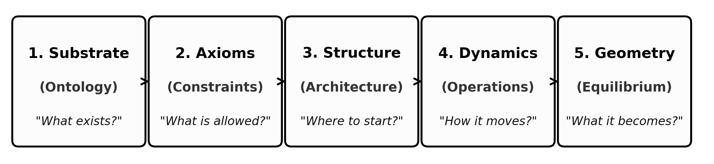
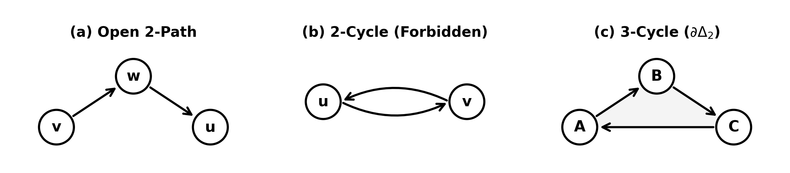

<nav aria-label="Breadcrumbs" style={{
  display: 'flex',
  alignItems: 'center',
  flexWrap: 'wrap',
  gap: '0.45rem',
  fontSize: '0.85rem',
  marginBottom: '1.25rem',
  color: 'var(--ifm-color-emphasis-700)'
}}>
  <a href="/" style={{ color: 'var(--ifm-color-emphasis-700)', textDecoration: 'none' }}>Home</a>
  /
  <a href="/papers" style={{ color: '#2563eb', fontWeight: 600, textDecoration: 'none' }}>Research Papers</a>
  /
  Vacuum Phase &amp; Causal Geometry
</nav>

:::info[**Archival Paper & Open Access Record**]
**Title:** Constrained Stochastic Rewrite System on Timestamped DAGs: Vacuum Architecture, Absorbing-State Dynamics, and the Emergence of Causal Geometry  
**Author:** **R. Fisher**, *Principal Investigator* ([ORCID: 0009-0006-2441-3282](https://orcid.org/0009-0006-2441-3282))  
**Affiliation:** Braid Dynamics Group  
**Published / Release:** August 24, 2026 · **Status:** Preprint / Research Article (v1.0.0) · **License:** [Creative Commons Attribution 4.0 (CC BY 4.0)](https://creativecommons.org/licenses/by/4.0/)  
**Classification:** Statistical Mechanics · Discrete Quantum Gravity · Directed Percolation  
**Downloads & Assets:** [Publication PDF](pathname:///papers/vacuum-phase/downloads/vacuum-phase.pdf) · [Markdown Source](pathname:///papers/vacuum-phase/downloads/vacuum-phase.md) · [Technical Supplement (Online)](/papers/vacuum-phase/supplement) · [Replication Bundle](pathname:///papers/vacuum-phase/downloads/vacuum-phase-replication.zip)
:::

# Introduction: Foundational Principles

Constructing spacetime geometry, causal order, and physical conservation laws directly from combinatorial connectivity is a central objective of discrete, background-independent physics. Foundational models, including causal set theory [4, 19], causal dynamical triangulations [1], quantum graphity [12], and discrete graph-rewriting frameworks [9, 23], demonstrate that macroscopic geometric properties can emerge from discrete relational networks, but a fundamental question remains: how do localized rewrite operations generate and sustain stable macroscopic phases?

We evaluate how graph evolution proceeds through stochastic updates, where local path-closing additions compete with tension-driven deletions, and determine the conditions under which this non-equilibrium process avoids collapse into its absorbing ground state. Here we analyze the nucleation of geometric structures, the mitigation of boundary dissipation on finite graph fragments, and the stabilization of an active quasi-stationary phase acting as a localized topological soliton. Extensive, volume-filling macroscopic spacetime requires continuous pump driving ($\Lambda > 0$) or distributed multi-seed nucleation, which is developed in companion works on continuum geometric reconstruction. The investigation proceeds through five structural stages:

# 1. Ontological Substrate

A constructive, background-independent formulation of spacetime isolates the minimal pre-geometric primitives required to generate relational causality, geometric dimension, and dynamic succession directly from discrete combinatorial incidence.

## 1.1 Epistemological Foundations and Definitions

The foundational kinematics build constructively from elementary relational primitives to higher-order topological structures:

**Definition 1.1.1** (Abstract Events $V$).
Let $V = \{ v_1, v_2, \ldots, v_N \}$ be a finite set of $N = |V| < \infty$ vertices representing **Abstract Events**. An abstract event is a structureless point representing the intersection of causal influences, possessing no intrinsic spatial coordinates, metric positions, or internal degrees of freedom. Identity is defined exhaustively by incidence relations within the network.

**Definition 1.1.2** (Directed Causal Relations $E$).
Let $E \subseteq V \times V$ be a set of directed edges, where each ordered pair $e = (u, v) \in E$ is an unmediated **Causal Relation** denoting the atomic proposition that event $u$ acts as an immediate causal antecedent of event $v$. The relation is strictly asymmetric:
$$(u, v) \in E \implies (v, u) \notin E.$$
Physical distance is defined operationally as a relational path cost across the edge set $E$.

**Definition 1.1.3** (Directed Paths).
A **Directed Path** in $G = (V, E)$ is a sequence of vertices $\pi = (v_0, v_1, \dots, v_n)$ of length $n \ge 0$ such that $(v_i, v_{i+1}) \in E$ for all $0 \le i < n$.

**Definition 1.1.4** (Simple Paths).
A **Simple Path** is a Directed Path $(v_0, v_1, \dots, v_n)$ containing no repeated vertices ($v_i \neq v_j$ for all $0 \le i < j \le n$). Simple paths define non-self-intersecting causal channels of historical influence.

**Definition 1.1.5** (Open 2-Paths).
An **Open 2-Path** is a simple directed path of length exactly 2, denoted as an ordered triplet of distinct vertices $(v, w, u)$ such that $(v, w) \in E$ and $(w, u) \in E$. The intermediate vertex $w$ acts as a common causal bridge connecting $v$ to $u$, serving as the minimal unit of transitive mediation and the candidate site for geometric area accretion.

**Definition 1.1.6** (Directed Cycles).
A **Cycle** (or directed cycle) is a non-trivial directed path $(v_0, v_1, \dots, v_k)$ of length $k \ge 1$ such that $v_0 = v_k$ and $(v_i, v_{i+1}) \in E$ for all $0 \le i < k$.

**Definition 1.1.7** (Closed 2-Cycles).
A **2-Cycle** is a cycle of length exactly $k=2$, consisting of a pair of distinct vertices $\{u, v\}$ such that $(u, v) \in E$ and $(v, u) \in E$. The 2-cycle represents an instantaneous mutual feedback loop, which is strictly forbidden by causal asymmetry (Axiom 1).

**Definition 1.1.8** (Closed 3-Cycles and Geometric Quanta).
A **3-Cycle** ($\partial \Delta_2$) is a cycle of length exactly $k=3$, consisting of an ordered triplet of distinct vertices $(A, B, C)$ such that $(A, B), (B, C), (C, A) \in E$. The 3-cycle represents the minimal closed boundary enclosing an elementary topological area, functioning as the fundamental discrete quantum of spatial geometry.

**Definition 1.1.9** (Directed Acyclic Graphs and Causal Posets).
A **Directed Acyclic Graph (DAG)** is a directed graph $G = (V, E)$ containing no directed cycles of any length $k \ge 1$. The topological reachability relation in a DAG induces a strict partial order on the event set $V$, ensuring that causal influence flows irreversibly from ancestral causes to descendant effects.

**Definition 1.1.10** (Bipartite Graphs and Parity Stratification).
A **Bipartite Graph** is a directed graph $G = (V, E)$ whose vertex set $V$ admits a partition into two disjoint subsets, $V = V_{\mathrm{even}} \sqcup V_{\mathrm{odd}}$ ($V_{\mathrm{even}} \cap V_{\mathrm{odd}} = \emptyset$), such that every directed edge connects vertices of opposite parity:
$$E \subseteq (V_{\mathrm{even}} \times V_{\mathrm{odd}}) \cup (V_{\mathrm{odd}} \times V_{\mathrm{even}}).$$
Bipartiteness forbids odd-length cycles ($N_{2k+1} = 0$), establishing the pristine ground state from which spatial geometry emerges upon symmetry breaking (Figure 2).

**Definition 1.1.11** (Active Spatial State and Occurrence Coordinates).

Let the **Causal Graph Substrate** at logical tick $t$ be the active spatial configuration $G_t=(V,E_t,H_t)$, where $V$ is a fixed finite vertex set, $E_t\subseteq V\times V$ is irreflexive and asymmetric, and $H_t:E_t\to\mathbb N_0$ records immutable causal heights of the active edge occurrences. Directed spatial cycles are permitted; the chronological order belongs to the distinct creation-event structure.

A creation occurrence is a record $\omega=(u,v,b,h)$ with birth tick $b\in\mathbb N_0$ and causal height $h\in\mathbb N_0$. At most one occurrence of a given ordered pair is created per tick. The active-occurrence map $\alpha_t:E_t\to\mathcal E_t$ identifies the current record and satisfies $H_t(u,v)=h(\alpha_t(u,v))$. The cumulative creation record $\mathcal E_t$ retains past occurrences after active deletion (Definition 4.1.2).

The scheduler index is $t_L\in\mathbb N_0$; emergent proper time is a separately specified relational observable along an observer history. These quantities are not identified with the recurrence height.

## 1.2 Temporal Ontology and Creation Timestamps

Temporal precedence is embedded directly into the edge topology through an immutable **Creation Timestamp** mapping $H: E \to \mathbb{N}_0$.

**Definition 1.2.1** (Scheduler Birth Tick and Immutable Causal Height).

Let the **Creation Timestamp** $H_t(e)$ denote the causal height of the active occurrence of $e$, distinct from its scheduler birth tick $b(e)$. For a new edge $e=(u,v)$ inserted during the transition from tick $t$ to tick $t+1$, its height is

$$
h_{\mathrm{new}}(u,v)=1+\max\bigl(\{H_t(x,u):(x,u)\in E_t\}\cup\{0\}\bigr),
\qquad \omega=(u,v,t+1,h_{\mathrm{new}}(u,v)).
$$

Existing occurrences retain their assigned heights. The initial substrate has $H_0(e)=0$. A deleted pair recreated later receives a new occurrence identifier even if its newly computed height equals an earlier height. The birth tick and height are both immutable coordinates of an occurrence; neither is a replacement for the other.

**Lemma 1.2.2** (Irreflexivity of Timestamps).
A self-loop $e_{\mathrm{self}} = (u, u)$ admits no mathematically consistent timestamp assignment under the constructor recurrence and is strictly excluded.

*Proof.* We proceed by analyzing the stability conditions required for self-loop instantiation:

**I. Pre-computation of Source History:** Let the proposed self-loop $e_{\mathrm{self}} = (u, u)$ be evaluated on vertex $u$. Let $T_{\max}$ represent the maximum creation timestamp among all pre-existing incoming edges incident to $u$:
  $$T_{\max} = \max \left( \{ H(e') \mid e' \in \mathrm{In}(u)_{\mathrm{pre}} \} \cup \{0\} \right).$$
  The constructor recurrence assigns the candidate creation timestamp:
  $$H(e_{\mathrm{self}}) = T_{\max} + 1.$$

**II. State Update and Post-Creation Evaluation:** Upon hypothetical insertion, the edge $e_{\mathrm{self}}$ enters the incoming set of $u$, updating the active incidence profile:
  $$\mathrm{In}(u)_{\mathrm{post}} = \mathrm{In}(u)_{\mathrm{pre}} \cup \{ e_{\mathrm{self}} \}.$$
  For the recursive timestamp assignment to remain stable and causal, the assigned value must strictly exceed all incoming timestamps in the updated configuration:
  $$H(e_{\mathrm{self}}) > \max_{k \in \mathrm{In}(u)_{\mathrm{post}}} H(k).$$

**III. Contradiction Derivation:** Because $e_{\mathrm{self}} \in \mathrm{In}(u)_{\mathrm{post}}$, the maximum of the updated incoming set explicitly includes $H(e_{\mathrm{self}})$:
  $$\max_{k \in \mathrm{In}(u)_{\mathrm{post}}} H(k) = \max(T_{\max}, H(e_{\mathrm{self}})).$$
  By definition of the candidate assignment, $H(e_{\mathrm{self}}) = T_{\max} + 1 > T_{\max}$, which evaluates the maximum to:
  $$\max_{k \in \mathrm{In}(u)_{\mathrm{post}}} H(k) = H(e_{\mathrm{self}}).$$
  Substituting this identity back into the stability inequality yields:
  $$H(e_{\mathrm{self}}) > H(e_{\mathrm{self}}).$$

The inequality $x > x$ is false for all $x \in \mathbb{N}_0$. Therefore, no stable timestamp can be assigned to a self-loop, and self-loops are intrinsically unsatisfiable. $\square$

**Lemma 1.2.3** (Transitive Monotonicity along Sequential Causal Chains).

Let $e_1,\ldots,e_k$ be a sequentially instantiated causal chain whose occurrence of $e_i$ remains incoming to the source when $e_{i+1}$ is created, for each $i<k$. Then $H(e_1)<\cdots<H(e_k)$, and for $k\ge2$ the endpoint bound is $H(e_k)\ge H(e_1)+k-1$ (Definition 1.2.1).

*Proof.*

**I. Predecessor Membership at Creation**

Let $\omega_i$ be the occurrence of $e_i$ and put $h_i=h(\omega_i)$. The sequential-chain hypothesis means that, when $e_{i+1}$ is created from a snapshot $G_{t_i}$, its source is the target of $e_i$ and $e_i$ is still present there. Consequently

$$
h_i\in\{H_{t_i}(x,s(e_{i+1})):(x,s(e_{i+1}))\in E_{t_i}\}.
$$

**II. Consecutive Inequality**

The source-side recurrence (Definition 1.2.1) therefore gives

$$
\begin{aligned}
h_{i+1}
&=1+\max\bigl(\{H_{t_i}(x,s(e_{i+1}))\}\cup\{0\}\bigr)\\
&\ge1+h_i>h_i.
\end{aligned}
$$

Here the set in the maximum ranges over the incoming edges of that source in the creation snapshot. Both the membership and the maximum refer to that same snapshot.

**III. Induction on the Chain**

For $j=1$, $h_j=h_1=h_1+j-1$. If $h_j\ge h_1+j-1$, then

$$
h_{j+1}\ge h_j+1\ge h_1+j=h_1+(j+1)-1.
$$

Induction proves $h_j\ge h_1+j-1$ for all $j\le k$. The consecutive strict inequalities concatenate by transitivity of the natural-number order. This establishes the sequential-chain claim (Lemma 1.2.3).

**IV. Conclusion**

$$
\boxed{h_1<\cdots<h_k,\qquad h_k\ge h_1+k-1.}
$$

Q.E.D.

**Theorem 1.2.4** (Chronological Dependency Order).

Let creation heights satisfy the source-side recurrence and let $\omega\mathrel D\eta$ mean that the edge occurrence $\omega$ is an incoming edge of the source of $\eta$ in the snapshot used to create $\eta$. Then $D^+$ is an irreflexive transitive relation on creation occurrences and every $D$-chain has strictly increasing heights; active spatial walks need not have increasing heights (Definition 1.2.1).

*Proof.*

**I. Direct Event Dependencies**

Let $\omega D\eta$ be a dependency with the stipulated creation-snapshot meaning (Theorem 1.2.4). The preceding incoming occurrence belongs to the creation snapshot of $\eta$. The source-side maximum therefore gives

$$
\omega D\eta\ \Longrightarrow\ h(\eta)\ge h(\omega)+1.
$$

Stable self-loop assignment also has the independent obstruction $h\ge h+1$ (Lemma 1.2.2). Physical self-loops are excluded directly by the irreflexive edge constraint.

**II. Finite Dependency Paths**

A witness for $\omega D^+\eta$ is a chain $\omega=\omega_0D\omega_1D\cdots D\omega_m=\eta$ with $m\ge1$. The sequential inequality (Lemma 1.2.3) gives

$$
h(\eta)\ge h(\omega)+m>h(\omega).
$$

**III. Irreflexivity and Transitivity**

If $\omega D^+\omega$, the endpoint inequality becomes $h(\omega)>h(\omega)$, a contradiction. If $\omega D^+\eta$ and $\eta D^+\zeta$, concatenation of the two finite dependency chains is a nonempty dependency chain from $\omega$ to $\zeta$. Thus

$$
\neg(\omega D^+\omega),\qquad
(\omega D^+\eta\land\eta D^+\zeta)\Longrightarrow\omega D^+\zeta.
$$

**IV. Well-Founded Height Descent**

A reversed dependency chain $\omega_{j+1}D^+\omega_j$ satisfies $h(\omega_{j+1})\le h(\omega_j)-1$. Induction gives $h(\omega_j)+j\le h(\omega_0)$. Taking $j=h(\omega_0)+1$ contradicts nonnegativity. Therefore no infinite descending dependency chain exists, and $D^+$ is a well-founded strict partial order on creation occurrences.

Q.E.D.

**Finite distinguishable history.** Logical time enumerates updates. Suppose a present state ranges over $M$ values and the specified family of occurrence histories is recoverable from those values. Injectivity bounds the history count by $M$. In a comb, the $K$ distinct terminated alternatives and the continuing history give $K+1\le M$. With at least two continuing children at each shorter prefix, the depth counts obey $n_0=1$ and $n_{j+1}\ge2n_j$, so $2^K\le n_K\le M$. These bounds constrain the tick count when unbounded tick depth entails unbounded branching in the encoded family. Repeated adjacency can coexist with distinct creation records, and a deterministic new record can carry zero conditional Shannon entropy.

## 1.3 Kinematic Task Space

Physical transformations of the causal graph substrate are formalized on an admissible **Task Space** $\mathfrak{T}$ that preserves causal order and topological coherence across state transitions.

**Definition 1.3.1** (Elementary Task Space and Kinematic Purity).

Let the **Elementary Task Space** $\mathfrak T(G)$ consist of guarded additions and deletions on a fixed spatial vertex set $V$. An addition changes one absent directed pair to present, preserves irreflexivity and asymmetry, assigns the source-side causal height, and satisfies the applicable candidate-relative PUC and causal-admission predicates; a deletion removes one present edge without erasing its historical occurrence (Definition 1.2.1). The uniqueness predicate is candidate-relative (Lemma 2.2.3).

Each primitive preserves $V$, changes at most one active edge, and leaves all surviving occurrence heights unchanged. Spatial triangle creation is permitted. The event dependency order, rather than all active spatial adjacency, is the chronological structure. A fixed-snapshot parallel merge and a sequential re-evaluation of guards are different task schedules.

**Definition 1.3.2** (Guarded Edge Addition).

Let the **Edge Addition Task** $\mathfrak T_{add}(u,v)$ act on $G_t=(V,E_t,H_t)$ for an absent pair $(u,v)$ with $u\ne v$ and $(v,u)\notin E_t$. Its admitted candidate includes the required geometric and causal guard evidence. The updated components are

$$
V'=V,\qquad E'=E_t\cup\{(u,v)\},\qquad
H'|_{E_t}=H_t,\qquad
H'(u,v)=1+\max\bigl(\{H_t(x,u):(x,u)\in E_t\}\cup\{0\}\bigr).
$$

The transition from tick $t$ records the new occurrence $(u,v,t+1,H'(u,v))$. For a return chord across $v\to w\to u$, PUC is evaluated relative to that candidate (Lemma 2.2.3). Passing PUC is one guard, not an assertion that every other guard holds. The target spatial graph can contain the newly closed triangle.

**Definition 1.3.3** (Edge Deletion Task $\mathfrak{T}_{\mathrm{del}}$).
For any active directed edge $e = (u, v) \in E$, the **Edge Deletion Task** $\mathfrak{T}_{\mathrm{del}}(u, v): G \mapsto G' = (V', E', H')$ is defined by:

* **Vertex Set:** $V' = V$.
* **Edge Set:** $E' = E \setminus \{(u, v)\}$.
* **Timestamp Assignment:** $H'$ is the restriction of $H$ to $E'$, satisfying $H'(e') = H(e')$ for all $e' \in E'$.

Edge deletion executes the primitive excision transformation, contracting superfluous connections and resolving local topological stress. Deletion removes the active causal link but preserves the immutable historical creation log $H(e)$ with zero runtime memory overhead.

**Lemma 1.3.4** (Relational Vertex Emergence and Ontological Minimality).
Let $G = (V, E, H)$ be a causal graph, and let $V_{\mathrm{act}} = \{ v \in V \mid \deg_{\mathrm{in}}(v) + \deg_{\mathrm{out}}(v) > 0 \}$ be the active vertex set. The creation or destruction of physical vertices is strictly subordinate to edge incidence; no primitive task in $\mathfrak{T}$ directly mutates the underlying vertex set $V$.

*Proof.* We evaluate the vertex set mapping across both primitive operators:

**I. Vertex Invariance under Primitives:** By Definitions 1.3.2 and 1.3.3, both $\mathfrak{T}_{\mathrm{add}}(u, v)$ and $\mathfrak{T}_{\mathrm{del}}(u, v)$ explicitly set $V' = V$.

**II. Dynamic Incidence Coupling:** Under $\mathfrak{T}_{\mathrm{add}}(u, v)$, the degrees of $u$ and $v$ increment by unity ($\deg(u) \mapsto \deg(u)+1, \deg(v) \mapsto \deg(v)+1$). If $u, v \notin V_{\mathrm{act}}(G)$, they enter $V_{\mathrm{act}}(G')$. Under $\mathfrak{T}_{\mathrm{del}}(u, v)$, the degrees of $u$ and $v$ decrement by unity; if their total degree drops to zero, they vacate $V_{\mathrm{act}}(G')$.

Because $V' = V$ identically under all primitive operators, the vertex set serves as an invariant container. All physical instantiation and termination of event loci are governed strictly by relational edge incidence, establishing a purely relational ontology where spatial structure is constituted entirely by active connections. $\square$

**Lemma 1.3.5** (Recorded Rollback of Active Edge Fields).

Let a snapshot have adjacency $E(x)\in\{0,1\}$ and height $H(x)\in\mathbb N$ at every directed pair $x$, with height zero when absent. Both fields are restored by adding an absent pair and then deleting it, or by deleting an active pair and then restoring it at its saved height.

*Proof.*

**I. Single-Pair Updates**

The height field belongs to the active edge snapshot.

Write $A_{e,h}$ for setting $(E(e),H(e))=(1,h)$ and $D_e$ for setting $(E(e),H(e))=(0,0)$. Both operations preserve $(E(x),H(x))$ for every $x\ne e$.

**II. Rollback of Addition**

At an absent $e$, the forward and backward updates are

$$
(0,0)\xrightarrow{A_{e,h}}(1,h)\xrightarrow{D_e}(0,0).
$$

At all other pairs both operations preserve both fields. Hence $D_e(A_{e,h}(G))=G$ on the active snapshot.

**III. Rollback of Deletion**

At an active $e$, save $h=H_G(e)$. The two updates at $e$ are

$$
(1,h)\xrightarrow{D_e}(0,0)\xrightarrow{A_{e,h}}(1,h).
$$

Again the other pairs are unchanged, so $A_{e,h}(D_e(G))=G$ on the active snapshot.

Q.E.D.

**Theorem 1.3.6** (Vacuum Repertoire and Recorded Task Composition).

Let $\mathfrak T$ be the space of tasks witnessed by finite admissible sequences of guarded edge additions and deletions on a fixed vertex set $V$. Each task is a finite composition of the primitives, with active incidence determined by the edge set and rollback of each active update specified by the edited pair and its previous height.

*Proof.*

**I. Domain and Objects**

A task in the space specifies an admissible trajectory of active snapshots.

**II. Finite Task Composition**

An admissible task has a witness sequence $G_0\xrightarrow{T_1}G_1\to\cdots\xrightarrow{T_m}G_m$, with each $T_j$ a guarded primitive in its input snapshot. Thus $G_m=(T_m\circ\cdots\circ T_1)(G_0)$. Each step preserves $V$, and at index $j$ the active vertex set is $\{v\in V:\deg_{G_j}(v)>0\}$.

**III. Recorded Rollback**

Let $R_j$ be the restoration determined by the record for step $j$. The pointwise identities give $R_j(G_j)=G_{j-1}$. Substitution from the last index to the first gives

$$
(R_1\circ\cdots\circ R_m)(G_m)=
(R_1\circ\cdots\circ R_{m-1})(G_{m-1})=\cdots=G_0 .
$$

Q.E.D.

# 2. Axiomatic Foundation

The kinematics, state transformations, and geometric observables of the graph rewrite system are governed by three constructive axioms. These axioms establish background-independent causality, locality, and dimensional order directly on the combinatorial substrate.

## 2.1 Causal Primitive and the Insufficiency of Antisymmetry

The fundamental relational atom on the abstract event set $V$ is the directed causal link $(u, v) \in E$, defined as an irreversible vector of directed influence.

**Definition 2.1.1** (Axiom 1: Directed Causal Link).
The active edge set $E \subset V \times V$ strictly satisfies two constructive invariants for all vertices:

* **Strict Irreflexivity:** $\forall u \in V, \; (u, u) \notin E$ (rejection of causal inertia and self-loops).
* **Strict Asymmetry:** $\forall u \neq v, \; (u, v) \in E \implies (v, u) \notin E$ (rejection of instantaneous reciprocity).

The existence of directed edge $e = (u, v)$ constitutes the physical encoding that event $u$ acts as a necessary causal antecedent of event $v$.

**Lemma 2.1.2** (Pathology of Self-Loops as Length-1 Directed Cycles).
A self-loop $e_{\mathrm{loop}} = (u, u)$ constitutes a directed cycle of length $k = 1$, violating the global causal acyclicity required of a physical history.

*Proof.* We verify the cycle definition on the singleton edge transition:

**I. The Generalized Cycle Definition:** A directed cycle of length $k$ is an ordered vertex sequence $C_k = (v_0, v_1, \dots, v_k)$ satisfying:

$$
\begin{aligned}
\text{Connectivity:} & \quad \forall i \in \{0, \dots, k-1\}, \; (v_i, v_{i+1}) \in E, \\
\text{Closure:} & \quad v_0 = v_k.
\end{aligned}
$$

**II. Sequence Mapping:** Let $e_{\mathrm{loop}} = (u, u) \in E$ denote a candidate self-loop incident to vertex $u$. Define the two-element sequence $S = (v_0, v_1)$ with $v_0 = u$ and $v_1 = u$.

**III. Verification of Cycle Conditions:** We evaluate sequence $S$ against the formal cycle criteria:

* **Length:** The sequence contains exactly $k = 1$ directed edge transition.
* **Connectivity:** The single directed edge $(v_0, v_1) = (u, u) \in E$ holds by hypothesis.
* **Closure:** The initial and terminal endpoints coincide ($v_0 = u$ and $v_1 = u$), satisfying topological closure $v_0 = v_1$.

**IV. Conclusion:** The self-loop $e_{\mathrm{loop}}$ satisfies all defining criteria of a directed cycle $C_1$. Because physical causal histories admit no directed cycles of any length, $e_{\mathrm{loop}}$ is intrinsically pathological and excluded from the kinematic substrate. $\square$

**Lemma 2.1.3** (Self-Loop Nullity for Simple-Path Counting).

Let $\Omega(G)$ count a family of simple directed paths specified by their vertex and edge sequences. This family is unchanged by adding a self-loop, so its logarithmic path entropy is unchanged on the domain $\Omega(G)>0$.

*Proof.*

**I. Domain and Objects**

A path in the family has pairwise distinct vertices.

**II. Inclusion in Both Directions**

Put $G'=G\cup\{(u,u)\}$. Any simple path in $G$ uses edges of $G'$. Conversely, if a path in $G'$ used $(u,u)$, consecutive positions would have the same vertex $u$, contradicting pairwise distinctness. Thus its edges lie in $G$.

**III. Entropy Difference**

The families coincide, giving $\Omega(G')=\Omega(G)$. For positive count,

$$
k_B\log\Omega(G')-k_B\log\Omega(G)
=k_B\log\frac{\Omega(G')}{\Omega(G)}
=k_B\log 1=0 .
$$

Q.E.D.

## 2.2 Geometric Constructibility and Confluent Polygon Digestion

Arbitrary edge insertions on an unconstrained graph destroy metric locality, collapsing the network into a non-spatial complete graph. In the framework of algebraic graph rewriting [8], Geometric Constructibility restricts local accretion to elementary simplicial units.

**Definition 2.2.1** (Candidate-Relative Geometric Constructibility).

Let **Geometric Constructibility** constrain candidate edge additions by two distinct requirements.

1. **Elementary closure:** A geometric addition is a return chord $(u,v)$ across a simple directed two-path $v\to w\to u$, creating the elementary directed triangle $v\to w\to u\to v$.
2. **Candidate-relative uniqueness:** The candidate passes PUC precisely when there is no direct edge $(v,u)$ and no other intermediate vertex $x\ne w$ with $v\to x\to u$.

$$
\operatorname{PUC}(G;v,w,u)\ \Longleftrightarrow\
(v,u)\notin E\ \land\
\forall x\ne w,\ \neg\bigl((v,x)\in E\land(x,u)\in E\bigr).
$$

The candidate path itself is not an alternative path. Absence of the proposed chord, irreflexivity, asymmetry, and the causal-admission check remain additional requirements. This is a rule on proposals and their elementary closure, not a theorem that every larger simple cycle in a spatial graph is absent.

**Lemma 2.2.2** (Geometric Quantum as the Minimal Stable Causal Closure).
The directed 3-cycle $\gamma = \partial \Delta_2 = \{(u, v), (v, w), (w, u)\}$ is the unique minimal closed cycle compatible with Axiom 1, establishing the indivisible quantum of emergent spatial area.

*Proof.* We evaluate cycle lengths $L \in \mathbb{N}_{\ge 1}$ systematically:

* **Length $L = 1$:** Requires $(u, u) \in E$, excluded by Lemma 2.1.2 (Strict Irreflexivity).
* **Length $L = 2$:** Requires $(u, v) \in E$ and $(v, u) \in E$, excluded by Definition 2.1.1 (Strict Asymmetry).
* **Length $L = 3$:** Involves distinct vertices $u \neq v \neq w$ and edges $(u, v), (v, w), (w, u)$, where every link is mutually asymmetric and irreflexive.

Hence, $L_{\min} = 3$ is the unique minimal causal cycle length, serving as the elementary quantum of geometric area. $\square$

**Lemma 2.2.3** (Principle of Unique Causality).

Let $v\to w\to u$ be a simple directed two-path and let $\Pi_{\ell\le2}(v,u)$ contain all simple directed paths of length one or two from $v$ to $u$. Then the candidate passes PUC if and only if $|\Pi_{\ell\le2}(v,u)|=1$, with the sole path $v\to w\to u$ (Definition 2.2.1).

*Proof.*

**I. Complete Short-Path Classification**

The construction uses candidate-relative geometric admission (Definition 2.2.1).

For distinct $v,u$, every simple path of length at most two has exactly one of the forms

$$
(v,u),\qquad(v,x,u)\quad(x\notin\{v,u\}).
$$

The first exists exactly when $(v,u)\in E$. The second exists exactly when $(v,x),(x,u)\in E$. Different intermediate vertices give different vertex sequences.

**II. Cardinality Decomposition**

Put $M(v,u)=\{x\notin\{v,u\}:(v,x),(x,u)\in E\}$. The two path classes are disjoint, so

$$
|\Pi_{\ell\le2}(v,u)|=\mathbf1_{(v,u)\in E}+|M(v,u)|.
$$

The candidate supplies $w\in M(v,u)$ and hence $|M(v,u)|\ge1$.

**III. Both Implications**

If PUC holds (Lemma 2.2.3), its first clause gives $\mathbf1_{(v,u)\in E}=0$ and its uniqueness clause gives $M(v,u)\subseteq\{w\}$. Together with $w\in M(v,u)$,

$$
M(v,u)=\{w\},\qquad |\Pi_{\ell\le2}(v,u)|=0+1=1.
$$

Conversely, if the path count is one, the already present candidate accounts for that one element. A direct edge would supply a second path, and an intermediate vertex $x\ne w$ would supply another distinct two-edge path. Both are excluded. Thus both PUC clauses hold.

**IV. Conclusion**

$$
\boxed{\operatorname{PUC}(G;v,w,u)\Longleftrightarrow
\Pi_{\ell\le2}(v,u)=\{(v,w,u)\}.}
$$

Q.E.D.

**Lemma 2.2.4** (Frozen-Proposal Merge Order Invariance).

Let legal proposals and their new heights be fixed from one input snapshot. Then merging the resulting directed edge-height pairs is independent of their accumulation order, with any reciprocal rejection evaluated on the same complete proposal set.

*Proof.*

**I. Frozen Proposal Data**

Let $B_1,B_2$ be finite sets of proposed directed edges with snapshot-assigned heights. Equal directed targets have the same source and the same snapshot incoming maximum, so their assigned heights agree (Definition 1.2.1). Thus their union is a well-defined edge-height relation.

**II. Set Union Evaluation**

For every pair $e$,

$$
e\in(E\cup B_1)\cup B_2
\Longleftrightarrow e\in E\lor e\in B_1\lor e\in B_2
\Longleftrightarrow e\in(E\cup B_2)\cup B_1.
$$

The existing heights are unchanged and the new heights agree by Section I, giving equality of the annotated merged graphs.

**III. Complete-Set Reciprocal Filter**

The retained set $B_{\mathrm{filt}}=\{(u,v)\in B:u\ne v,(v,u)\notin B\}$ depends only on $B=B_1\cup B_2$, which is equal under both accumulation orders. Therefore applying that same complete-set filter yields equal outputs (Lemma 2.2.4).

Q.E.D.

**Lemma 2.2.5** (Isolated-Cycle Initial Candidates).

Let the input be exactly the isolated directed cycle $C_k$ with edges $i\to i+1\pmod k$, $k\ge4$. Then this initial maximal cycle is chordless and each of its $k$ perimeter two-paths passes candidate-relative PUC (Lemma 2.2.3).

*Proof.*

**I. Initial Edge Set**

The proof uses the specified objects and conventions (Definition 2.2.1).

The vertex set is $\mathbb Z/k\mathbb Z$ and $E_0=\{(i,i+1):i\in\mathbb Z/k\mathbb Z\}$. Each vertex has exactly one outgoing neighbor. A nonadjacent pair therefore has no edge in the induced cycle graph.

**II. Short Paths**

For the path $i\to i+1\to i+2$, distinctness follows from $k\ge4$. Its endpoints have no direct edge, because $i+2\not\equiv i+1\pmod k$. Any intermediate $x$ with $i\to x\to i+2$ must satisfy $x=i+1$, since this is the only outgoing neighbor of $i$.

**III. PUC and Candidate Count**

Thus the candidate is the unique path of length at most two between its endpoints. The return chord $(i+2,i)$ is absent initially, and each $i$ gives a distinct proposed chord. There are exactly $k$ such candidates (Lemma 2.2.5).

Q.E.D.

**Lemma 2.2.6** (Cycle-Potential Reduction by Maximal-Cycle Deletion).

Let $e$ denote an edge belonging to a simple cycle $C$ of maximal length within a graph $G$ characterized by the state valuation $\Phi(G)$ (Section 2.3). Then the deletion of $e$ yields a graph $G'$ satisfying the strict descent condition $\Phi(G') < \Phi(G)$.

*Proof.*

**I. Cycle Families Before Deletion**

Let $G=(V,E)$ have maximal simple-cycle length $L$ and $n_L$ cycles of that length (Section 2.3). Fix one maximal cycle $C$ and $e\in E(C)$. For each length $k$, define

$$
\mathcal C_k(G)=\{D\subseteq G:D\text{ is a simple directed cycle of length }k\},\qquad
\mathcal D_k(e)=\{D\in\mathcal C_k(G):e\in E(D)\}.
$$

In particular $C\in\mathcal D_L(e)$, so $|\mathcal D_L(e)|\ge1$.

**II. Exact Cycle-Set Identity**

Deletion gives $G'=(V,E\setminus\{e\})$ (Section 1.5). If $D\in\mathcal C_k(G')$, all its edges lie in $E\setminus\{e\}$, so $D\in\mathcal C_k(G)$ and $e\notin E(D)$. Conversely, if $D\in\mathcal C_k(G)$ and $e\notin E(D)$, all its edges remain in $G'$, so $D\in\mathcal C_k(G')$. Thus

$$
\mathcal C_k(G')=\mathcal C_k(G)\setminus\mathcal D_k(e)
\quad\Longrightarrow\quad
|\mathcal C_k(G')|=|\mathcal C_k(G)|-|\mathcal D_k(e)|.
$$

No cycle of length greater than $L$ can appear, since every remaining cycle already belonged to $G$.

**III. The Two Potential Cases**

At length $L$,

$$
0\le|\mathcal C_L(G')|
=n_L-|\mathcal D_L(e)|\le n_L-1<n_L.
$$

If this number is positive, then $L'_{max}=L$ and

$$
\Phi(G')=(L,n_L-|\mathcal D_L(e)|)<_{lex}(L,n_L)=\Phi(G).
$$

If it is zero, no length-$L$ cycle survives, and none longer exists. Thus $L'_{max}<L$; use $L'_{max}=0$ if no cycles remain. The first coordinate then gives $\Phi(G')<_{lex}\Phi(G)$ regardless of the second coordinate.

$$
\boxed{e\in E(C),\quad |C|=L_{max}(G)
\ \Longrightarrow\ \Phi(G-e)<_{lex}\Phi(G).}
$$

Q.E.D.

**Lemma 2.2.7** (Isolated Reduction Mutation Bound).

Let the isolated-cycle benchmark perform its single chord-addition phase followed by deletion-only pruning of cycles longer than three. Then it uses at most $k$ additions and $2\cdot k$ deletions, and its final cycle potential is smaller than that of its initial $C_k$ (Lemma 2.2.5).

*Proof.*

**I. Finite Edge Budget**

The input has $k$ edges. The frozen perimeter list has $k$ distinct proposed chords, so the addition phase leaves at most $2\cdot k$ edges.

**II. Deletion Termination**

Each pruning step selects an existing edge of a cycle longer than three and removes it. If $m_j$ is the current edge count, then $m_{j+1}=m_j-1$. Induction gives $m_j=m_0-j$. Since $m_j\ge0$, there can be at most $m_0\le2k$ deletions. The loop can stop only when no cycle longer than three remains.

**III. Final Potential**

The initial longest cycle has length $k\ge4$. The final graph has $L_{\max}\le3<k$. Hence its lexicographic cycle potential is strictly smaller regardless of its remaining cycle multiplicity. The separate maximal-cycle edge-deletion lemma supplies strict lexicographic descent when that more specific deletion choice is used (Lemma 2.2.6). The implementation's arbitrary long-cycle choice is certified here by edge count instead.

**IV. Mutation Bound**

$$
N_{\mathrm{add}}\le k,\qquad N_{\mathrm{delete}}\le2k,\qquad
N_{\mathrm{add}}+N_{\mathrm{delete}}\le3k.
$$

These are the claimed mutation and final-potential bounds (Lemma 2.2.7).

Q.E.D.

**Theorem 2.2.8** (Isolated Kinematic Cycle Reduction).

Let the kinematic reduction benchmark start from an isolated directed cycle $C_k$, $k\ge4$, insert the frozen perimeter two-path chords once, and then delete an edge from a cycle longer than three until none remains. Then it terminates with $L_{\max}\le3$ after at most $3\cdot k$ edge mutations; for $k\ge5$ the output is asymmetric, while the unguarded four-cycle benchmark need not be.

*Proof.*

**I. Initial Accessibility and Merge**

The isolated input has the $k$ PUC-compliant perimeter paths (Lemma 2.2.5). Its frozen proposal union has the stated accumulation-order property (Lemma 2.2.4).

**II. Pruning and Termination**

The maximal-cycle deletion identity is valid independently of chordlessness (Lemma 2.2.6). For the actual benchmark's arbitrary long-cycle choices, the decreasing edge budget gives termination, the $3\cdot k$ mutation bound and final $L_{\max}\le3$ (Lemma 2.2.7).

**III. Reciprocal-Chord Cases**

Two proposed chords $(i+2,i)$ and $(j+2,j)$ are reciprocal exactly when $j=i+2$ and $i=j+2$ modulo $k$. These equations imply $k\mid4$, so among $k\ge4$ only $k=4$ admits such a pair. No proposed chord is reciprocal to a perimeter edge for $k\ge4$. Thus for $k\ge5$ no two-cycle is created; deletions cannot create one later.

**IV. Scope of the Conclusion**

For $k\ge5$, absence of loops and reciprocal pairs together with $L_{\max}\le3$ leaves only directed three-cycles if any cycles remain. For $k=4$, the asserted stopping condition alone is $L_{\max}\le3$ (Theorem 2.2.8).

Q.E.D.

The benchmark is a kinematic reduction procedure, not the physical triangle-only stochastic scheduler. For the unguarded four-cycle case, the measured output has cycle lengths 2, 2, 3, 3 and therefore fails edge asymmetry even though its longest cycle has length three. Symmetric rejection of reciprocal proposals and selecting one proposal per opposing pair are different modifications; neither retains the original four-addition count automatically. The linear bound counts edge mutations, not cycle-enumeration runtime. Termination does not establish confluence or uniqueness of the final graph.

Table 1: *Cycle Decomposition and Topological Digestion Scaling across Defect Lengths $k \in [4, 12]$ (all configurations terminate at simplicial ground state $L_{\max} = 3$).*

| Defect Length $k$ | Chord Additions ($Ops_{\mathrm{add}} = k$) | Entropic Deletions ($Ops_{\mathrm{del}}$) | Total Reduction Steps |
| :---: | :---: | :---: | :---: |
| **$4$** | $4$ | $1$ | $5$ |
| **$5$** | $5$ | $3$ | $8$ |
| **$6$** | $6$ | $2$ | $8$ |
| **$7$** | $7$ | $3$ | $10$ |
| **$8$** | $8$ | $3$ | $11$ |
| **$9$** | $9$ | $3$ | $12$ |
| **$10$** | $10$ | $3$ | $13$ |
| **$11$** | $11$ | $3$ | $14$ |
| **$12$** | $12$ | $3$ | $15$ |

The deterministic scaling in Table 1 confirms that chord additions scale linearly ($Ops_{\mathrm{add}} = k$) while entropic deletions stabilize at $Ops_{\mathrm{del}} \le 3$ for $k \ge 7$, proving that arbitrary macroscopic defects are digested in linear operational time $\mathcal{O}(k)$ (verified via `run_reduction_protocol`, Supplement Appendix D.3).

**Theorem 2.2.9** (Locality Preservation and Singularity Exclusion via PUC).
Enforcing the Principle of Unique Causality (Clause B) guarantees that edge additions cannot generate 2-cycle shortcuts or multi-simplex pinch points ('3-page book' singularities), preserving discrete Hausdorff 2-manifold embeddability.

*Proof.* We evaluate the two structural failure modes that occur under the negation $\neg\mathrm{PUC}$:

* **Direct Bypass Shortcut:** If a direct edge $(v, u) \in E$ already exists, adding chord $(u, v)$ creates the reciprocal 2-cycle $\{(v, u), (u, v)\}$, violating Strict Asymmetry (Axiom 1).

* **Alternative Intermediate Routing:** If there exists an alternative intermediate vertex $x \neq w$ with $v \to x \to u$, adding chord $(u, v)$ simultaneously closes two distinct 3-cycles:
  $$\partial \Delta_A = (v \to w \to u \to v) \quad \text{and} \quad \partial \Delta_B = (v \to x \to u \to v).$$
  Both 2-simplices share the identical boundary edge $(u, v)$, producing a singular non-manifold branch ('3-page book' singularity) that violates local disk-homeomorphism.

Restricting additions strictly to unique 2-paths ensures that every new 2-simplex $\partial \Delta_2$ joins the complex along an unshared boundary, preserving discrete Hausdorff locality (Lean 4 certified: `puc_precludes_alternative_intermediate`, Supplement Appendix A, Part 4). $\square$

## 2.3 Effective Influence and Dual-Graph Architecture

A foundational conceptual distinction must be maintained between the instantaneous spatial network and the historical causal poset:

**Definition 2.3.1** (Spatial Graphs, Occurrence Records and Event Dependencies).

Let the **Causal Graph Substrate** at logical tick $t$ be the active spatial configuration $G_t=(V,E_t,H_t)$, where $V$ is a fixed finite vertex set, $E_t\subseteq V\times V$ is irreflexive and asymmetric, and $H_t:E_t\to\mathbb N_0$ records immutable causal heights of the active edge occurrences. Directed spatial cycles are permitted; the chronological order belongs to the distinct creation-event structure.

A creation occurrence is a record $\omega=(u,v,b,h)$ with birth tick $b\in\mathbb N_0$ and causal height $h\in\mathbb N_0$. At most one occurrence of a given ordered pair is created per tick. The active-occurrence map $\alpha_t:E_t\to\mathcal E_t$ identifies the current record and satisfies $H_t(u,v)=h(\alpha_t(u,v))$. The cumulative creation record $\mathcal E_t$ retains past occurrences after active deletion (Definition 4.1.2).

Let the **Historical Category** $\mathbf{Hist}$ have objects given by cumulative creation-record sets $\mathcal E_t$ and morphisms given by their canonical inclusions. A record is $\omega=(u,v,b,h)$ with source, target, scheduler birth tick and causal height (Definition 1.2.1). Write

$$
\mathcal E_{t+1}=\mathcal E_t\cup A^{\mathrm{occ}}_{t+1},\qquad
b(\omega)=\omega_3,\quad h(\omega)=\omega_4.
$$

The initial records have $b=h=0$. New records have birth tick $t+1$ and height assigned from the pre-tick snapshot. For any fixed pair and birth tick the scheduler creates at most one record. The active-occurrence map $\alpha_t:E_t\to\mathcal E_t$ identifies which past creation is currently active. The cumulative spatial support is the projection

$$
\overline E_t=\{(u,v):\exists b,h,\ (u,v,b,h)\in\mathcal E_t\},\qquad
\overline G_t=(V,\overline E_t).
$$

The unlabeled support $\overline G_t$ is the cumulative spatial shadow of the creation history. It is not itself the occurrence dependency poset, and it does not identify different births of the same pair. A first-birth label on $\overline E_t$, if used, is not the current active height. Deletion records and the full state trajectory are additional data when required; the creation record alone is not defined to reconstruct every intermediate state.

An inclusion $\iota_{t,s}:\mathcal E_t\hookrightarrow\mathcal E_s$, $t\le s$, has $\iota_{t,s}(\omega)=\omega$. Identities and composition are ordinary inclusion identities and composition, preserving all four coordinates exactly.

**Definition 2.3.2** (Mediated Time-Respecting Influence).

Let $uRv$ mean that a simple directed spatial path of length at least two joins $u$ to $v$ with strictly increasing consecutive causal heights. The vertex sequence has pairwise distinct vertices. Its nonempty transitive closure $R^+$ is formed from finite chains of such mediated influence steps; individual chronological paths need not concatenate into a simple chronological path.

**Lemma 2.3.3** (Strict and Weak Height Filtering).

Let $R_{\le}$ use the same simple paths of length at least two as $R$, with nondecreasing heights in place of strictly increasing heights. Then $R\subseteq R_{\le}$, and the inclusion can be strict even when both relations have acyclic closure.

*Proof.*

**I. Domain and Objects**

Both tests use the same underlying spatial path family.

**II. Inclusion**

For every witness of $uRv$, each comparison $h_i<h_{i+1}$ implies $h_i\le h_{i+1}$, giving $uR_{\le}v$.

**III. Equal-Height Witness**

In $a\xrightarrow{0}b\xrightarrow{0}c$, the only simple directed path of length at least two has heights $(0,0)$. Hence

$$
R=\varnothing,\qquad R_{\le}=\{(a,c)\}.
$$

Each closure is irreflexive. Acyclicity of the weak relation therefore permits equal heights along a mediated path.

Q.E.D.

The spatial triangle relation and the chronological dependency relation have different domains. The former is computed on the active graph. The latter uses immutable creation occurrences and increases along recorded supporting dependencies.

## 2.4 Axiom 3 (Acyclic Effective Causality) and Tiered Enforcement

**Definition 2.4.1** (Acyclic Closure of Mediated Influence).

Let $R$ be the **Effective Influence** relation of mediated simple spatial paths with strictly increasing causal heights. **Acyclic Effective Causality** requires its nonempty transitive closure $R^+$ to be irreflexive:

$$
\forall v\in V,\ \neg(vR^+v).
$$

Concatenation of finite $R$-chains makes $R^+$ transitive. If $uR^+v$ and $vR^+u$, concatenation would give $uR^+u$, so $R^+$ is asymmetric as well. The strict partial order in this axiom is $R^+$; the original time-respecting simple-path relation need not be transitive. The occurrence dependency order is a separate chronological relation on creation records.

The bounded constructor guard evaluates a single increasing reverse witness in the old graph. A walk formulation and a simple-path formulation are equivalent at the same horizon when the endpoints differ and the direct forward bypass is absent. Erasing the edges between repeated occurrences of a vertex retains a subsequence of strictly increasing heights and cannot increase the terminal height. Repetition of the erasure gives a simple path of at least two edges. The Lean edge-list formulation omits the operational cutoff.

**Sequential overlap.** Let the four endpoints $v,w,u,x$ be distinct with $(v,x)\notin E$, both paths $v\to w\to u$ and $w\to u\to x$ pass PUC and the bounded reverse-witness guard, and the chord heights dominate old outgoing heights at their respective targets. Then both candidate admissions are preserved in either sequential order and the final active timestamped graph is the same.

**I. Candidate Paths and Source Maxima**

Each candidate is supported by its specified unique two-path.

After adding $e_1$, the next candidate $e_2$ has support $w\to u\to x$. Any new competing two-path would use $e_1$ as its first edge leaving $w$ or its last edge entering $x$. The ends of $e_1$ are $u,v$, so both are impossible. The edges $(w,x),(x,w)$ remain absent, and no incoming edge at $x$ changes. Thus PUC and $h_2=1+\max_{\operatorname{In}(x)}H$ are preserved.

After adding $e_2$, a competing path for $e_1$ would require $e_2$ to leave $v$ or enter $u$. Its ends are $x,w$, so neither occurs. The edges $(v,u),(u,v)$ and the incoming heights at $u$ are unchanged, preserving PUC and $h_1$.

**II. Reverse Witnesses**

A strictly increasing witness from $w$ to $x$ using $e_1$ reaches $v$ at height $h_1$. Since $v\ne x$, its next edge must leave $v$ with height strictly greater than $h_1$, excluded by dominance. Thus any witness against $e_2$ was already present. In the other order, a witness from $v$ to $u$ using $e_2$ must leave $w$ on an edge of height strictly greater than $h_2$, also excluded. The common vertex set keeps the cutoff fixed.

**III. Equality of Active Outputs**

Both branches retain $E\cup\{e_1,e_2\}$ and assign $h_1,h_2$ to the same respective edges, leaving $H$ unchanged on $E$. The active outputs are equal.

Q.E.D.

**Full batch criterion.** Let old $R$ be acyclic, with every retained new chord's height dominating the old outgoing heights at its target. The final $R$ is acyclic exactly when its full closure has no target diagonal, with the pre-deletion test sufficient and the two-chord sequential diamond also acyclic when both targets are old $R$-sinks.

**I. Terminal Localization**

The old and final relations are computed from simple increasing witnesses.

Any final mediated pair absent from the old $R$ has a witness using a new edge. After any new edge the next edge, if present, must have strictly greater height. Dominance excludes an old edge at that join. Thus all edges from the first new edge onward are new, and the witness ends at a batch target.

**II. Diagonal Test**

A directed cycle of final mediated pairs must contain a pair absent from the old acyclic relation. By localization the cycle visits a batch target, so that target appears on the diagonal of the full final closure. Conversely any target diagonal is a nonempty closed relation walk. A deletion only removes witnesses, hence the pre-deletion test is sufficient.

**III. Two Old Sinks**

For the sequential overlap, take chords $(u,v)$ and $(x,w)$ across $v\to w\to u$ and $w\to u\to x$, neither chord can directly follow the other since $\{v,w\}$ and $\{u,x\}$ are disjoint. Thus a new witness uses only one new edge, at its end. The only possible new pair leaving $v$ would end at $w$, since $R$ is irreflexive. Such a witness must start with an old increasing path from $v$ to $x$, of length at least two because $(v,x)\notin E$. That would give $vRx$ in the old graph, contrary to the sink assumption. So $v$ remains a sink. Any new pair leaving $w$ must end at $v$. No cycle can visit either target.

Q.E.D.

**First tick on a graded substrate.** Let every old edge have height $h$ and raise a vertex grading by one, and let a batch of elementary return chords have height $h+1$. The mediated closure after the tick is acyclic.

**I. Height and Grading Changes**

An elementary chord closes a directed two-path in the frozen graph.

Every candidate chord $u\to v$ closes a two-path $v\to w\to u$ and has at least one old incoming edge at $u$. Its source maximum is $h$, so its height is $h+1$. For the grading $d$,

$$
d(u)=d(w)+1=d(v)+2,\qquad d(v)-d(u)=-2.
$$

**II. Mediated Witness.** Every increasing witness of length at least two uses exactly the two heights $h<h+1$. Its first edge raises the grading by one and its second lowers it by two. Thus $aRb$ implies $d(b)=d(a)-1$ in the merged graph, and the same implication holds after deletions.

**III. Exclusion of Closure Diagonals**

A chain of $m\ge1$ mediated pairs from $a$ to $b$ has $d(b)=d(a)-m$. It cannot return to $a$. Hence the final $R^+$ is irreflexive.

Q.E.D.

For contrast, a uniform-height directed six-cycle retains all six height-one return chords. Its mediated pairs run from residue $i$ to $i-1$, so its closure has a diagonal. The cutoff estimate for a missed single reverse witness assumes a uniform bound $p<1/4$ on each successive timestamp comparison on a fixed degree-three support. Counting paths and sites gives the bound $18N(2p)^{L_{\mathrm{cut}}}/(1-2p)$ per tick. A repair cost bound separately assumes ambient communication span and irreversible erasure. If the repair requires at least $D$ hops and $b$ erased bits, with the stated additive costs, then $W\ge\epsilon_{\mathrm{hop}}D+b k_BT_c\log 2$.

## 2.5 Independence of the Axiom Tests

**Theorem 2.5.1** (Mutual Independence on the Specified Raw Graph Domain).

The following table gives the four predicate values on a raw graph universe allowing loops and reciprocal pairs. The static diagnostic requires that all simple cycles of length at least two be triangles and that each simple two-path be unique among paths of length at most two. The constructive predicate starts from a base with no such cycles and the same two-path uniqueness, then accretes candidate-relative PUC chords at constructor heights without creating longer cycles.

*Proof.*

| Graph | Axiom 1 | Static geometry | Constructive accretion | Axiom 3 |
| --- | --- | --- | --- | --- |
| Uniform-height outward tree | True | True | True | True |
| Uniform-height directed four-cycle | True | False | False | True |
| Triangle and isolated loop | False | True | True | True |
| Five-vertex butterfly | True | True | True | False |

The outward tree is a permitted base and has empty mediated relation at uniform height.

**I. Domain and Objects**

Both geometric tests are evaluated on the raw graph universe.

**II. Causal Predicates**

With residues modulo four, $E_A=\{(i,i+1):0\le i<4\}$. No edge is a loop and no reverse edge is present. Any path of at least two edges has successive heights $0,0$, so $R(G_A)=\varnothing$ and $R(G_A)^+=\varnothing$.

**III. Geometric Predicates**

The perimeter is a simple directed cycle of length four. It violates the static cycle condition. A constructive base has no such cycle, and each constructive addition preserves its absence by the accretion rule. Induction over the addition count excludes $G_A$ from the constructive class.

Q.E.D.

**I. Domain and Objects**

The raw graph universe permits an isolated loop before the tests are applied.

**II. Static and Constructive Geometry**

Use edges $a\to b$, $b\to c$, $c\to a$ at heights $0,0,1$ and a loop $z\to z$. The triangle is the only simple cycle of length at least two. Each triangle vertex has one simple outgoing two-path with no competing path of length one or two. The isolated loop supplies no simple two-path. For the constructive witness start with $a\to b\to c$ and the isolated loop. Adding $(c,a)$ closes the unique supported triangle at height $1+H(b,c)=1$ and creates no longer cycle.

**III. Causal Predicates**

The loop violates irreflexivity. The triangle's two-edge height lists are $(0,0),(0,1),(1,0)$, so $R(G_B)=\{(b,a)\}$ and its closure has no diagonal.

Q.E.D.

**I. Static Conditions**

The butterfly is tested under both raw geometric predicates.

The six edges have distinct endpoints and no reciprocal partners. Any simple cycle is confined to one of the two triangles meeting at $Z$, since changing triangles and returning would repeat $Z$. For paths entering $Z$ from $A$ or $C$, their distinct two-step endpoints are $D$ and $B$. The remaining two-paths are $Z\to D\to C$, $Z\to B\to A$, $D\to C\to Z$, and $B\to A\to Z$. The listed endpoint pairs are distinct and lack direct bypass edges.

**II. Accretion**

Start with $A\to Z$, $Z\to D$, $D\to C$, $Z\to B$. This base is acyclic and its simple two-paths are unique without bypasses. The candidate $C\to Z$ closes $Z\to D\to C$ at height $1+3=4$. The candidate $B\to A$ then closes $A\to Z\to B$ at height $1+5=6$. Each has unique support, and each added cycle is its triangle, since a simple cycle cannot pass twice through $Z$.

**III. Mediated Cycle**

The simple paths

$$
A\xrightarrow{1}Z\xrightarrow{2}D,\qquad
D\xrightarrow{3}C\xrightarrow{4}Z\xrightarrow{5}B\xrightarrow{6}A
$$

give $A R D$ and $D R A$. Therefore $(A,A)\in R^+$.

Q.E.D.

**Raw transition proposals.** The transition tests use the enlarged domain of specified raw proposals, including malformed supporting paths or pre-states with a loop.

**I. Failure of Geometric Admission**

Geometric admission evaluates the candidate-relative two-path test.

On $0\xrightarrow{0}1\xrightarrow{0}2\xrightarrow{0}3$ propose $(3,0)$ at height one with specified middle vertex $1$. The edge $(1,3)$ is absent, so the support fails. The added edge produces no loop or reciprocal pair. The reverse path has equal old heights, and the output has $R=\{(2,0)\}$, so both causal tests pass.

**II. Failure of Axiom 1**

On $0\xrightarrow{0}1\xrightarrow{0}2$ with an isolated height-zero loop at $3$, propose $(2,0)$ at height one. The support is unique, the old reverse path has equal heights, and $R$ of the output is $\{(1,0)\}$. The isolated loop remains, so Axiom 1 fails.

**III. Failure of the Causal Tests**

Use $A\xrightarrow{1}Z\xrightarrow{2}D\xrightarrow{3}C\xrightarrow{4}Z\xrightarrow{5}B$ and propose $(B,A)$ at height six. The only simple two-path from $A$ to $B$ is $A\to Z\to B$ and $(A,B)$ is absent. The chord is neither a loop nor reciprocal. The reverse witness has $1<5<6$, so it fails the bounded test. In the output, $A\xrightarrow{1}Z\xrightarrow{2}D$ and $D\xrightarrow{3}C\xrightarrow{4}Z\xrightarrow{5}B\xrightarrow{6}A$ give $A R D R A$, violating the closure test.

Q.E.D.

# 3. Object Model (Architecture)

The pre-geometric substrate $G_0$ is uniquely deduced from the kinematic axioms and maximum relational entropy constraints through systematic topological exclusion.

## 3.1 Vacuum is a Finite Rooted Tree

**Initial-state premises.** Let **Vacuum Topology** denote the following initial-state class, specified before geometric nucleation. A designated vertex $r$ has indegree zero; every vertex is reachable from $r$ by a directed path of length at most $D<\infty$; every vertex has at most $B<\infty$ children; and every non-root vertex has indegree at most one. These are independent initial-state premises, including causal unity, a finite horizon and non-reconvergence.

The logical depth $d(v)$ is the shortest root-path length. Once uniqueness of root paths is established, $d(v)$ is their unique length. The root has depth zero, and parity is $\pi(v)=d(v)\bmod2$. The parity sets are $V_{even}=\{v:d(v)\equiv0\pmod2\}$ and $V_{odd}=\{v:d(v)\equiv1\pmod2\}$. Tree sparsity means $|E_0|=|V_0|-1$. The initialized causal heights satisfy $H_0(e)=0$ (Definition 1.2.1). No deduction of non-reconvergence from the length-two PUC predicate is included in this definition.

**Lemma 3.1.1** (Conditional Finiteness of the Initial Vertex Set).

Let every vertex be reachable from $r$ within depth $D$ and let every vertex have at most $B$ children, with $B,D$ finite (Section 3.1). Then $|V_0|\le\sum_{j=0}^{D}B^j<\infty$.

*Proof.*

**I. Root-Path Levels**

The proof uses the specified objects and conventions (Section 3.1).

Let $L_j=\{v:d(v)=j\}$, where $d(v)$ is the shortest root-path length. Root reachability and the horizon give

$$
V_0=\bigcup_{j=0}^{D}L_j,\qquad L_i\cap L_j=\varnothing\ (i\ne j),\qquad L_0=\{r\}.
$$

Every vertex of $L_{j+1}$ has a shortest root path whose preceding vertex belongs to $L_j$.

**II. Level Bound**

At most $B$ outgoing neighbors are available per vertex, so $|L_{j+1}|\le B|L_j|$. For $j=0$, $|L_0|=1=B^0$. If $|L_j|\le B^j$, then

$$
|L_{j+1}|\le B|L_j|\le B\,B^j=B^{j+1}.
$$

**III. Summation**

The levels are disjoint and finite. Hence

$$
|V_0|=\sum_{j=0}^{D}|L_j|\le\sum_{j=0}^{D}B^j<\infty.
$$

For $B=1$ the bound is $D+1$; for $B>1$ it is $(B^{D+1}-1)/(B-1)$. If $B=0$, root reachability leaves only $r$ (Lemma 3.1.1).

Q.E.D.

**Lemma 3.1.2** (Acyclicity from Root Reachability and Non-Reconvergence).

Let every vertex be reachable from an indegree-zero root and let every non-root vertex have indegree at most one (Section 3.1). Then $G_0$ contains no directed cycle.

*Proof.*

**I. A Hypothetical Cycle**

The proof uses the specified objects and conventions (Section 3.1).

Suppose a directed cycle exists. Removing repeated interior portions gives a simple directed cycle $C$. The root does not belong to $C$, since each cycle vertex has an incoming perimeter edge whereas $d_{\mathrm{in}}(r)=0$.

**II. First Entry from the Root**

Choose a root path ending on $C$ and let $z$ be its first cycle vertex. Its preceding vertex $y$ lies outside $C$. Let $x$ be the cycle predecessor of $z$. Then

$$
y\notin V(C),\qquad x\in V(C),\qquad y\ne x,\qquad
(y,z),(x,z)\in E_0.
$$

**III. Contradiction**

The two distinct incoming neighbors give $d_{\mathrm{in}}(z)\ge2$. Since $z\ne r$, non-reconvergence gives $d_{\mathrm{in}}(z)\le1$. Therefore

$$
2\le d_{\mathrm{in}}(z)\le1,
$$

a contradiction. No directed cycle exists (Lemma 3.1.2).

Q.E.D.

**Lemma 3.1.3** (Causal Unity and Weak Connectivity).

Let every vertex of $G_0$ be reachable from the designated root (Section 3.1). Then the underlying undirected graph is connected.

*Proof.*

**I. Two Arbitrary Vertices**

The proof uses the specified objects and conventions (Section 3.1).

Let $u,v\in V_0$. Root reachability gives directed paths $p:r\leadsto u$ and $q:r\leadsto v$.

**II. An Undirected Walk**

Forgetting orientation makes both paths undirected walks. Reversing $p$ and following $q$ yields

$$
u\leadsto r\leadsto v.
$$

The joined walk has finite length $\ell(p)+\ell(q)$. If a vertex repeats, deletion of the segment between two occurrences preserves the endpoints and shortens the walk. Repetition removal terminates at an undirected path.

**III. Connectivity**

Every pair $u,v$ is joined by an undirected path. Thus $G_0$ is weakly connected (Lemma 3.1.3).

Q.E.D.

**Lemma 3.1.4** (Exact Tree Sparsity from Unique Ancestry).

Let $G_0$ be finite, root-reachable and non-reconvergent with indegree-zero root (Section 3.1). Then every non-root vertex has indegree one and $|E_0|=|V_0|-1$.

*Proof.*

**I. Lower and Upper Indegree Bounds**

For $v\ne r$, a root path has positive length, so its final edge is incoming to $v$. Therefore $d_{\mathrm{in}}(v)\ge1$. Non-reconvergence supplies the opposite bound, giving

$$
1\le d_{\mathrm{in}}(v)\le1,\qquad d_{\mathrm{in}}(v)=1.
$$

**II. Partition of Edges by Target**

Each directed edge has exactly one target. The incoming-edge sets are disjoint and cover $E_0$, so

$$
|E_0|=\sum_{v\in V_0}d_{\mathrm{in}}(v)
=d_{\mathrm{in}}(r)+\sum_{v\ne r}1
=0+(|V_0|-1).
$$

Finiteness is available from the finite-level bound (Lemma 3.1.1).

**III. Tree Characterization**

The underlying graph is connected (Lemma 3.1.3) and has $N-1$ edges on $N$ vertices. A connected graph has a spanning tree with $N-1$ edges. Its edge set is contained in the graph's edge set and has equal finite cardinality, so the two sets coincide. Thus the underlying graph is a tree, and root reachability fixes its outward orientation (Lemma 3.1.4).

Q.E.D.

**Lemma 3.1.5** (Depth-Parity Bipartition and Geometric Area Nullity).
The logical depth function $d(v)$ on $G_0$ induces a canonical depth-parity 2-coloring $V = V_{\mathrm{even}} \sqcup V_{\mathrm{odd}}$ that strictly excludes odd cycles, ensuring that the unperturbed vacuum possesses identically zero spatial curvature and area ($N_3(G_0) = 0$).

*Proof.* We analyze the parity stratification of directed tree depth:

**I. Logical Depth Recurrence:** In a rooted directed tree with unique root $r$ ($d(r) = 0$), the logical depth of any vertex $v$ satisfies $d(v) = d(u) + 1$ for $(u, v) \in E_0$.

**II. Depth-Parity Partition:** Define the vertex partition:
$$V_{\mathrm{even}} = \{ v \in V_0 \mid d(v) \equiv 0 \pmod 2 \}, \qquad V_{\mathrm{odd}} = \{ v \in V_0 \mid d(v) \equiv 1 \pmod 2 \}.$$
Every directed edge $(u, v) \in E_0$ connects vertices of opposite parity ($d(v) = d(u) + 1 \implies d(v) \not\equiv d(u) \pmod 2$). Thus, $E_0 \subseteq (V_{\mathrm{even}} \times V_{\mathrm{odd}}) \cup (V_{\mathrm{odd}} \times V_{\mathrm{even}})$.

**III. Exclusion of Odd Cycles:** A graph is bipartite if and only if it contains no odd-length cycles. Because 3 is odd, all 3-cycles are strictly excluded:
$$N_3(G_0) = |\mathcal{C}_3(G_0)| = 0.$$
The pristine unperturbed vacuum carries identically zero spatial geometric area. $\square$

**Theorem 3.1.6** (Conditional Rooted-Tree Structure).

Let $G_0$ satisfy the finite-horizon, bounded-branching, root-reachability and non-reconvergence premises (Section 3.1). Then $G_0$ is a finite outward rooted tree, each non-root vertex has indegree one, and $|E_0|=|V_0|-1$; its depth parity gives a bipartition.

*Proof.*

**I. Finite Initial Domain**

The initial-state premises give $|V_0|\le\sum_{j=0}^{D}B^j$ (Lemma 3.1.1). The edge relation is irreflexive and asymmetric (Section 3.1).

Root reachability and non-reconvergence exclude directed cycles (Lemma 3.1.2). The depth function supplies the global acyclicity certificate (Section 3.1).

**II. Connected Sparse Orientation**

Root reachability gives weak connectivity (Lemma 3.1.3). The indegree sum gives $d_{\mathrm{in}}(r)=0$, $d_{\mathrm{in}}(v)=1$ for $v\ne r$, and $|E_0|=|V_0|-1$ (Lemma 3.1.4). A connected graph with this edge count is a tree, so its root-to-vertex paths are unique.

**III. Parity and Conclusion**

Each edge increases the unique root-path depth by one, so its endpoints have opposite parity (Lemma 3.1.5). The resulting bipartite graph contains no odd cycle (Section 3.1). Thus all the asserted initial tree and parity properties hold.

Q.E.D.

## 3.2 Optimal Vacuum Structure (Bethe Regularity)

**Lemma 3.2.1** (Explicit Internal Regularity Filter).

Let the finite candidate class impose internal degree regularity by $\operatorname{Var}_{J}(d_{\mathrm{out}})=0$, where $J=V_{\mathrm{int}}\setminus\{r\}$ is nonempty. Then all vertices of $J$ have the same outgoing degree.

*Proof.*

**I. Mean Internal Degree**

The proof uses the specified objects and conventions (Theorem 3.2.3).

Let $M=|J|>0$, write $k_v=d_{\mathrm{out}}(v)$ and put $\bar k=M^{-1}\sum_{v\in J}k_v$. The imposed regularity condition is

$$
0=\operatorname{Var}(k)=\frac1M\sum_{v\in J}(k_v-\bar k)^2.
$$

**II. Nonnegative Summands**

Multiplication by $M>0$ gives $\sum_v(k_v-\bar k)^2=0$. If one term were positive, the sum of that term and the other nonnegative terms would be positive. Therefore every term is zero:

$$
(k_v-\bar k)^2=0\Longrightarrow k_v=\bar k.
$$

**III. Degree Equality**

For any two internal vertices $v,w$, $k_v=\bar k=k_w$. Thus outgoing internal degree is constant on the stipulated class (Lemma 3.2.1).

Q.E.D.

**Lemma 3.2.2** (Local Fan Incidence and the Optional Full Face Check).

Let $v\to w$ be a tree edge and let nonroot $w$ have $m$ children. Closing all $m$ two-paths through $w$ gives exactly $m$ faces in that fan at $(v,w)$, so $2\le m\le2$ under the stated lower branching and upper fan conditions implies initial degree three at $w$.

*Proof.*

**I. Domain and Objects**

The elementary closure of each supported two-path supplies one triangle.

**II. Enumeration of the Fan**

For each child $u$ of $w$, the edges $v\to w\to u$ and $u\to v$ form the face on $\{v,w,u\}$. Different children give distinct faces. Every face contributed by this single bridge construction has exactly one such child. Thus

$$
N_{\mathrm{fan}}(v,w)=d_{\mathrm{out}}(w)=m .
$$

**III. Degree under the Fan Premises**

The two premises give $2\le m=N_{\mathrm{fan}}(v,w)\le2$. Consequently $m=2$. For nonroot $w$, $d_{\mathrm{in}}(w)=1$, so $d_{\mathrm{in}}(w)+d_{\mathrm{out}}(w)=1+2=3$.

Q.E.D.

Let the faces be all directed triangles of a graph obtained by merging a batch. The edge ceiling is equivalent to checking at most two triangles at every merged edge and is preserved by deletion, while applying the same check to the final graph is exact there.

**I. Domain and Objects**

Edge incidence is one necessary condition for a selected triangulated surface.

**II. Merged Face Set**

For a retained edge $e$, its face count is $\sum_{C\in\mathcal C_3(M)}\mathbf 1_{\{e\in C\}}$. This sum ranges over all triangles of $M$, including triangles with several new chords. The ceiling is precisely the simultaneous bound of two on these sums.

**III. Deletion**

For a final graph $F\subseteq M$ obtained by edge deletion, $\mathcal C_3(F)\subseteq\mathcal C_3(M)$. Thus each surviving edge has final face count at most its merged count. Computing the sum with $\mathcal C_3(F)$ gives the exact final condition.

Q.E.D.

### 3.2.1 Quantitative Tree Census and the Axiomatic Sieve

To verify uniqueness quantitatively, we evaluate the complete configuration space of all 106 non-isomorphic candidate trees at size $N = 10$. Applying the axiomatic constraints sequentially acts as a rigorous sieve:

Table 3: *Axiomatic Sieve across the Complete Configuration Space of Non-Isomorphic Trees ($N=10$).*

| Sieve Step | Axiomatic Filter | Mathematical Constraint | Survivors | Eliminated Candidates |
| :--- | :--- | :--- | :---: | :--- |
| **1. Configuration Space** | Unconstrained Tree Enumeration | Non-isomorphic free trees ($N=10$) | $106$ | -- |
| **2. Simplicial Closure** | Lemma 3.2.2 (Manifold Regularity) | Maximum degree $k_{\mathrm{deg}} \le 3$ | $37$ | $69$ (High-degree stars and hubs) |
| **3. Site Maximality** | Axiom 2 (2-Simplex Branching) | Maximum degree $k_{\mathrm{deg}} \ge 3$ | $36$ | $1$ (Unbranched linear chain) |
| **4. Strict Regularity** | Lemma 3.2.1 (Relational Uniformity) | $\mathrm{Var}(\deg_{\mathrm{int}}) = 0$ | $2$ | $34$ (Irregular branched trees) |

The two surviving configurations are the **Balanced Regular Bethe Fragment** and the **Caterpillar Graph** (linear internal core). Ranking candidates by the **Structural Optimality Score** $\mathcal{O}(G; \lambda) = \lambda \log_2 |\operatorname{Aut}(G)| + (1-\lambda) H_S(G)$ (where $H_S = -\sum p_i \log_2 p_i$ is the Shannon orbit entropy measuring positional indistinguishability) confirms quantitative supremacy across the parameter interval $\lambda \in [0.4, 0.6]$:

Table 4: *Structural Optimality Scorecard and Orbit Entropy Comparison ($N=10$).*

| Candidate Topology | $|\operatorname{Aut}(G)|$ | Orbit Entropy $H_S$ | $\mathcal{O}(\lambda=0.4)$ | $\mathcal{O}(\lambda=0.5)$ | $\mathcal{O}(\lambda=0.6)$ | Classification |
| :--- | :---: | :---: | :---: | :---: | :---: | :--- |
| **Balanced Bethe Fragment** | $\mathbf{48}$ | $\mathbf{1.2955}$ | $\mathbf{3.011}$ | $\mathbf{3.440}$ | $\mathbf{3.869}$ | **Optimal Vacuum ($G_0$)** |
| **Caterpillar (Linear Core)**| $8$ | $1.9219$ | $2.353$ | $2.461$ | $2.569$ | Suboptimal Branching |
| **Star Graph (Hub)** | $362,880$ | $0.4690$ | $7.670$ | $9.469$ | $11.268$ | Excluded by Lemma 3.2.2 |
| **Linear Path** | $2$ | $1.6464$ | $1.388$ | $1.323$ | $1.258$ | Excluded by Site Maximality |

While the centralized Star graph achieves high permutation symmetry through leaf permutations, its singleton hub orbit collapses the orbit entropy ($H_S = 0.4690$) and violates simplicial embeddability ($k = 9 > 3$). Note that the raw unconstrained score $\mathcal{O}(G; \lambda)$ of the Star graph is inflated by leaf permutations ($|\operatorname{Aut}| = (N-1)! = 362,880$), but the Star graph is strictly excluded at Step 2 of the axiomatic sieve by manifold embeddability ($k_{\mathrm{deg}} = 9 > 3$, Lemma 3.2.2). Within the stated ten-vertex internally trivalent comparison class, the balanced fragment has larger automorphism order while the caterpillar has larger orbit-partition entropy. The balanced shape wins the weighted score on the specified interval. This finite comparison neither derives the hard degree filter nor proves a unique optimizer at every size.

**Theorem 3.2.3** (Finite Score Comparison and the Regular-Fragment Model).

Let the finite comparison class consist of the ten-vertex undirected trees whose non-leaf vertices all have degree three. Then the balanced Bethe fragment is the unique isomorphism class maximizing $\mathcal O(G;\lambda)=\lambda\log_2|\operatorname{Aut}(G)|+(1-\lambda)H_S(G)$ throughout $\lambda\in[0.4,0.6]$; the regular-fragment family at other sizes is an explicit initial-state model choice (Theorem 3.2.3).

Let $G_0 = (V_0, E_0, H_0)$ denote the **Regular Bethe Fragment** of uniform internal coordination number $k_{\mathrm{deg}} = 3$ and finite depth $d \in \mathbb{N}^+$. The vertex set $V_0$ is partitioned into disjoint generational levels $L_n$ for $0 \le n \le d$, where the root vertex $r$ defines level $L_0 = \{r\}$, and the set of leaves defines level $L_d$. The graph is characterized by the following degree constraints on its vertices $u \in V_0$:

$$
\operatorname{in-deg}(u) = \begin{cases} 0 & \text{if } u = r \\ 1 & \text{if } u \neq r \end{cases}, \qquad \operatorname{out-deg}(u) = \begin{cases} 3 & \text{if } u = r \\ 2 & \text{if } u \in V_{\mathrm{int}} \setminus \{r\} \\ 0 & \text{if } u \in L_d \end{cases}
$$

Every internal vertex $v \in V_{\mathrm{int}} \setminus \{r\}$ satisfies total coordination $k_{\mathrm{deg}}(v) = \operatorname{in-deg}(v) + \operatorname{out-deg}(v) = 1 + 2 = 3$. The edge set $E_0$ consists of directed links $(u, v)$ from parents to children satisfying these degree conditions, and the mapping $H_0: E_0 \to \mathbb{N}_0$ assigns initial logical timestamps $H_0(e) \equiv 0$ across all relations.

*Proof.*

**I. Exactly Two Candidate Shapes**

Let $I$ and $L$ count internal vertices and leaves. The degree sum and total count give

$$
3I+L=2(10-1)=18,\qquad I+L=10,
\qquad 2I=8,\quad I=4,\ L=6.
$$

The subgraph induced by the internal vertices is a tree: paths between internal vertices cannot have a leaf as an interior vertex. A tree on four vertices has degree sum six and maximum degree at most three. Its sorted degree sequence is either $(3,1,1,1)$ or $(2,2,1,1)$, giving respectively an internal star or an internal path. Adding enough leaves to make each internal total degree three fixes each full shape uniquely.

**II. Automorphisms and Orbits**

For the balanced shape, the central internal vertex is fixed, its three internal neighbors can be permuted freely, and each neighbor's two leaves can be swapped independently. Thus

$$
|\operatorname{Aut}(B)|=3!(2!)^3=48,
\qquad (|O_i(B)|)=(1,3,6).
$$

For the caterpillar, the internal path can be reversed, each end internal vertex has two interchangeable leaves, and the two middle vertices each have one leaf. Hence

$$
|\operatorname{Aut}(C)|=2\cdot2\cdot2=8,
\qquad (|O_i(C)|)=(2,2,2,4).
$$

**III. Exact Score Difference**

Put $a=\log_2 3$. Direct substitution into the orbit entropy gives

$$
\begin{aligned}
H_S(B)&=\log_2 10-\tfrac35-\tfrac9{10}a,\\
H_S(C)&=\log_2 5-\tfrac25,\\
H_S(B)-H_S(C)&=\tfrac45-\tfrac9{10}a,\\
\log_2|\operatorname{Aut}(B)|-\log_2|\operatorname{Aut}(C)|&=1+a.
\end{aligned}
$$

The defined weighting (Section 3.2) therefore gives

$$
\Delta\mathcal O(\lambda)
=\tfrac45+\tfrac15\lambda+
\left(\tfrac{19}{10}\lambda-\tfrac9{10}\right)a.
$$

Its derivative is $1/5+19a/10>0$. On the stated interval its minimum occurs at $\lambda=2/5$, where

$$
\Delta\mathcal O(2/5)=\tfrac{22}{25}-\tfrac7{50}a
>\tfrac{22}{25}-\tfrac7{50}\cdot2=\tfrac35>0,
$$

using $a<2$ from $3<4$.

**IV. Unique Finite Maximizer**

The two candidate isomorphism classes exhaust the stated domain, and the score difference is positive throughout the interval. Thus the balanced shape is its unique maximizer (Section 3.2).

Q.E.D.

## 3.3 Finite Bethe Geometry and Maximal Parallelism

**Proposition 3.3.1** (Initial Leaf Count of Trivalent Bethe Fragments).

Let a finite outward tree on $N$ vertices have a root of outdegree three and all other internal vertices of outdegree two. Its initial leaves have no outgoing routes and number $L=(N+2)/2$, so $L/N\to1/2$ along increasing fragments, with the initial spatial support given by the fixed vertex set and its maximum depth.

*Proof.*

**I. Domain and Objects**

Every nonroot vertex of the outward fragment has one incoming edge.

**II. Exact Count**

If $I=N-L$ counts internal vertices including the root, then

$$
N-1=\sum_v d_{\mathrm{out}}(v)=3+2(I-1)=2I+1.
$$

Thus $I=(N-2)/2$ and $L=N-I=(N+2)/2$. Dividing by $N$ gives $L/N=1/2+1/N$.

**III. Initial Routing**

A two-path starting or continuing at a vertex needs an outgoing edge there. Every initial leaf has outdegree zero, so it can only occur as the terminal vertex of such an initial path. All vertices lie in the finite set $V_0$ and have initial depth at most the maximum depth of that tree.

Q.E.D.

**Theorem 3.3.2** (Orbit-Invariant Selection and Kernel Covariance).

Let $\Gamma$ act on the candidates by automorphisms of the timestamped input, so selected sets are $\Gamma$-invariant exactly when they are unions of orbits. Equivariant merge and distinguishable effects make orbit splitting break successor invariance, and equivariant outcome laws and merge give a covariant kernel.

*Proof.*

**I. Orbits of the Selected Set**

If $S$ is invariant and $a\in S$, every $\gamma a$ for $\gamma\in\Gamma$ belongs to $S$. Thus $S$ is a union of orbits. Each orbit is itself invariant, giving the converse. Under equivariant merge, $\gamma$ carries the output of $S$ to that of $\gamma S$. If an orbit is split, some $\gamma$ gives $\gamma S\ne S$, so distinguishable output effects give a changed output.

**II. Conflict Selection**

Candidate admission commutes with relabeling. Strict dominance gives a deterministic equivariant independent set. An equivariant law and merge preserve kernel covariance.

**III. Complexity Scope**

Work and span control parallel time under the stated premises. The conditional component-diameter estimate uses the separate path-occupancy premise.

Q.E.D.

**I. Domain and Objects**

The conflict graph is taken with its relabeling action on candidate sites.

**II. Conflict Exclusion**

If adjacent $a,b$ were both retained, the rule would require $w(a)>w(b)$ and $w(b)>w(a)$. Hence no two retained candidates are adjacent.

**III. Equivariance**

Let $\varphi$ relabel the graph, preserving $w'(\varphi(a))=w(a)$ and $N'(\varphi(a))=\varphi(N(a))$. Then

$$
\forall b\in N(a),\ w(a)>w(b)
\quad\Longleftrightarrow\quad
\forall c\in N'(\varphi(a)),\ w'(\varphi(a))>w'(c).
$$

Thus the selected set relabels by $\varphi$. The comparisons fix the selection uniquely.

Q.E.D.

**I. Domain and Objects**

The finite tick law is a pushforward of the realization law.

**II. Outcome Correspondence**

Write $p_G(\xi)$ for the outcome mass and $\mathcal U(G,\xi)$ for its deterministic update. Equivariance gives

$$
p_{\varphi G}(\varphi\xi)=p_G(\xi),\qquad
\mathcal U(\varphi G,\varphi\xi)=\varphi\mathcal U(G,\xi).
$$

**III. Pushforward**

The map $\xi\mapsto\varphi\xi$ bijects outcomes leading from $G$ to $F$ with outcomes leading from $\varphi G$ to $\varphi F$. Hence

$$
K(\varphi G,\varphi F)=\sum_{\xi:\,\mathcal U(G,\xi)=F}p_{\varphi G}(\varphi\xi)
=\sum_{\xi:\,\mathcal U(G,\xi)=F}p_G(\xi)
=K(G,F).
$$

Q.E.D.

**I. Domain and Objects**

The conditional prefix bound counts first and subsequent steps separately.

**II. Work and Span**

A full processor step completes $P$ operations, giving at most $W/P$ such steps. A nonfull greedy step completes every ready operation. Each longest remaining dependency chain has a ready first operation, so the remaining maximum chain length falls by at least one. There are at most $D$ nonfull steps.

**III. Prefix Work**

The first edge has at most three choices and each later edge at most two after excluding the predecessor. A length-$L$ candidate prefix is retained with probability at most $p^{L-1}$ under the conditional extension premise. Thus the expected number of retained prefixes is at most

$$
\sum_{L\ge1}3\cdot2^{L-1}p^{L-1}=\frac{3}{1-2p}.
$$

At most three next-edge tests per retained prefix bound the expected search work by a constant multiple of this sum.

Q.E.D.

**I. Domain and Objects**

The conflict relation specifies edges of the candidate conflict graph.

**II. Radius Implication**

For vertices $x,y$ at distance at least $m$ within the component,

$$
m\le d(x,y)\le d(x,a)+d(a,y).
$$

Thus one of the two distances from $a$ is at least $\lceil m/2\rceil$. Its shortest path contains an active simple prefix of length $r$.

**III. Union Bound**

At most $d$ first edges and $d-1$ subsequent choices give at most $d(d-1)^{r-1}$ such prefixes. Multiplying by the stipulated path probability bounds their union.

Q.E.D.

## 3.4 Seeded Local Geometrogenesis

In the unperturbed Bethe vacuum $G_0$, strict depth-parity bipartiteness ($V = V_{\mathrm{even}} \sqcup V_{\mathrm{odd}}$) prevents the closure of odd-length cycles ($N_3(G_0) = 0$). Because standard rewrite rules $\mathcal{R}$ operate exclusively on compliant 2-paths and $\Lambda_{\mathrm{micro}} \equiv 0$, the pristine vacuum constitutes a static false-vacuum trapped in pre-geometric stasis.

The initiation of physical geometry is governed by a **non-perturbative topological tunneling event** $\mathcal{T}_{\mathrm{tunnel}}$.

**Lemma 3.4.1** (Same-Parity Seed Chord).

Let two distinct vertices of a rooted tree share their initial depth parity. Inserting a directed edge between them changes one adjacency entry and creates an undirected odd cycle, with the specific return on $r\to a\to u$ giving a directed triangle and with the chord endpoints at undirected distance one while the chord is active.

*Proof.*

**I. Parity of the Tree Path**

The initial rooted tree supplies the fixed depth labeling.

Every tree edge changes the depth parity $\pi_0$. Along the unique simple tree path of length $\ell$ between equal-parity vertices, this gives $\ell\equiv0\pmod2$. The endpoints are distinct, so $\ell\ge2$ and they were nonadjacent.

**II. Single-Edge Change**

The new edge differs from the tree in just its one directed adjacency entry. The old path and new undirected edge form a simple cycle of length $\ell+1$, which is odd.

**III. Seed Orientation and Distance**

For the indicated endpoints the old two-path is $r\to a\to u$. Adding $u\to r$ yields $r\to a\to u\to r$. For every later snapshot retaining $u\to r$, the edge gives an undirected path of length one. Since $u\ne r$, the undirected distance is exactly one. The fixed labeling gives $\pi_0(u)=\pi_0(r)$ throughout.

Q.E.D.

**Lemma 3.4.2** (Cross-Branch Candidate Nucleation).

Let the seed and distinct branches satisfy the specified rooted-tree setup. Then $u\to r\to w_2$ and $u\to r\to w_3$ are addition candidates with absent target edges and passing PUC and monotone-path AEC checks (Theorem 3.4.4).

*Proof.*

**I. New Paths and Absent Return Edges**

The seed gives $u\to r$ and the tree gives $r\to w_j$ for $j=2,3$. These vertices are distinct. Before the next update, neither $w_j\to u$ nor $u\to w_j$ belongs to the tree or the seed.

**II. Candidate-Relative PUC**

Any path from $u$ to another root branch must first use $u\to r$. No other outgoing tree route from $u$ returns upward to that branch. Hence a length-two path ending at $w_j$ must have intermediate vertex $r$, and there is no direct $u\to w_j$. Thus each candidate is the unique short path between its endpoints (Lemma 2.2.3).

**III. Height Filter and Reciprocal Targets**

The path heights are $(1,0)$, which fail $1<0$. The unique simple directed route from $u$ into the other branch is therefore not a monotone AEC witness. No tree two-path from $w_j$ back to $u$ proposes the reciprocal of $w_j\to u$. The two targets $w_2\to u$ and $w_3\to u$ are distinct and not reciprocal.

**IV. Conclusion**

Both candidates pass the specified snapshot guards (Lemma 3.4.2). The branch-one path $u\to r\to w_1$ has an already present return edge $w_1\to u$ and is not among these candidates.

Q.E.D.

**Lemma 3.4.3** (The Seed Already Forms a Geometric Triangle).

Let the same seed $u\to r$ be inserted into the root-to-grandchild path $r\to w_1\to u$. Then the seeded graph already contains the directed triangle $r\to w_1\to u\to r$, before any descendant addition (Theorem 3.4.4).

*Proof.*

**I. Initial Edges**

The tree contains $(r,w_1)$ and $(w_1,u)$, with distinct vertices. The seed adds $(u,r)$, absent in the outward tree.

**II. Closed Boundary**

The sequence $(r,w_1,u,r)$ has all three directed edges and no repeated interior vertex. Its length is three, so it is a directed geometric triangle (Lemma 2.2.2).

**III. Event Order**

The triangle exists in the immediate post-seed graph. A later candidate closure therefore creates a descendant quantum, not the first triangle of this construction (Lemma 3.4.3).

Q.E.D.

**Theorem 3.4.4** (Positive Local Descendant Probability).

Let $p=e^{-2\mu}$ and $q=\min(1,\tfrac12(1+2\lambda)e^{-2\mu})$ in the seeded snapshot. Then the probability of at least one cross-branch descendant triangle surviving the next tick is $[1-(1-p)^2](1-q/3)$ under the independent selection and uniform seed-edge deletion law (Section 4.6).

*Proof.*

**I. Cycle Incidence**

The seed triangle is the only triangle before the next tick (Lemma 3.4.3). Its vertices $u,r,w_1$ have incidence one; the other branch vertices $w_2,w_3$ have incidence zero. Each of the two cross-branch candidates (Lemma 3.4.2) therefore has

$$
s_{\mathrm{add}}=s(u)+s(r)+s(w_j)=1+1+0=2,
\qquad p=e^{-2\mu}.
$$

**II. At Least One Accepted Addition**

The two selection trials are independent, and their targets are distinct and survive the reciprocal filter. Thus

$$
\Pr(\text{at least one selected})=1-\Pr(X_2=0,X_3=0)=1-(1-p)^2.
$$

**III. Seed Return-Edge Survival**

The single old triangle has deletion stress $1+1+1-1=2$. Its deletion trial succeeds with probability $q$, then chooses each edge with probability one third. Therefore

$$
\Pr(u\to r\text{ survives})=1-q/3.
$$

The other two edges in a descendant triangle are $r\to w_j$, which is not in the seed triangle, and the newly added $w_j\to u$, which is absent from all old deletion candidates. Neither can be deleted by this snapshot's deletion stage.

**IV. Joint Event**

The addition trials and cycle outcome are independent. A cross-branch descendant survives exactly when at least one of these additions is selected and the common seed return edge survives. Hence

$$
\boxed{\Pr(\text{surviving cross-branch descendant})
=[1-(1-p)^2](1-q/3)>0.}
$$

This proves the stated local probability (Theorem 3.4.4).

Q.E.D.

**Lemma 3.4.5** (One-Tick Survival of the Named Seed Sector).

Let a local seeded fixture have one old triangle and two possible descendants selected independently with probability $p$, with an independent old-triangle deletion trial of probability $q$ choosing one of its edges uniformly. The probability that at least one of the three named triangles survives is $(1-q)+(2q/3)(2p-p^2)$.

*Proof.*

**I. Domain and Objects**

The same local fixture supplies the addition and deletion probabilities.

**II. Independent Addition Events**

If the two descendants are attempted independently, the probability of at least one selection is

$$
1-(1-p)^2=2p-p^2.
$$

**III. Partition of the Deletion Outcomes**

With probability $1-q$ there is no deletion and the old triangle survives. With probability $q/3$ the shared return chord is deleted and all three named triangles are absent. With probability $2q/3$ one old leg is deleted, so the old triangle is absent and each descendant survives exactly when it was selected. Summing the disjoint cases gives

$$
\Pr(\text{some named triangle survives})=(1-q)+\tfrac{2q}{3}(2p-p^2).
$$

Q.E.D.

## 3.5 Kinematic Constraints as Occupancy Projectors

Allowed graphs embed as computational-basis states of the directed-edge Hilbert space $\mathcal{H}=(\mathbb{C}^2)^{\otimes N(N-1)}$, cut out by commuting occupancy projectors that enforce Axiom 1 and spatial locality. Axiom 3 is enforced by creation timestamps and the acyclicity check $\mathrm{AEC}$, not by an occupancy projector. Protection of encoded matter as a braid stabilizer code is not used in this manuscript.

### 3.5.1 Hilbert Space Configuration Embedding

Let $V$ be a fixed vertex set of size $N$. The formal configuration space is embedded in the Hilbert space
$$\mathcal{H} = (\mathbb{C}^2)^{\otimes K}, \qquad K = N(N - 1),$$
where each ordered pair of distinct vertices $(u, v)$ is associated with a two-level qubit subsystem $q_{uv}$.

The computational basis states are defined as $|0\rangle_{uv}$ (absence of directed edge $(u, v)$) and $|1\rangle_{uv}$ (presence of directed edge $(u, v)$). A classical spatial graph state $|G\rangle \in \mathcal{H}$ is the tensor product of basis states given by its adjacency matrix $A_G$:
$$|G\rangle = \bigotimes_{u \neq v} |A_{uv}\rangle_{uv}, \qquad A_{uv} \in \{0, 1\}.$$

Distinct graph topologies map to orthogonal state vectors ($\langle G_1 | G_2 \rangle = \delta_{G_1, G_2}$), establishing a faithful isometric embedding $\Omega_{\mathrm{graph}} \hookrightarrow \mathcal{H}$.

### 3.5.2 Axiomatic Constraints as Commuting Occupancy Projectors

The inviolable physical axioms correspond to Hermitian projection operators acting on $\mathcal{H}$:

* **2-Cycle Prohibition Projector:** For every unordered pair $\{u, v\}$, the operator:
  $$\Pi_{\mathrm{cycle}}(u, v) = I - \frac{1}{4}(I - Z_{uv})(I - Z_{vu})$$
  satisfies $\Pi_{\mathrm{cycle}}|11\rangle_{uv,vu} = 0$ and acts as the identity on $\{|00\rangle, |01\rangle, |10\rangle\}$, annihilating reciprocal edge violations.

* **Strict Locality Projector:** For every pair $(u, v)$ whose undirected metric distance in the *current* graph satisfies $\bar{d}(u, v) > 2$:
  $$\Pi_{\mathrm{local}}(u, v) = \frac{1}{2}(I + Z_{uv})$$
  annihilates non-local edge instantiations ($\Pi_{\mathrm{local}}|1\rangle_{uv} = 0$). Because $\bar{d}$ is computed on the instantaneous edge set, the collection of active locality projectors is configuration-dependent: $\Pi_{\mathrm{local}}$ is a dynamic kinematic constraint, not a static, time-independent operator set.

Because both projectors are constructed from Pauli-$Z$ operators, they are diagonal in the computational basis and commute:
$$[\Pi_{\mathrm{cycle}}, \Pi_{\mathrm{local}}] = 0.$$
This commutativity is the elementary fact that diagonal $Z$-tensors commute; it is not evidence of a quantum error-correcting code.

The **kinematically allowed occupancy set** $\mathcal{C} \subset \mathcal{H}$ is the simultaneous $+1$ eigenspace of the hard occupancy projectors:
$$\mathcal{C} = \left\{ |\psi\rangle \in \mathcal{H} \;\middle|\; \forall \Pi \in \{\Pi_{\mathrm{cycle}}, \Pi_{\mathrm{local}}\}, \; \Pi|\psi\rangle = |\psi\rangle \right\}.$$
The set $\mathcal{C}$ enumerates classically allowed graphs. It is not a quantum error-correcting codespace. Acyclicity of effective influence (Axiom 3) is enforced by the timestamp recurrence and $\mathrm{AEC}$, which act on $G_{\mathrm{event}}$ rather than on occupancy.

### 3.5.3 Occupancy Observation vs. Dynamic Action

The algebraic structure reveals a fundamental duality between kinematic invariance and dynamic evolution:

* **Pauli-$Z$ Operators ($Z_{uv}$):** Act diagonally ($Z|x\rangle = (-1)^x |x\rangle$), representing occupancy readouts of graph invariants (cycle parities, degrees, local curvature) without altering graph connectivity.

* **Pauli-$X$ Operators ($X_{uv}$):** Act off-diagonally ($X|x\rangle = |x \oplus 1\rangle$), representing the elementary physical operations of edge creation and edge deletion.

The rewrite $\mathcal{R}$ applies physical occupancy bit-flips $X_{uv}$, accepted only if the post-state remains in $\mathcal{C}$ and passes PUC and AEC.

### 3.5.4 Triad Syndrome Classification and Topological Energy Splitting

On any ordered vertex triad $\{1, 2, 3\}$, the local geometry is classified by three triad occupancy checks
$$S_1 = Z_{12}Z_{23}, \qquad S_2 = Z_{23}Z_{31}, \qquad S_3 = Z_{31}Z_{12}.$$
These operators label constructor sites. They are not stabilizer generators of a quantum code and they do not define $\mathcal{C}$.

The joint measurement yields a syndrome vector $\sigma = (\lambda_1, \lambda_2, \lambda_3) \in \{+1, -1\}^3$, evaluated on candidate 2-paths:

| Configuration | Qubit State $|q_{12}q_{23}q_{31}\rangle$ | $\lambda_1$ ($Z_{12}Z_{23}$) | $\lambda_2$ ($Z_{23}Z_{31}$) | $\lambda_3$ ($Z_{31}Z_{12}$) | Physical State |
| :--- | :--- | :---: | :---: | :---: | :--- |
| **Vacuum** | $|000\rangle$ | $+1$ | $+1$ | $+1$ | Pre-geometric Void |
| **Tension A** | $|100\rangle$ | $-1$ | $+1$ | $-1$ | Single Edge $1 \to 2$ |
| **Tension B** | $|010\rangle$ | $-1$ | $-1$ | $+1$ | Single Edge $2 \to 3$ |
| **Tension C** | $|001\rangle$ | $+1$ | $-1$ | $-1$ | Single Edge $3 \to 1$ |
| **Precursor A** | $|110\rangle$ | $+1$ | $-1$ | $-1$ | Compliant 2-Path $1 \to 2 \to 3$ |
| **Precursor B** | $|011\rangle$ | $-1$ | $+1$ | $-1$ | Compliant 2-Path $2 \to 3 \to 1$ |
| **Precursor C** | $|101\rangle$ | $-1$ | $-1$ | $+1$ | Compliant 2-Path $3 \to 1 \to 2$ |
| **Geometric Quantum** | $|111\rangle$ | $+1$ | $+1$ | $+1$ | Closed 3-Cycle $\partial \Delta_2$ |

The $(+1, +1, +1)$ syndrome degeneracy between the Vacuum $|000\rangle$ and the Geometric Quantum $|111\rangle$ is a consequence of even overlap: completing a 3-cycle flips all three occupancy bits, hence an even number of factors in each $S_i$. The topological volume operator $V = Z_{12}Z_{23}Z_{31}$ (odd support) lifts the degeneracy, yielding eigenvalue $\lambda_V = +1$ for the vacuum and $\lambda_V = -1$ for the elementary 2-simplex.

### 3.5.5 Constraint Invariance under Accepted Rewrites

**Theorem 3.5.1** (Kinematic invariance of the allowed set under accepted rewrites).
Let the initial state $|G_0\rangle \in \mathcal{C}$ reside in the kinematically allowed occupancy set. Under the rewrite operator $\mathcal{R}$ with timestamp foliation $H_{\mathrm{new}} = 1 + \max_{(x, u)\in E} H(x, u)$ and localized acyclicity check $\mathrm{AEC}$, every accepted transition $|G(t)\rangle \to |G(t+1)\rangle$ remains strictly within $\mathcal{C}$.

*Proof.* We evaluate occupancy constraints and timestamp filters separately:

**I. Occupancy Rejection:** Candidate edge additions $X_{uv}$ are evaluated against $\Pi_{\mathrm{cycle}}$ and $\Pi_{\mathrm{local}}$. A mutation that would instantiate a 2-cycle or a chord at current undirected distance $\bar{d}(u, v) > 2$ leaves $\mathcal{C}$ and is rejected by the constructor.

**II. Temporal Foliation and Height Monotonicity:** For causal loop avoidance, the height increment $H_{\mathrm{new}} = 1 + \max H_{\mathrm{in}}$ guarantees that new edges are strictly outward-pointing in the causal foliation, ensuring that closed spatial cycles $\partial \Delta_2$ do not project closed timelike curves into $G_{\mathrm{event}}$. The bounded filter tests one reverse witness per candidate. Full post-batch mediated acyclicity is a separate relation check.

**III. Invariance of the Allowed Set:** Consequently, $\Pi_{\mathcal{C}}|G(t)\rangle = |G(t)\rangle$ holds for all $t \in \mathbb{N}_0$ along accepted trajectories. $\square$

# 4. Dynamics

All dynamical evolution beyond the initial tunneling ignition is governed by the microscopic constructor $\mathcal{R}$ operating within a rigorous categorical and information-theoretic framework. There is no spontaneous creation of edges between vertices that do not already form a compliant 2-path ($\Lambda_{\mathrm{micro}} \equiv 0$).

## 4.1 Categorical Foundations

To describe the growth of causal graphs in a background-independent manner, we formalize graph evolution using two complementary categories: the internal causal category $\mathbf{Caus}_t$ and the global historical category $\mathbf{Hist}$.

**Definition 4.1.1** (Internal Causal Category $\mathbf{Caus}_t$).
The **Internal Causal Category** $\mathbf{Caus}_t$ encapsulates the instantaneous causal path structure within a graph snapshot at logical time $t$:

* **Objects:** $\mathrm{Ob}(\mathbf{Caus}_t) = V(G_t)$, the set of causal events.
* **Morphisms:** For any ordered pair $(u, v)$, $\mathrm{Hom}_{\mathbf{Caus}_t}(u, v)$ is the set of all directed edge paths $S_p = (e_1, \dots, e_k)$ connecting $u$ to $v$.
* **Composition:** Path concatenation $\circ: \mathrm{Hom}(v, w) \times \mathrm{Hom}(u, v) \to \mathrm{Hom}(u, w)$ defined by sequence concatenation $S_q \cdot S_p = (e_1, \dots, e_k, e'_1, \dots, e'_m)$.
* **Identity:** For each $u \in V(G_t)$, the identity morphism is the trivial path of length zero $\mathrm{id}_u = (u, \emptyset, u)$, satisfying $\pi \circ \mathrm{id}_u = \pi = \mathrm{id}_v \circ \pi$ for all $\pi \in \mathrm{Hom}(u, v)$.

**Definition 4.1.2** (Creation-Record Historical Category).

Let the **Historical Category** $\mathbf{Hist}$ have objects given by cumulative creation-record sets $\mathcal E_t$ and morphisms given by their canonical inclusions. A record is $\omega=(u,v,b,h)$ with source, target, scheduler birth tick and causal height (Definition 1.2.1). Write

$$
\mathcal E_{t+1}=\mathcal E_t\cup A^{\mathrm{occ}}_{t+1},\qquad
b(\omega)=\omega_3,\quad h(\omega)=\omega_4.
$$

The initial records have $b=h=0$. New records have birth tick $t+1$ and height assigned from the pre-tick snapshot. For any fixed pair and birth tick the scheduler creates at most one record. The active-occurrence map $\alpha_t:E_t\to\mathcal E_t$ identifies which past creation is currently active. The cumulative spatial support is the projection

$$
\overline E_t=\{(u,v):\exists b,h,\ (u,v,b,h)\in\mathcal E_t\},\qquad
\overline G_t=(V,\overline E_t).
$$

The unlabeled support $\overline G_t$ is the cumulative spatial shadow of the creation history. It is not itself the occurrence dependency poset, and it does not identify different births of the same pair. A first-birth label on $\overline E_t$, if used, is not the current active height. Deletion records and the full state trajectory are additional data when required; the creation record alone is not defined to reconstruct every intermediate state.

An inclusion $\iota_{t,s}:\mathcal E_t\hookrightarrow\mathcal E_s$, $t\le s$, has $\iota_{t,s}(\omega)=\omega$. Identities and composition are ordinary inclusion identities and composition, preserving all four coordinates exactly.

**Lemma 4.1.3** (Historical Preservation under Active Deletion).

Let the active spatial state use the occurrence map $\alpha_t:E_t\to\mathcal E_t$ and let creation records accumulate by union (Definition 4.1.2). Then the historical record is preserved by active edge deletion, including every prior creation record and its birth tick and height, while the cumulative spatial support remains monotonically inclusive.

*Proof.*

**I. Record Inclusion**

The proof uses the specified objects and conventions (Definition 4.1.2).

For $\omega\in\mathcal E_t$, the union identity gives

$$
\omega\in\mathcal E_t\Longrightarrow
\omega\in\mathcal E_t\cup A^{\mathrm{occ}}_{t+1}=\mathcal E_{t+1}.
$$

Hence $\mathcal E_t\subseteq\mathcal E_{t+1}$.

**II. Projection to Spatial Support**

If $(u,v)\in\overline E_t$, some $b,h$ satisfy $(u,v,b,h)\in\mathcal E_t$. Record inclusion puts the same record in $\mathcal E_{t+1}$, so $(u,v)\in\overline E_{t+1}$. Therefore $\overline E_t\subseteq\overline E_{t+1}$.

**III. Active Excision**

If $e\in E_t$ is deleted, its active occurrence $\alpha_t(e)$ belongs to $\mathcal E_t$ and therefore to $\mathcal E_{t+1}$. Removal of $e$ from the active set changes neither union membership nor the stored record. This proves deletion indelibility (Lemma 4.1.3).

Q.E.D.

**I. Coordinate Form of the Inclusion**

The proof uses the specified objects and conventions (Definition 4.1.2).

Let $\omega=(u,v,b,h)\in\mathcal E_t$. The canonical inclusion changes its containing set, not its value:

$$
\iota_{t,s}(u,v,b,h)=(u,v,b,h).
$$

**II. Birth and Height Projections**

Applying the third and fourth projections separately gives

$$
\begin{aligned}
b(\iota_{t,s}(\omega))&=b(u,v,b,h)=b=b(\omega),\\
h(\iota_{t,s}(\omega))&=h(u,v,b,h)=h=h(\omega).
\end{aligned}
$$

**III. Distinct Re-Creations**

For records $(u,v,b_1,h_1)$ and $(u,v,b_2,h_2)$ with $b_1\ne b_2$, equality of records would imply equality of their third projections, contradicting $b_1\ne b_2$. Thus the two births remain distinct even when $h_1=h_2$. Each record retains its own projections (Lemma 4.1.3).

Q.E.D.

**I. Active Path Membership**

For a deletion-only change $E'=E\setminus F$, any path using an edge of $F$ is absent from the new active path set. Every path using only $E'$ was already a path in $E$, giving

$$
\mathcal P_{E'}(u,v)\subseteq\mathcal P_E(u,v).
$$

**II. Retained Historical Objects**

The same operation does not remove elements of $\mathcal E_t$ (Lemma 4.1.3). The coordinate values of each retained record remain equal (Lemma 4.1.3). The recorded predecessor relation $D$ is fixed at creation, so excision from the active graph changes no historical pair $(\omega,\eta)\in D$.

**III. Closure Invariance Under Deletion Alone**

A witness for $\omega D^+\eta$ consists of retained records and recorded dependency pairs. Neither is removed. Conversely, deletion alone introduces no new records or dependency pairs. Thus the set of such witnesses is unchanged, and the occurrence order is unchanged. This is the claimed domain decoupling (Lemma 4.1.3).

Q.E.D.

## 4.2 Validity of Categorical Syntax & Topological Injectivity

**Theorem 4.2.1** (Categorical Laws, Historical Inclusion and Filtered Influence).

Let active paths compose by concatenation, let historical morphisms be canonical creation-record inclusions, and assume the acyclicity axiom for the nonempty closure of mediated influence. Then the active path category and historical inclusion category satisfy their identity and associativity laws, historical inclusions preserve record coordinates, and the filtered relation's nonempty transitive closure is a strict partial order.

*Proof.*

**I. Active Path Category.** Write a path as its ordered edge list. For lists $p,q,r$, concatenation gives $(p\mathbin{+\!+}q)\mathbin{+\!+}r=p\mathbin{+\!+}(q\mathbin{+\!+}r)$ by induction on the length of $p$: the empty case is immediate, and the case $p=e::p'$ reduces to equality for $p'$ after the same initial edge $e$ is prefixed. The empty list is a two-sided identity. These are unrestricted active paths; simple, time-respecting paths form a filtered family, which need not be closed under composition.

**I. Identity Inclusion**

The historical object is a set of immutable creation records (Definition 4.1.2). Reflexivity of subset inclusion gives $\mathcal E\subseteq\mathcal E$. Its canonical map sends each record to itself:

$$
1_{\mathcal E}(\omega)=\omega,\qquad
b(1_{\mathcal E}(\omega))=b(\omega),\qquad
h(1_{\mathcal E}(\omega))=h(\omega).
$$

The source and target coordinates are unchanged as well.

**II. Precomposition**

For $f:\mathcal E\hookrightarrow\mathcal F$ and every $\omega\in\mathcal E$,

$$
(f\circ1_{\mathcal E})(\omega)=f(1_{\mathcal E}(\omega))=f(\omega).
$$

Pointwise equality gives $f\circ1_{\mathcal E}=f$.

**III. Postcomposition**

Likewise, because $f(\omega)\in\mathcal F$,

$$
(1_{\mathcal F}\circ f)(\omega)=1_{\mathcal F}(f(\omega))=f(\omega).
$$

Therefore $\boxed{1_{\mathcal F}\circ f=f=f\circ1_{\mathcal E}.}$ These are the required identity laws (Section 4.2).

Q.E.D.

**I. Closure of Inclusions**

Let $f:\mathcal E\hookrightarrow\mathcal F$ and $g:\mathcal F\hookrightarrow\mathcal G$ be canonical record inclusions (Definition 4.1.2). For $\omega\in\mathcal E$, the two memberships give $\omega\in\mathcal F$ and then $\omega\in\mathcal G$. Thus $\mathcal E\subseteq\mathcal G$ and $(g\circ f)(\omega)=\omega$. Every record coordinate is preserved.

**II. Threefold Evaluation**

For a third inclusion $h:\mathcal G\hookrightarrow\mathcal J$, compute on every source record:

$$
\begin{aligned}
((h\circ g)\circ f)(\omega)&=(h\circ g)(f(\omega))=h(g(f(\omega))),\\
(h\circ(g\circ f))(\omega)&=h((g\circ f)(\omega))=h(g(f(\omega))).
\end{aligned}
$$

Both maps have source $\mathcal E$ and target $\mathcal J$.

**III. Morphism Equality**

The displayed values agree for every source record. Extensionality gives

$$
\boxed{(h\circ g)\circ f=h\circ(g\circ f).}
$$

This is the associative law (Section 4.2). The identity maps are the canonical self-inclusions (Section 4.2).

Q.E.D.

**I. Individual Preservation**

For every $\omega\in\mathcal E_t$, $b(f(\omega))=b(\omega)$ and $h(f(\omega))=h(\omega)$. For every $\eta\in\mathcal E_s$, the corresponding identities hold for $g$ (Lemma 4.1.3).

**II. Composite Evaluation**

Substituting $\eta=f(\omega)$ gives

$$
\begin{aligned}
b((g\circ f)(\omega))&=b(g(f(\omega)))=b(f(\omega))=b(\omega),\\
h((g\circ f)(\omega))&=h(g(f(\omega)))=h(f(\omega))=h(\omega).
\end{aligned}
$$

**III. Conclusion**

Both coordinate equalities hold for every source occurrence, so the composite preserves the historical labels (Section 4.2).

Q.E.D.

**I. The Specified Morphism Class**

Let $f:\mathcal H_t\to\mathcal H_{t+1}$ be valid in the historical category. Its definition makes it a canonical inclusion on the underlying vertices and edges (Definition 4.1.2):

$$
f_V:V(\mathcal H_t)\hookrightarrow V(\mathcal H_{t+1}),\qquad
f_V(x)=x,\qquad f_E(e)=e.
$$

These functions have the smaller historical record as domain and the larger record as codomain.

**II. Injectivity on All Vertices**

For $u,v\in V(\mathcal H_t)$,

$$
f_V(u)=f_V(v)\ \Longrightarrow\ u=v,
$$

by substituting the two inclusion values. Conversely $u=v$ implies equality of their images. Thus the equality test is preserved in both directions:

$$
f_V(u)=f_V(v)\quad\Longleftrightarrow\quad u=v.
$$

In particular, restriction to a connected component remains injective. The same calculation on edge identifiers gives $f_E(e)=f_E(e')\Rightarrow e=e'$.

**III. Adjacent-Vertex Collapse Under a Graph Map**

The stated self-loop obstruction can also be evaluated independently. For an adjacency-preserving map $g$ and edge $(u,v)\in E$, its image edge is

$$
g_E(u,v)=(g_V(u),g_V(v)).
$$

If $g_V(u)=g_V(v)=w$, edge preservation forces $(w,w)$ to be an edge of the target. A target satisfying the causal primitive requires $(w,w)\notin E'$ (Section 2.1), a contradiction. Therefore such a map cannot identify the endpoints of an edge into an irreflexive target.

**IV. Historical Conclusion**

For the specified historical morphisms, the stronger global injectivity already follows from the canonical-inclusion formula of Section I. Its connected-vertex consequence is exactly the claim (Section 4.2):

$$
\boxed{f_V(u)=f_V(v)\Rightarrow u=v,\qquad
(u,v)\in E\Rightarrow f_V(u)\ne f_V(v).}
$$

Q.E.D.

**I. The Eligible Morphism Set**

The proof uses the specified objects and conventions (Definition 2.3.2).

Let $\operatorname{Hom}^{\mathrm{eff}}(u,v)$ be the subset of active path morphisms whose vertex sequence $p=(v_0,\ldots,v_k)$ satisfies

$$
v_0=u,\quad v_k=v,\quad k\ge2,\quad
v_i\ne v_j\ (i<j),\quad
H(v_{i-1},v_i)<H(v_i,v_{i+1})\ (1\le i<k).
$$

**II. Forward Implication**

If $p\in\operatorname{Hom}^{\mathrm{eff}}(u,v)$, the same sequence supplies the simple-path, mediation and height witnesses in the definition of $u\,R\,v$. Thus nonemptiness implies influence.

**III. Reverse Implication**

If $u\,R\,v$, its witnessing simple directed path is an active path morphism. Its length and height tests are the defining membership conditions above. Hence the witness belongs to $\operatorname{Hom}^{\mathrm{eff}}(u,v)$.

**IV. Conclusion**

$$
\operatorname{Hom}^{\mathrm{eff}}(u,v)\ne\varnothing\Longleftrightarrow u\,R\,v
$$

(Section 4.2).

Q.E.D.

**I. Closure Witnesses**

The proof uses the specified objects and conventions (Definition 2.3.2).

A witness for $uR^+v$ is a finite $R$-chain of positive length. If $uR^+v$ and $vR^+w$, concatenate the two witness chains at their common endpoint. Its number of steps is the sum of two positive integers, hence positive. Every step still belongs to $R$, so $uR^+w$.

**II. Irreflexivity**

The stated causal axiom supplies $\neg(uR^+u)$ for every $u$. This is an explicit hypothesis on the closure, not a conclusion from arbitrary spatial-path concatenation.

**III. Asymmetry**

If both $uR^+v$ and $vR^+u$, the concatenation from Section I gives $uR^+u$, contradicting Section II. Therefore

$$
uR^+v\Longrightarrow\neg(vR^+u).
$$

Transitivity and irreflexivity establish the strict partial order (Section 4.2).

Q.E.D.

## 4.3 Awareness Layer (Transported Product Comonad & Conditional Rigidity)

To evaluate candidate rewrite sites without invoking an extrinsic, non-local observer, the graph queries its local neighborhood via a comonadic self-observation functor.

**Definition 4.3.1** (Fixed-Domain Annotated Graph Category).

Let $V$ be the fixed spatial vertex universe, let $\mathcal V_{\mathrm{even}}=\{s\in\mathbb F_2^3:s_1+s_2+s_3=0\}$ and put $S=\{b:V^3\to\mathcal V_{\mathrm{even}}\}$. The category of **Annotated Causal Graphs (AnnCG)** has objects $(X,A)$, where $X$ includes an active graph $G_X$ and its creation history, and $A$ is an annotation fiber closed under finite products with $S$; an annotated state is $(X,a)$ with $a\in A$.

The base transitions $f:X\to Y$ are finite composable histories of the specified rewrites, with the associated inclusions of retained creation records (Definition 4.1.2). The identity is the empty transition history and composition is concatenation. An AnnCG morphism is $(f,k):(X,A)\to(Y,B)$ with $k:A\to B$. Composition is $(g,l)\circ(f,k)=(g\circ f,l\circ k)$ and identity is $(\mathrm{id}_X,\mathrm{id}_A)$.

Every ordered triple, including an inactive candidate, has the pair-check observation $s_X=\sigma_{G_X}\in S$ (Section 3.5.4). If $E_X$ and $E_Y$ are the adjacency fields, define

$$
\Delta E_f=E_X\oplus E_Y,\qquad
u_f=\sigma_{\Delta E_f}=s_X\oplus s_Y,\qquad
\tau_f(b)=b\oplus u_f.
$$

The ambient category permits arbitrary annotation maps. Physical faithful-label updates form the specified subclass whose maps track the incidence displacement (Theorem 4.3.5).

**Definition 4.3.2** (Graph-Changing Product Awareness Lift).

Let the **Awareness Endofunctor** $R_T$ act on the product annotation fibers by

$$
R_T(X,A)=(X,A\times S),\qquad
R_T(f,k)(a,b)=(k(a),\tau_f(b)).
$$

The freshly observed state associated with $(X,a)$ is $(X,(a,s_X))$. The second component is transported across graph-changing transitions; at a fixed snapshot its displacement is zero and it remains unchanged (Definition 4.3.1).

**Definition 4.3.3** (Counit Projection and Context Duplication).

Let the **Context Extraction** counit $\epsilon:R_T\to\mathrm{Id}$ have component at $(X,A)$ equal to the identity base transition and the projection

$$
\epsilon_{(X,A)}:A\times S\to A,\qquad \epsilon(a,b)=a.
$$

This map is defined on the full product fiber, including historical annotations that are not currently faithful (Definition 4.3.1).

Let the **Meta-Check** comultiplication $\delta:R_T\to R_T^2$ have identity base transition and annotation component

$$
\delta_{(X,A)}:A\times S\to(A\times S)\times S,\qquad
\delta(a,b)=((a,b),b).
$$

Both copies are transported by the same base displacement when a graph-changing morphism acts (Definition 4.3.2).

**Theorem 4.3.4** (Transported Awareness Comonad).

Given AnnCG with fixed syndrome domain and the product lift $R_T(f,k)(a,b)=(k(a),\tau_f(b))$, the following holds: $(R_T,\epsilon,\delta)$ is a comonad, with a functorial lift, natural counit and comultiplication, two counit identities and coassociativity (Definition 4.3.1).

*Proof.*

**I. Cancellation of Endpoint Fields**

The proof uses the specified objects and conventions (Definition 4.3.1).

For $f:X\to Y$ and $g:Y\to Z$, binary addition gives

$$
u_f\oplus u_g=(s_X\oplus s_Y)\oplus(s_Y\oplus s_Z)
=s_X\oplus(s_Y\oplus s_Y)\oplus s_Z=s_X\oplus s_Z=u_{g\circ f}.
$$

Also $u_{\mathrm{id}_X}=s_X\oplus s_X=0$. For every $b\in S$,

$$
\tau_{\mathrm{id}}(b)=b\oplus0=b,\qquad
\tau_g(\tau_f(b))=(b\oplus u_f)\oplus u_g=b\oplus u_{g\circ f}.
$$

**II. Identity Lift**

The lifted identity sends $(a,b)$ to $(\mathrm{id}(a),\tau_{\mathrm{id}}(b))=(a,b)$. Its base transition is the identity, hence it is the identity morphism on the product object.

**III. Composite Lift**

For annotation maps $k:A\to B$ and $l:B\to C$,

$$
\begin{aligned}
R_T(g,l)(R_T(f,k)(a,b))
&=R_T(g,l)(k(a),\tau_f(b))\\
&=(l(k(a)),\tau_g(\tau_f(b)))\\
&=((l\circ k)(a),\tau_{g\circ f}(b))\\
&=R_T(g\circ f,l\circ k)(a,b).
\end{aligned}
$$

Equality holds for every element of the source fiber and the base transitions agree. This proves functoriality (Section 4.3).

Q.E.D.

**I. Counit Square**

The proof uses the specified objects and conventions (Definition 4.3.1).

For $h=(f,k)$ and $(a,b)\in A\times S$,

$$
\epsilon_Y(R_T(h)(a,b))=\epsilon_Y(k(a),\tau_f(b))=k(a)
=k(\epsilon_X(a,b)).
$$

Both composites have base transition $f$, so their annotation equality proves the counit square.

**II. Second Lift**

The annotation part of $R_T(h)$ is $\widetilde k(a,b)=(k(a),\tau_f(b))$. Applying the product lift to it gives

$$
R_T^2(h)((a,b),c)=((k(a),\tau_f(b)),\tau_f(c)).
$$

In particular both observation slots, not just the inner one, are transported.

**III. Comultiplication Square**

Direct substitution on the two sides yields

$$
\begin{aligned}
\delta_Y(R_T(h)(a,b))&=((k(a),\tau_f(b)),\tau_f(b)),\\
R_T^2(h)(\delta_X(a,b))&=R_T^2(h)((a,b),b)
=((k(a),\tau_f(b)),\tau_f(b)).
\end{aligned}
$$

The base transitions again agree. Thus both naturality squares commute (Section 4.3).

Q.E.D.

**I. Outer Counit**

The proof uses the specified objects and conventions (Definition 4.3.1).

For $(a,b)\in A\times S$,

$$
\epsilon_{R_T X}(\delta_X(a,b))=\epsilon_{R_T X}((a,b),b)=(a,b).
$$

**II. Lifted Inner Counit**

The base transition of $\epsilon_X$ is identity, so its displacement vanishes. Consequently

$$
R_T(\epsilon_X)(\delta_X(a,b))
=R_T(\epsilon_X)((a,b),b)
=(\epsilon_X(a,b),b)=(a,b).
$$

**III. Coassociativity**

The two annotation composites are

$$
\begin{aligned}
\delta_{R_T X}(\delta_X(a,b))&=\delta_{R_T X}((a,b),b)=(((a,b),b),b),\\
R_T(\delta_X)(\delta_X(a,b))&=R_T(\delta_X)((a,b),b)
=(\delta_X(a,b),b)=(((a,b),b),b).
\end{aligned}
$$

Each base transition is identity. The equalities establish all three laws (Section 4.3).

Q.E.D.

**Theorem 4.3.5** (Deterministic Affine Update & Uniqueness of Triad Occupancy Labels).
Let $h = (f, k): (G_t, \sigma) \to (G_{t+1}, \sigma')$ be a morphism in $\mathbf{AnnCG}$ corresponding to a physical rewrite on an arbitrary $N$-vertex graph $G = (V, E)$ with global topological symmetric difference $\Delta E = E_{t+1} \oplus E_t$.
At every candidate 2-path site $p = (v, w, u) \in V^3$, the local triad occupancy-check syndrome $\sigma(p) \in \{+1, -1\}^3$ (identified with $\mathbb{F}_2^3$ via $+1 \leftrightarrow 0, -1 \leftrightarrow 1$) is evaluated via $S_1 = Z_{vw}Z_{wu}$, $S_2 = Z_{wu}Z_{uv}$, and $S_3 = Z_{uv}Z_{vw}$.
Across the entire global graph, all local syndromes strictly reside in the even-parity occupancy sector $\mathcal{V}_{\mathrm{even}} = \{s \in \mathbb{F}_2^3 \mid s_1 \oplus s_2 \oplus s_3 = 0\}$ (Lean 4 certified: `all_global_triad_syndromes_are_even_parity`, Appendix A, Part 3).
If the local diagnostic update $k$ is an affine occupancy translation tracking incidence displacement $\boldsymbol{u}_{\Delta E}(p) \in \mathcal{V}_{\mathrm{even}}$ (satisfying base anchoring $k(0) = \boldsymbol{u}_{\Delta E}(p)$ and translation equivariance $k(s_1 \oplus s_2) = k(s_1) \oplus s_2$), then $k$ is uniquely forced to equal
$$k(\sigma)(p) = \sigma(p) \oplus \boldsymbol{u}_{\Delta E}(p),$$
where $\boldsymbol{u}_{\Delta E}(p) \in \mathcal{V}_{\mathrm{even}}$ is the local incidence shift vector (Lean 4 certified: `global_incidence_displacement_is_even_parity`, `global_even_parity_sector_closed_under_shift`, `affine_shift_uniquely_determined`, and `affine_morphism_unique`, Appendix A, Part 3).
Furthermore, if $(G, \sigma)$ begins faithful to physical ground truth ($\sigma = \sigma_G(E)$), the dynamically updated label field $k(\sigma)$ identically equals the re-evaluated syndrome on $E \oplus \Delta E$ (Lean 4 certified: `dynamic_update_preserves_consistency`, Appendix A, Part 3).

*Proof.* We evaluate the global algebraic kinematics:

**I. Global Homomorphism & Parity Invariance:** Every global edge modification $\Delta E$ acts as a boolean symmetric difference on $V \times V \to \mathbb{F}_2$. For every site $p = (v, w, u)$, the local syndrome transforms homomorphically as an exact XOR translation $\sigma_G(E \oplus \Delta E, p) = \sigma_G(E, p) \oplus \boldsymbol{u}_{\Delta E}(p)$ (Lean 4 certified: `global_triad_syndrome_homomorphism`, Appendix A, Part 3). Completing a 3-cycle is $|000\rangle \to |111\rangle$ and has even overlap with each $S_i$, so the $ZZ$ syndrome is unchanged; the volume operator $V = Z_{vw}Z_{wu}Z_{uv}$ (odd support) records the new geometric quantum.

**II. Spatial Localization & Non-Interference:** If a global rewrite $\Delta E$ has support disjoint from the 3 directed edges of site $p = (v, w, u)$, the local incidence shift is identically zero $\boldsymbol{u}_{\Delta E}(p) = \mathbf{0}$, leaving the syndrome at site $p$ strictly invariant: $\sigma_G(E \oplus \Delta E, p) = \sigma_G(E, p)$ (Lean 4 certified: `global_disjoint_support_invariance`, Appendix A, Part 3).

**III. Uniqueness of Affine Occupancy Translations:** Any awareness update morphism $k$ tracking displacement $\boldsymbol{u}_{\Delta E}$ satisfying base anchoring $k(0) = \boldsymbol{u}_{\Delta E}$ and translation equivariance $k(s_1 \oplus s_2) = k(s_1) \oplus s_2$ is uniquely forced to equal $k(s) = s \oplus \boldsymbol{u}_{\Delta E}$ across all states, proving that any two candidate morphisms $k_1, k_2$ are identically equal (Lean 4 certified: `affine_shift_uniquely_determined` and `affine_morphism_unique`, Appendix A, Part 3).

**IV. Dynamic Consistency Invariance:** Applying $k(\sigma)(p) = \sigma(p) \oplus \boldsymbol{u}_{\Delta E}(p)$ to a faithful initial state $\sigma = \sigma_G(E)$ yields $\sigma'(p) = \sigma_G(E, p) \oplus \boldsymbol{u}_{\Delta E}(p) = \sigma_G(E \oplus \Delta E, p)$, identically maintaining consistency with ground-truth physics across time evolution (Lean 4 certified: `dynamic_update_preserves_consistency`, Appendix A, Part 3).

**V. Involution and Homomorphism:** Applying the same topological rewrite twice returns the syndrome to its original state: $T_u(T_u(\sigma)) = \sigma$ (Lean 4 certified: `comonad_shift_involution`, Appendix A, Part 3). Sequential physical updates compose homomorphically: $T_{u_2}(T_{u_1}(\sigma)) = T_{u_1 \oplus u_2}(\sigma)$ (Lean 4 certified: `comonad_shift_composition_homomorphism`, Appendix A, Part 3). The stored triad labels therefore update deterministically with $\Delta E$ and have no independent diagnostic degrees of freedom. $\square$

**I. Binary Pair Checks**

At a site with occupancy bits $x_1,x_2,x_3$, the pair-check bit vector is

$$
B(x)=(x_1\oplus x_2,\ x_2\oplus x_3,\ x_3\oplus x_1).
$$

For a displacement $d$, coordinate expansion gives

$$
B(x\oplus d)_1=(x_1\oplus d_1)\oplus(x_2\oplus d_2)
=(x_1\oplus x_2)\oplus(d_1\oplus d_2),
$$

and the same calculation on coordinates two and three proves $B(x\oplus d)=B(x)\oplus B(d)$ (Theorem 4.3.5).

**II. Global Observation Difference**

The coordinate identity holds at every ordered triple in $V^3$, so

$$
s_Y=s_X\oplus\sigma_{\Delta E},\qquad
u_f=\sigma_{\Delta E}=s_X\oplus s_Y.
$$

**III. Faithful Context Transport**

For $b=s_X$,

$$
\tau_f(b)=s_X\oplus(s_X\oplus s_Y)
=(s_X\oplus s_X)\oplus s_Y=0\oplus s_Y=s_Y.
$$

Therefore $R_T(f,k)(a,s_X)=(k(a),s_Y)$, the freshly observed target state (Section 4.3).

Q.E.D.

## 4.4 Thermodynamic & Information-Theoretic Foundations

The canonical analytical reference coordinates are conditional constitutive choices. The unbiased binary prior follows from bit-flip symmetry; channel energies additionally use stipulated equal allocation, the source uses six independent fair decisions and a reference attempt clock, catalysis uses an affine family with a chosen endpoint, and friction uses the continuum Gaussian reference. The exact discrete Gaussian normalization retains the theta correction shown below. These assumptions define the reference model against which scalar stability and simulations are compared.

Table 5: *Constitutive Assumptions, Conditional Coordinates and Their Mathematical Relations.*

| Constitutive Parameter | Reference Value | Specified Premise | Mathematical Relation | Operational Role | Validation Scope |
| :--- | :---: | :--- | :--- | :--- | :--- |
| Binary prior and information unit | $Q_0=1/2$, $\ln2$ | Normalization and bit-flip invariance | $p_0=p_1$, $p_0+p_1=1$ | Binary reference and bit-to-nat conversion | Lean conditional prior identity |
| Catalytic coefficient | $\lambda_0=e-1$ | Affine factor with $f(0)=1$, $f(1)=e$ | $f(s)=1+(e-1)s$ | Selected stress response | Analytic affine uniqueness |
| Friction reference | $\mu_0=1/\sqrt{2\pi}$ | Continuum Gaussian convention | $p_{\mathbb Z}(0)=\mu_0/\vartheta_3(0,e^{-2\pi^2})$ | Chosen damping coordinate | Exact Poisson identity and bounded theta correction |
| Channel energy | $\varepsilon_0=\ln2/3$ | Total energy $\ln2$ and equal allocation | $3\varepsilon_0=\ln2$ | Dimensionless channel reference | Conditional allocation proof |
| Auxiliary source | $\Lambda_0=1/64$ | Six independent fair decisions; unit attempt intensity | $\Lambda=\nu(1/2)^6$, $\nu=1$ | Driven continuum source; zero in unpumped runs | Counting and rate normalization |

**Theorem 4.4.1** (Conditional Constitutive Reference Coordinates).

Given an unbiased binary prior, a stipulated dimensionless total loop energy $E_0=\ln2$ equally allocated to three channels, six independent fair routing decisions, affine catalytic interpolation with $f(0)=1$, $f(1)=e$, and the continuum Gaussian reference convention, the following holds: the corresponding reference coordinates are $Q_0=1/2$, $\varepsilon_0=\ln2/3$, $\Lambda_0=2^{-6}$, $\lambda_0=e-1$ and $\mu_0=1/\sqrt{2\pi}$. These values are conditional constitutive coordinates; the exact signed-lattice Gaussian normalization includes its theta correction.

*Proof.*

**I. Equal-Allocation Premise**

The proof uses the specified objects and conventions (Theorem 4.4.1).

Write the three channel energies as $\varepsilon_1,\varepsilon_2,\varepsilon_3$. The specified allocation law is

$$
\varepsilon_1=\varepsilon_2=\varepsilon_3=\varepsilon_0,
\qquad \varepsilon_1+\varepsilon_2+\varepsilon_3=E_0.
$$

**II. Energy Conservation**

Substitution gives $3\varepsilon_0=E_0$, hence $\varepsilon_0=E_0/3$.

**III. Reference Energy Unit**

In the stated energy unit $E_0=\ln2$, so

$$
\boxed{\varepsilon_0=\frac{\ln2}{3}.}
$$

This is the conditional channel scale (Section 4.4).

Q.E.D.

**I. Decision Index Set**

The proof uses the specified objects and conventions (Theorem 4.4.1).

Let $I=\{1,2,3\}\times\{1,2\}$ index the binary decisions. Its cardinality is $|I|=3\cdot2=6$. A complete decision state is an element of $\{0,1\}^{I}$, whose cardinality is $2^{|I|}=64$.

**II. Joint Probability**

For a specified assignment $b=(b_i)_{i\in I}$, fairness gives $\Pr(B_i=b_i)=1/2$. Independence gives

$$
\Pr(\forall i\in I,\ B_i=b_i)
=\prod_{i\in I}\Pr(B_i=b_i)
=\prod_{i\in I}\frac12=\left(\frac12\right)^6.
$$

**III. Normalization**

The 64 assignments are disjoint and exhaustive. Their equal masses sum to $64\cdot2^{-6}=1$. Therefore the chosen alignment has the asserted probability (Section 4.4).

Q.E.D.

**I. Interpolation Conditions**

The proof uses the specified objects and conventions (Theorem 4.4.1).

An affine law $f(s)=a+bs$ satisfying $f(0)=1$ has $a=1$. The second condition is $f(1)=a+b=e$.

**II. Coefficient Solution**

Substituting $a=1$ gives $1+b=e$, so $b=e-1$. Thus $f(s)=1+(e-1)s$.

**III. Uniqueness in the Chosen Family**

If $g(s)=c+ds$ satisfies the same two conditions, $c=g(0)=1$ and $c+d=g(1)=e$, hence $d=e-1$. Therefore $f=g$ for every $s$, and the affine coefficient is unique (Section 4.4).

Q.E.D.

**I. Exact Signed-Lattice Normalization**

The proof uses the specified objects and conventions (Theorem 4.4.1).

For the stated Gaussian convention, Poisson summation gives

$$
\begin{aligned}
Z=\sum_{n\in\mathbb Z}e^{-n^2/2}
&=\sqrt{2\pi}\sum_{k\in\mathbb Z}e^{-2\pi^2k^2}\\
&=\sqrt{2\pi}\left(1+2\sum_{k=1}^{\infty}q^{k^2}\right),
\qquad q=e^{-2\pi^2}.
\end{aligned}
$$

The bracket is $\vartheta_3(0,q)$. Put $\delta=2\sum_{k\ge1}q^{k^2}>0$. Then

$$
p(0)=Z^{-1}=\frac{\mu_0}{1+\delta}<\mu_0.
$$

**II. Positive Tail Bound**

For every integer $k\ge1$, $(k-1)(k-2)\ge0$ implies $k^2\ge1+3(k-1)$. Since $0<q<1$,

$$
2q\le\delta
\le2\sum_{k=1}^{\infty}q^{1+3(k-1)}
=2q\sum_{j=0}^{\infty}(q^3)^j
=\frac{2q}{1-q^3}.
$$

**III. Relative Error**

Direct subtraction gives

$$
0<\frac{\mu_0-p(0)}{\mu_0}
=1-\frac1{1+\delta}
=\frac{\delta}{1+\delta}
\le\delta\le\frac{2q}{1-q^3}.
$$

The normalization and controlled approximation are the asserted relations (Section 4.4).

Q.E.D.

## 4.5 Universal Constructor

All candidate additions and deletions are evaluated locally using a geometric stress functional $s$.

### 4.5.1 Microscopic Rewrite Grammar

* **Addition Sites:** An ordered vertex triple $(v, w, u)$ is an active addition candidate if and only if:

   * $(v, w) \in E$ and $(w, u) \in E$ form a directed 2-path,
   * $v \neq u$ and $(u, v) \notin E$,
   * The parent-uniqueness condition $\mathrm{PUC}(G; u, v, w)$ holds: $(v, u) \notin E$ and no alternate intermediate vertex $x \neq w$ satisfies $(v, x) \in E$ and $(x, u) \in E$,
   * The bounded-horizon Acyclicity Evaluation Check $\mathrm{AEC}(G; u, v, H_{\mathrm{new}})$ passes with cutoff $L_{\mathrm{cut}} = \lfloor \log_2 N \rfloor + 3$, where proposed timestamp is $H_{\mathrm{new}} = 1 + \max_{(x, u) \in E} H(x, u)$.

* **Deletion Sites:** Every directed edge $e = (u, v)$ participating in at least one closed 3-cycle ($N_3(e) \ge 1$) is an active deletion candidate.

### 4.5.2 Stress Functional and Constitutive Kernel

For an addition candidate on 2-path $v \to w \to u$, the local addition stress measures the cumulative cycle-incidence of the three participant vertices:
$$s_{\mathrm{add}}(v, w, u) = \sum_{x \in \{v, w, u\}} |\mathcal{C}_3(x)|,$$
where $|\mathcal{C}_3(x)|$ is the number of closed directed 3-cycles incident on vertex $x$.
For a deletion candidate on directed 3-cycle $c = (u, v, w)$, the constitutive deletion self-stress measures cycle crowding minus the cycle's own contribution:
$$s_{\mathrm{del}}(c) = \max\left(0, \sum_{x \in \{u, v, w\}} |\mathcal{C}_3(x)| - 1\right).$$

**Theorem 4.5.5** (Constitutive Kernel).
Under the canonical reference priors $(\mu_0, \lambda_0) = (1/\sqrt{2\pi}, e-1)$, transition probabilities are given by:
$$P_{\mathrm{acc}}(s_{\mathrm{add}}) = \mathrm{e}^{-\mu_0 s_{\mathrm{add}}}, \qquad Q_{\mathrm{del}}(s_{\mathrm{del}}) = \min\left(1, \frac{1}{2}(1 + \lambda_0 s_{\mathrm{del}})\,\mathrm{e}^{-\mu_0 s_{\mathrm{del}}}\right).$$

At the isolated single-cycle base state ($s_{\mathrm{del}} = (1+1+1)-1 = 2$, Lean 4 certified from graph topology: `isolated_3cycle_self_stress_eq_two`, Supplement Appendix A, Part 8), the deletion probability evaluates to $Q_{\mathrm{del}}(2) \approx 0.999$, ensuring that isolated fluctuations rapidly decay into the absorbing vacuum unless rescued by parallel collective growth.

### 4.5.3 Dual Time Architecture and Homeostatic Stopping Time

The dynamical evolution of the relational substrate operates within a rigorous **Dual Time Architecture** $(t_{\mathrm{phys}}, t_L)$ (Definition 1.3.1), which fundamentally distinguishes the discrete step counter of the global rewrite operator from emergent physical proper time:

* **Global Logical Time ($t_L \in \mathbb{N}_0$):** The discrete scheduling index counting successive parallel executions of the rewrite operator $\mathcal{U}$. Each application $G_{t_L+1} = \mathcal{U}(G_{t_L})$ evaluates all candidate additions and deletions across the entire graph.
* **Emergent Physical Time ($t_{\mathrm{phys}}$):** Proper time computed along directed causal paths in the graph. Physical time advances if and only if elementary rewrite events generate new causal edges or delete existing ones, updating causal timestamp intervals $\Delta H$.

When a scheduler tick produces no accepted additions and no accepted deletions ($\mathcal{A}_{t_L} = \emptyset \land \mathcal{D}_{t_L} = \emptyset$), the rewrite operator acts as the strict identity map:
$$\mathcal{U}(G_{t_L}) = G_{t_L}.$$
Under the identity map, zero edges are added or removed, no new causal events occur, and all edge timestamps remain static. Consequently, the emergent physical proper time increment vanishes identically:
$$\Delta t_{\mathrm{phys}}(t_L) \equiv 0.$$
A quiescent snapshot has $K(G,G)=1$. For the canonical unpumped tick, this means there are no old triangles and no unpaired eligible chord after reciprocal filtering. A realized tick with no retained moves only records that one outcome left the active fields unchanged.

The single-tick simulation stopping rule is

$$
\tau_{\mathrm{homeo}}=\inf\{t_L\ge1:\mathcal A_{t_L}^{\mathrm{ret}}=\varnothing,\ \mathcal D_{t_L}=\varnothing\}.
$$

Here the addition set is taken after reciprocal filtering. The supplement reports finite sensitivity results for stopping after $K$ consecutive inactive ticks, with $K\in\{1,2,5,10\}$. Those data describe the sampled terminal states under each protocol. The active-class communication, long-time quiescence probabilities and their relation to the stopping rule require separate estimates.

## 4.6 Single Tick of Logical Time

The microscopic rewrite grammar, parallel execution scheduler $\mathcal{U}$, and resulting dynamical phase trajectories are summarized in Figure 1.

![Microscopic graph rewrite system, elementary moves, execution scheduler, and bifurcating dynamical fates. (a) Regular bipartite Bethe substrate ($k=3$) with alternating depth-parity node coloring (dark for even depths, open for odd depths) and an initial parity-breaking defect edge linking inner same-parity nodes. (b) Elementary rewrite moves: path-closing addition on directed 2-paths and tension-dependent deletion on 3-cycle edges under causal PUC and AEC constraints. (c) Maximally parallel discrete tick $\mathcal{U}$ executing candidate proposals, independent Bernoulli selections, idempotent addition merge, and deletion purge (Lemma 4.6.1). (d) Dynamical trajectories of 3-cycle population $N_3(t)$, illustrating the bifurcation between rapid decay to the frozen absorbing vacuum ($N_3=0$) and first-tick burst escape into a persistent Quasi-Stationary Distribution (QSD, $\langle N_3 \rangle_{\mathrm{QSD}} \approx 124$ at $N = 10^4$).](figure_framework_schematic.png)

Let the **Evolution Operator** be the Markov kernel induced by a deterministic four-stage realization map $\mathcal U(G,\xi)$ on the complete active graph state, including its current heights. All proposals and their probabilities are evaluated against the same pre-tick snapshot.

1. **Awareness:** Enumerate legal addition sites $\mathcal A(G)$, directed triangles $\mathcal C_3(G)$, and vertex cycle incidences $s_G(v)$. The addition stress is the sum over its three vertices; a triangle's deletion stress is $\max(0,\sum_{v\in c}s_G(v)-1)$.
2. **Independent selection:** For each addition site choose $X_a\in\{0,1\}$ with probability $p_a=e^{-\mu s_a}$. For each triangle choose $J_c\in\{\bot\}\cup E(c)$ with probabilities $\Pr(J_c=\bot)=1-q_c$ and $\Pr(J_c=e)=q_c/3$, where $q_c=\min(1,\tfrac12(1+\lambda s_c)e^{-\mu s_c})$.
3. **Symmetric merge:** Let $B=\{e_a:X_a=1\}$ and retain $B_{\mathrm{filt}}=\{(u,v)\in B:u\ne v,\ (v,u)\notin B\}$. Insert these edges with source-side heights from the pre-tick snapshot and record their birth occurrences.
4. **Deletion purge:** Let $D=\{J_c:J_c\ne\bot\}$. Remove $D$ from the intermediate active edge set. Multiple selections of the same edge merge by set union; they do not create repeated deletions or erase historical records.

The complete realization is $\xi=(X_{\mathcal A},J_{\mathcal C})$. The graph kernel is the pushforward of its normalized product measure (Lemma 4.6.2). The raw reciprocal filter rejects both accepted directions, rather than choosing an order-dependent winner.

**Lemma 4.6.1** (Deterministic, Race-Free Parallel Execution).
The four-step parallel execution scheduler $\mathcal{U}$ is deterministic and race-free: for any fixed random seed sequence $\boldsymbol{\xi}_t = (X_{\mathcal{A}}, Y_{\mathcal{D}})$, the updated state $G_{t+1} = \mathcal{U}(G_t, \boldsymbol{\xi}_t)$ is uniquely determined and independent of thread execution order. Proposing the complete candidate site sets $\mathcal{A}_t$ and $\mathcal{D}_t$ across the entire lattice at each tick is fundamentally required by Theorem 3.3.2 to preserve $\mathrm{Aut}(G_t)$-covariance across symmetry orbits, rather than merely serving as an implementation convenience. Note that the deterministic, race-free merge property (confluence under arbitrary thread scheduling given a fixed pseudo-random seed) is distinct from the symmetry-orbit completeness of Theorem 3.3.2.

**Lemma 4.6.2** (Complete Realization Measure and Graph Transition Kernel).

Let $\xi$ comprise the independent addition and cycle-deletion outcomes (Section 4.6). Then $K(G,G')=\sum_{\xi:\mathcal U(G,\xi)=G'}\Pr(\xi\mid G)$ is normalized, and every positive realization probability has the additive negative-log action $-\log\Pr(\xi\mid G)$.

*Proof.*

**I. Local Outcome Normalization**

The proof uses the specified objects and conventions (Section 4.6).

For each addition, $\Pr(X_a=1)=p_a$ and $\Pr(X_a=0)=1-p_a$, with sum one. Each triangle has three distinct edges and

$$
\Pr(J_c=\bot)+\sum_{e\in E(c)}\Pr(J_c=e)
=(1-q_c)+3(q_c/3)=1.
$$

**II. Product Realization Measure**

For a specified realization, let $A=\{a:X_a=1\}$ and $C_D=\{c:J_c\ne\bot\}$. Independence gives

$$
\Pr(\xi\mid G)=
\prod_{a\in A}p_a\prod_{a\notin A}(1-p_a)
\prod_{c\in C_D}\frac{q_c}{3}\prod_{c\notin C_D}(1-q_c).
$$

The indices run through the fixed candidate sets of the input snapshot. Distributivity of the finite sums yields

$$
\sum_\xi\Pr(\xi\mid G)
=\prod_a[p_a+(1-p_a)]\prod_c[(1-q_c)+3q_c/3]=1.
$$

**III. Pushforward and Collision Preimages**

The deterministic map assigns each realization exactly one successor. The preimage sets $F_{G'}=\{\xi:\mathcal U(G,\xi)=G'\}$ are disjoint and cover the realization space. Hence

$$
\sum_{G'}K(G,G')
=\sum_{G'}\sum_{\xi\in F_{G'}}\Pr(\xi\mid G)
=\sum_\xi\Pr(\xi\mid G)=1.
$$

Shared deletion edges and reciprocal filtering can make $|F_{G'}|>1$; the summation therefore cannot generally be replaced by one product.

**IV. Realization Action**

For a positive-probability realization, logarithmic additivity gives

$$
\begin{aligned}
\mathcal S(\xi\mid G)
&=-\log\Pr(\xi\mid G)\\
&=-\sum_{a\in A}\log p_a-\sum_{a\notin A}\log(1-p_a)\\
&\quad-\sum_{c\in C_D}\log(q_c/3)-\sum_{c\notin C_D}\log(1-q_c).
\end{aligned}
$$

Thus $\Pr(\xi\mid G)=e^{-\mathcal S(\xi\mid G)}$ and $K(G,G')=\sum_{\xi\in F_{G'}}e^{-\mathcal S(\xi\mid G)}$. The accepted-addition contribution alone is $-\sum_{a\in A}\log p_a=\mu\sum_{a\in A}s_a$ (Lemma 4.6.2).

Q.E.D.

**Lemma 4.6.3** (Trajectory Entropy Growth and Common-Kernel KL Contraction).

Let $G_0,\ldots,G_{t+1}$ be a Markov trajectory with finite entropies and kernel $K$, and let $p,q$ be two distributions on the finite-horizon state class propagated by that same kernel. Then $H(G_0,\ldots,G_{t+1})-H(G_0,\ldots,G_t)=H(G_{t+1}\mid G_t)\ge0$ and $D_{\mathrm{KL}}(pK\parallel qK)\le D_{\mathrm{KL}}(p\parallel q)$ (Section 4.6).

*Proof.*

**I. Chain Rule on Full Trajectories**

The proof uses the specified objects and conventions (Section 4.6).

For fixed vertex count and horizon $T$, every active edge is absent or has a height in $\{0,\ldots,T\}$, giving at most $(T+2)^{N(N-1)}$ labeled configurations. The distributions below are on this finite class. Write $\Gamma_t=(G_0,\ldots,G_t)$. For each trajectory and successor of positive probability,

$$
\Pr(\Gamma_t,g')=\Pr(\Gamma_t)K(G_t,g'),\qquad
\log\Pr(\Gamma_t,g')=\log\Pr(\Gamma_t)+\log K(G_t,g').
$$

Multiply by the joint probability, sum, and use $\sum_{g'}K(G_t,g')=1$. The result is

$$
H(\Gamma_{t+1})=H(\Gamma_t)
-\sum_g p_t(g)\sum_{g'}K(g,g')\log K(g,g').
$$

The final sum with its minus sign is $H(G_{t+1}\mid G_t)$. Every summand $-K\log K$ is nonnegative for $0\le K\le1$, using $0\log0=0$. It is positive exactly when a positive-mass current state has a nondegenerate successor distribution.

**II. Log-Sum Inequality**

For nonnegative finite families $a_i,b_i$ with positive sums $A,B$, put $\alpha_i=a_i/A$ and $\beta_i=b_i/B$. If some $a_i>0=b_i$, the divergence is infinite and the inequality is immediate. Otherwise, $-\log z\ge1-z$ gives

$$
\begin{aligned}
\sum_i a_i\log\frac{a_i}{b_i}-A\log\frac AB
&=A\sum_{i:\alpha_i>0}\alpha_i\log\frac{\alpha_i}{\beta_i}\\
&\ge A\sum_{i:\alpha_i>0}(\alpha_i-\beta_i)\\
&=A\left(1-\sum_{i:\alpha_i>0}\beta_i\right)\ge0.
\end{aligned}
$$

**III. Common-Kernel Contraction**

At each output $y$, apply the inequality to $a_x=p(x)K(x,y)$ and $b_x=q(x)K(x,y)$. Summing over $y$ gives

$$
\begin{aligned}
D_{\mathrm{KL}}(pK\parallel qK)
&\le\sum_{x,y}p(x)K(x,y)\log\frac{p(x)K(x,y)}{q(x)K(x,y)}\\
&=\sum_xp(x)\log\frac{p(x)}{q(x)}\sum_yK(x,y)\\
&=D_{\mathrm{KL}}(p\parallel q).
\end{aligned}
$$

Zero-probability terms have their usual limiting values. If the input divergence is infinite, contraction is understood as an extended-value inequality. This proves both asserted information laws (Lemma 4.6.3).

Q.E.D.

Trajectory entropy measures uncertainty in a sequence of graph states rather than uncertainty in its final member alone. Appending the next state adds a nonnegative conditional entropy, while concentration toward an absorbing class can reduce the instantaneous snapshot entropy. The two statements are compatible. Common-kernel KL contraction likewise compares two propagated ensembles and can hold with equality. Its physical interpretation depends on what the comparison ensemble represents, not just on the existence of a stochastic update.

The creation record and full trajectory have distinct information content unless a reconstruction map is supplied. A trajectory can encode rejected trials only through their visible effects, and different realizations can have the same successor graph. Discarding those random details does not by itself identify two predecessor graphs or establish thermodynamic dissipation. A physical entropy-production law needs its forward and reverse processes and its environment accounting. The proved path and relative-entropy identities provide exact information-theoretic statements while keeping that additional thermodynamic identification explicit.

**Lemma 4.6.4** (Conditional Single-Tick Triangle Drift).

Let $G$ be a fixed-vertex snapshot with old-triangle deletion probabilities $q_c$ and eligible chord selection probabilities $p_a$, where $\nu_a$ counts triangles containing $a$ in the full candidate supergraph. The one-tick triangle drift is at most $\sum_a p_a\nu_a-\sum_c q_c$ and is strictly negative when this difference is negative.

*Proof.*

**I. New and Lost Triangles**

The tick uses frozen candidate selection and old-triangle excision.

Let $A$ be the retained batch and $D$ the excisions. The final edge set is $(E\cup A)\setminus D$. If $\mathcal C_3(G)$ and $\mathcal C_3(F)$ are the old and final triangle sets, respectively, then

$$
N_3(F)-N_3(G)=
|\mathcal C_3(F)\setminus\mathcal C_3(G)|-
|\mathcal C_3(G)\setminus\mathcal C_3(F)|.
$$

**II. Upper Bound on New Triangles**

Every new triangle contains a retained edge, and the full candidate supergraph contains every retained batch. Thus the number of new triangles is at most $\sum_{a\in A}\nu_a$. An edge is retained only if selected, giving

$$
\mathbb E\bigl[|\mathcal C_3(F)\setminus\mathcal C_3(G)|\mid G\bigr]
\le \sum_a \nu_a\Pr(a\in A\mid G)\le\sum_a\nu_a p_a .
$$

**III. Lower Bound on Lost Triangles**

An old triangle is absent whenever its own deletion trial succeeds, because an old edge removed in the tick is absent from the final graph. Hence

$$
\mathbb E\bigl[|\mathcal C_3(G)\setminus\mathcal C_3(F)|\mid G\bigr]
=\sum_c\Pr(c\notin\mathcal C_3(F)\mid G)\ge\sum_c q_c.
$$

The difference gives the claimed drift bound. For fixed $N>0$, division by $N$ bounds the drift in triangle density.

**IV. Degree and Stress Envelope**

If the old undirected degree is at most $\Delta$, each new neighbor is at old distance two. At most $\Delta(\Delta-1)$ new neighbors can be attached to any vertex. Exclusion of reciprocal pairs yields a merged total degree at most $\Delta^2$. If there are at most $M$ candidates, each with stress at least $s_*$ and triangle count at most $\nu_*$, and each old deletion probability is at least $q_*$, then the site sum is bounded above by $M\nu_*e^{-\mu s_*}-Cq_*$. The stated stress, degree and cycle-count premises suffice for negative drift when this upper bound is negative.

**V. Exact Drift in the Degree-Three Fixture**

Use the old triangle $a\to b\to c\to a$ of heights $0,0,1$ and the tail $c\to d$ of height zero. The three two-paths internal to the old triangle already have their return edges. The remaining two-path $b\to c\to d$ gives the sole candidate $d\to b$ at height one. Its reverse path has heights $(0,0)$, and $b,c$ each lie in the old triangle, so the addition stress is two. The old triangle has deletion stress two, giving the respective probabilities

$$
p=e^{-2\mu_0},\qquad q=\min\{1,\tfrac12(1+2\lambda_0)e^{-2\mu_0}\}.
$$

The old triangle is lost with probability $q$. The new triangle survives when its candidate is selected and edge $(b,c)$ is kept, which has probability $p(1-q/3)$ by independence and the uniform deletion choice. The exact triangle drift is therefore

$$
\mathbb E[\Delta N_3\mid G]=p(1-q/3)-q\le p-q<0
$$

at the canonical parameters, since $\tfrac12(1+2\lambda_0)>1$ and $p<1$.

Q.E.D.

**Lemma 4.6.5** (Exact Unpumped Quiescence).

Let $G$ be a finite active snapshot for the canonical unpumped tick. Then $K(G,G)=1$ exactly when there are no old triangles and every eligible addition candidate has an eligible reciprocal partner.

*Proof.*

**I. Domain and Objects**

The unpumped kernel uses reciprocal filtering followed by deletion.

**II. An Old Triangle Prevents Quiescence**

An old triangle has finite stress and positive trigger probability at the canonical parameters. If its trial succeeds, one old edge is deleted. Additions use absent pairs of the old snapshot, so that edge cannot be reinserted during the same tick. This event has positive probability and changes the active state.

**III. Triangle-Free Snapshots**

With no old triangle, deletion trials are absent and every eligible addition has zero old stress. Its selection probability is $e^0=1$. The deterministic reciprocal filter removes both directions for each pair of reciprocal candidates. All unpaired candidates survive. The active snapshot stays fixed exactly when their set is empty.

Q.E.D.

**Lemma 4.6.6** (Finite-Horizon Maximum Active Height).

Let the vertex set be finite and fixed, and the active heights be nonnegative integers. After $t$ unpumped ticks their maximum is bounded by $H_{\max}(0)+t$, with the maximum of an empty graph taken as zero, so the reachable active snapshots through any fixed horizon form a finite set.

*Proof.*

**I. Domain and Objects**

An admitted addition uses its incoming source maximum.

**II. Single-Tick Maximum**

Each retained chord has height one plus an incoming source maximum in the frozen snapshot, at most $H_{\max}(t)+1$. A retained old edge keeps its height and deletion cannot increase the maximum. Thus $H_{\max}(t+1)\le H_{\max}(t)+1$.

**III. Finite Horizon**

Induction gives $H_{\max}(t)\le H_{\max}(0)+t$. With $P$ possible directed pairs and horizon $T$, each pair is absent or has one of $H_{\max}(0)+T+1$ heights. There are at most

$$
\bigl(H_{\max}(0)+T+2\bigr)^P
$$

active snapshots in that horizon.

Q.E.D.

**Lemma 4.6.7** (Common-Height Shift Equivariance).

Let two unpumped snapshots agree in adjacency and differ by a common integer shift on active heights, with both assignments nonnegative. Their transition probabilities agree on shift classes, and the quotient is finite on any invariant class with fixed vertices and a uniform finite height span.

*Proof.*

**I. Shift of the Candidate Height**

Candidate rates are evaluated from the common active snapshot.

For a legal return chord the source has an old incoming support edge. A common shift $c$ therefore sends its assigned height $1+\max H_{\mathrm{in}}$ to $1+\max H_{\mathrm{in}}+c$. PUC and all triangle stresses depend on adjacency. Strict height comparisons and the terminal comparison with the candidate height are invariant under the same shift.

**II. Coupled Outputs**

Both inputs have identical eligible candidates and identical trial probabilities. Use the same outcome list. Reciprocal filtering and deletion select the same edges. Old active heights and newly assigned heights differ by $c$ on every surviving edge, proving equality of the output class under the coupling.

**III. Finiteness under a Span Bound**

In each nonempty class subtract the minimum active height. If the span is bounded by $B$, every remaining height lies in $\{0,\ldots,B\}$. There are finitely many adjacencies and finitely many assignments per adjacency, together with the empty snapshot.

Q.E.D.

## 4.7 Finite-Kernel Quasi-Stationarity

**Theorem 4.7.1** (Conditional Quasi-Stationarity and Survival).

Let $Q$ be the finite substochastic active-to-active matrix of a killed transition, irreducible with Perron root $\lambda\in(0,1)$. Its unique quasi-stationary probability $\nu$ has mean exit time $(1-\lambda)^{-1}$ when used as the initial law, and if $Q$ is primitive the conditioned law converges to $\nu$ exponentially.

*Proof.*

**I. Domain and Objects**

The killed matrix is substochastic on the finite active class.

**II. Construction**

Perron-Frobenius gives positive vectors $\ell,r$ with $\ell Q=\lambda\ell$ and $Qr=\lambda r$. Set $\nu=\ell/(\ell\mathbf1)$. Then

$$
\nu Q\mathbf1=\lambda,\qquad \frac{\nu Q}{\nu Q\mathbf1}=\nu .
$$

**III. Uniqueness**

For any quasi-stationary probability $\pi$, put $a=\pi Q\mathbf1>0$, so $\pi Q=a\pi$. Multiplying by $r$ gives

$$
a\,\pi r=\pi Qr=\lambda\,\pi r .
$$

Since $r>0$ and $\pi$ has mass one, $\pi r>0$ and $a=\lambda$. The left Perron eigenspace is one-dimensional, so normalization gives $\pi=\nu$.

Q.E.D.

**I. Domain and Objects**

The initial law is the normalized left Perron vector.

**II. Survival Mass**

The active unnormalized law after $t$ steps is $\nu Q^t$. Induction on the eigenvector identity gives $\nu Q^t=\lambda^t\nu$, hence $\Pr_\nu(\tau>t)=\nu Q^t\mathbf1=\lambda^t$.

**III. Mean Lifetime**

For positive integer exit time, $\tau=\sum_{t\ge0}\mathbf1_{\{\tau>t\}}$. Taking expectations of the nonnegative sum yields

$$
\mathbb E_\nu[\tau]=\sum_{t=0}^{\infty}\lambda^t=\frac1{1-\lambda}.
$$

Q.E.D.

**I. Domain and Objects**

The positive Perron eigenvectors determine the limiting law.

**II. Perron Projection and Remainder**

Normalize the positive right eigenvector by $\nu r=1$. The Perron projection is $r\nu$. The remaining Jordan blocks of $Q/\lambda$ have eigenvalues of modulus smaller than $\eta$. A block of size $m$ with eigenvalue $z$ contributes entries bounded by sums of $\binom{t}{j}|z|^{t-j}$ for $0\le j<m$. For $z\ne0$, dividing by $\eta^t$ bounds each term uniformly since $|z|/\eta<1$. For $z=0$, the block vanishes at $t\ge m$. Thus

$$
\pi Q^t/\lambda^t=(\pi r)\nu+e_t,\qquad
\|e_t\|_1\le A_\eta(\pi)\eta^t .
$$

**III. Normalization**

Write $b=\pi r>0$. Since $|e_t\mathbf1|\le\|e_t\|_1$, for sufficiently large $t$ the denominator $b+e_t\mathbf1$ is at least $b/2$. Subtracting $\nu$ gives

$$
\frac{\pi Q^t}{\pi Q^t\mathbf1}-\nu
=\frac{e_t-(e_t\mathbf1)\nu}{b+e_t\mathbf1}.
$$

The numerator has $\ell^1$ norm at most $2\|e_t\|_1$. Total variation is half that norm after division, so the error is at most $2A_\eta(\pi)\eta^t/b$. Every active state has a positive outgoing active transition under the stated hypotheses. The survival denominators are therefore positive at the finitely many earlier times, which are covered by increasing the constant.

Q.E.D.

The finite killed class and the communication hypotheses must be justified for the physical dynamics. Common-height shifts alone leave the relative span unrestricted. The driven mean-field equilibrium describes a stipulated scalar closure.

# 5. Non-Equilibrium Statistical Mechanics and Equilibrium

The statistical mechanics of the substrate are governed by non-equilibrium phase transitions into absorbing states, where active topological fluctuations compete against boundary leaf quenching and tension-driven deletion.

## 5.1 Thermodynamic Framework

The active state includes adjacency and its active heights. The one-tick intensive order parameter is $\rho(G)=N_3(G)/N$. The exact unpumped quiescence criterion also uses the surviving candidate set.

**Theorem 5.1.1** (Conditional Extensive Block Entropy).

Let $P_N$ be the uniform law on $\Omega_N$ finite configurations, encoded bijectively by a block tuple, and assume the sum of the block marginal entropies is $cN+o(N)$ and their total correlation is $o(N)$. Then $\log\Omega_N=cN+o(N)$.

*Proof.*

**I. Domain and Objects**

The finite configuration representation supplies the joint block law.

**II. Support and Relative Entropy**

If $P(x)>0$, then $P_i(x_i)\ge P(x)>0$ for each $i$. Expanding the logarithm gives

$$
\begin{aligned}
D(P\|P_\otimes)
&=\sum_x P(x)\left(\log P(x)-\sum_i\log P_i(x_i)\right)\\
&=-H(P)-\sum_i\sum_{x_i}P_i(x_i)\log P_i(x_i)\\
&=\sum_i H(P_i)-H(P)=\operatorname{TC}(P).
\end{aligned}
$$

**III. Distributional Bound**

Pinsker's inequality in natural units gives

$$
2\|P-P_\otimes\|_{\mathrm{TV}}^2\le D(P\|P_\otimes).
$$

Taking nonnegative square roots gives the claimed estimate.

Q.E.D.

**I. Joint Entropy**

Uniformity on the configurations gives $H(P_N)=\log\Omega_N$. A bijective block representation preserves that entropy. For the block law,

$$
H(P_N)=\sum_i H(P_{N,i})-\operatorname{TC}(P_N)
$$

by the relative entropy identity.

**II. Subextensive Correction**

Write $\sum_i H(P_{N,i})=cN+a_N$ and $\operatorname{TC}(P_N)=b_N$ with $a_N/N\to0$ and $b_N/N\to0$. Then

$$
\frac{\log\Omega_N}{N}-c=\frac{a_N-b_N}{N}\longrightarrow0.
$$

**III. Scope of the Auxiliary Estimates**

The walk sum is an upper bound under path domination. Gaussian pairs obey the determinant estimate in their own domain. The extensive entropy calculation uses the total correlation of the full block law as its explicit premise.

Q.E.D.

Spatial correlation bounds require a summable walk representation. The Gaussian formula separately applies to a nondegenerate Gaussian block law.

**I. Domain and Objects**

The path count separates first-step choices from later non-backtracking choices.

**II. First Edge and Subsequent Choices**

A non-backtracking path has at most $D$ choices for its first edge and $D-1$ for each later edge. Every path joining the specified vertices has length at least $r$.

**III. Tail Summation**

With $q=(D-1)p$, the weighted tail is bounded by

$$
\sum_{L=r}^\infty D(D-1)^{L-1}Ap^L
=A D p\sum_{L=r}^\infty q^{L-1}
=\frac{A D p\,q^{r-1}}{1-q}.
$$

When $p=0$, all positive-length weights vanish.

Q.E.D.

**I. Domain and Objects**

Joint-versus-marginal information is evaluated here for two Gaussian blocks.

**II. Covariance Determinant**

The joint covariance has determinant $\det A\det(B-C^\top A^{-1}C)$ by block elimination. Factoring $B^{1/2}$ gives

$$
\det\Sigma=\det A\,\det B\,\det(I-M^\top M).
$$

Positive definiteness gives $I-M^\top M>0$.

**III. Information and the Singular Values**

Subtracting the Gaussian differential entropies cancels the dimension-dependent constants, so

$$
I(X;Y)=\tfrac12\log\frac{\det A\det B}{\det\Sigma}
=-\tfrac12\sum_j\log(1-s_j^2).
$$

For $0\le z\le s_*^2$, $-\log(1-z)=\int_0^z(1-u)^{-1}du\le z/(1-s_*^2)$. Summing with $z=s_j^2$ gives the stated Frobenius bound.

Q.E.D.

## 5.2 Master Equation and Analytical Nucleation Barrier

The non-equilibrium kinetics governing cycle nucleation, phase transitions, and absorbing-state dynamics are analytically formulated via continuous density equations.

### 5.2.1 Conditional Scalar Closure and Auxiliary Jump Moments

Let **Thermodynamic Fluxes** specify a homogeneous mean-field closure for the intensive density $\rho=N_3/N$. The baseline driven balance used here is

$$
\dot\rho=C(\rho)-D_0(\rho),\qquad
C(\rho)=(\Lambda+9\rho^2)e^{-6\mu\rho},\qquad
D_0(\rho)=\tfrac12\rho(1+6\lambda\rho).
$$

The precursor product, candidate-conditioned deterministic stress $6\rho$, drive $\Lambda$ and omission of deletion damping in $D_0$ are explicit constitutive closures. The microscopic kernel instead retains damping and the actual candidate/triangle counts (Section 4.6). Its unsaturated zero-offset scalar approximation is $D(\rho)=D_0(\rho)e^{-6\mu\rho}$, which is distinct from $D_0$. A physical self-stress floor of two defines another expansion point. None of these closures is identified with an exact expectation over arbitrary graph states.

**I. Probability Space**

Use the six-decision probability space (Section 4.4). For a specified assignment $b\in\{0,1\}^6$, independence and fairness give

$$
p_b=\Pr(B_1=b_1,\ldots,B_6=b_6)
=\prod_{j=1}^6\frac12=\frac1{64}.
$$

**II. Rate Normalization**

For an auxiliary Poisson attempt process with mean $\nu\,\mathrm{d}t$ in an interval of length $\mathrm{d}t$, independent marking gives

$$
\mathbb E[N_{\mathrm{success}}(\mathrm{d}t)]
=\mathbb E[\mathbb E(N_{\mathrm{success}}(\mathrm{d}t)\mid N_{\mathrm{attempt}})]
=p_b\mathbb E[N_{\mathrm{attempt}}(\mathrm{d}t)]
=\frac{\nu}{64}\,\mathrm{d}t.
$$

Consequently $\Lambda=\lim_{\mathrm{d}t\downarrow0}\mathbb E[N_{\mathrm{success}}(\mathrm{d}t)]/\mathrm{d}t=\nu/64$ in this auxiliary source model.

**III. Reference Clock**

Setting $\nu=1$ yields $\boxed{\Lambda_0=2^{-6}=1/64.}$ This is the prescribed continuum source (Section 4.4). The unpumped microscopic scheduler has no such independent injection process and uses $\Lambda_{\mathrm{micro}}=0$.

Q.E.D.

**I. Product Distribution**

The proof uses the specified objects and conventions (Section 5.2.1).

Write $a_i,b_j$ for the possible channel values and $p_i,q_j$ for their probabilities. Independence gives $\Pr(A=a_i,B=b_j)=p_iq_j$.

**II. Expectation Factorization**

For finite or nonnegative countable supports, rearrangement of nonnegative sums gives

$$
\begin{aligned}
\mathbb E[AB]
&=\sum_{i,j}a_ib_jp_iq_j
=\left(\sum_i a_ip_i\right)\left(\sum_j b_jq_j\right)\\
&=\mathbb E[A]\mathbb E[B]=(3\rho)(3\rho)=9\rho^2.
\end{aligned}
$$

**III. Conditional Flux**

The prescribed identification $J_{\mathrm{auto}}=\mathbb E[AB]$ gives the claimed closure (Section 5.2).

Q.E.D.

**I. Specified Scalar Stress**

The model supplies $s_{\mathrm{cl}}=6\rho$ as a candidate-conditioned constitutive approximation. The acceptance law at deterministic stress is $P(s)=\exp(-\mu s)$ (Theorem 4.5.5).

**II. Substitution**

Substituting the specified stress gives

$$
P_{\mathrm{cl}}(\rho)=P(s_{\mathrm{cl}}(\rho))
=\exp(-\mu(6\rho))=\exp(-6\mu\rho).
$$

For $\rho\ge0$ and $\mu\ge0$, the exponent is nonpositive, so $0<P_{\mathrm{cl}}\le1$.

**III. Scope of Equality**

This equality evaluates the deterministic closed model (Section 5.2). It assumes the specified stress rather than replacing a random exponential moment by an exact mean identity.

Q.E.D.

**I. Unsaturated Neighborhood**

The proof uses the specified objects and conventions (Section 5.2.1).

At the zero-offset reference, the unclipped deletion factor is one half at $\rho=0$. Continuity gives a neighborhood of zero where it is less than one, so the clipping operation does not change the displayed scalar expression there.

**II. Exponential Expansion**

Taylor expansion gives

$$
e^{-6\mu\rho}=1-6\mu\rho+18\mu^2\rho^2+O(\rho^3).
$$

Multiplication by the affine catalytic factor yields

$$
\begin{aligned}
(1+6\lambda\rho)e^{-6\mu\rho}
&=1+(6\lambda-6\mu)\rho
+(18\mu^2-36\lambda\mu)\rho^2+O(\rho^3).
\end{aligned}
$$

**III. Flux Coefficients**

Multiplying every term by $\rho/2$ gives

$$
D(\rho)=\tfrac12\rho+3(\lambda-\mu)\rho^2
+(9\mu^2-18\lambda\mu)\rho^3+O(\rho^4).
$$

If deletion damping is omitted as a separate baseline choice, direct multiplication instead gives $D_0(\rho)=\rho/2+3\lambda\rho^2$. Their quadratic coefficients differ by $-3\mu$, which is not a fourth-order remainder (Section 5.2).

Q.E.D.

**I. Rate and Jump Convention**

The proof uses the specified objects and conventions (Section 5.2.1).

In a small time interval $h$, the chance of jump $r$ is $W_{\Omega,r}(\rho)h+o(h)$ and the density increment on that event is $r/\Omega$. The no-jump event contributes zero to every positive-order jump moment.

**II. Conditional Moment**

With the stated finite-moment hypotheses,

$$
\begin{aligned}
a_k(\rho)
&=\lim_{h\downarrow0}\frac1h\mathbb E[(\Delta\rho)^k\mid\rho]\\
&=\sum_r\left(\frac r\Omega\right)^k W_{\Omega,r}(\rho)
=\Omega^{-k}\sum_r r^k\Omega w_r(\rho)\\
&=\Omega^{1-k}\sum_r r^kw_r(\rho).
\end{aligned}
$$

**III. First Two Moments**

For a prescribed one-cycle birth/death approximation with only $r=\pm1$,

$$
a_1=w_+-w_-,\qquad
a_2=\Omega^{-1}(w_++w_-).
$$

If $|\sum_r r^kw_r|\le M_k$ uniformly on the parameter/state region, then $|a_k|\le M_k\Omega^{1-k}$. This is the asserted scaling (Section 5.2).

Q.E.D.

The system-size identity concerns the auxiliary continuous-time jump process whose jump sizes and rates are prescribed explicitly. Its first jump moment is the drift, its second moment determines the leading fluctuation scale, and higher moments carry the stated powers of inverse system size. Both the jump normalization and the rate clock enter these powers, so a change of clock must be accompanied by a change of rates.

Identifying this auxiliary process with the parallel graph scheduler would require additional control of simultaneous changes, conditional moments and correlation errors. The moment calculation does not supply that convergence theorem. Likewise, a cubic term from expanding the chosen creation flux is an analytic property of that closure, rather than an independent proof of macroscopic sparseness. The exact identities remain valid for their specified process while the physical continuum limit remains a distinct obligation.

### 5.2.2 Analytical Derivation of the Unpumped Nucleation Barrier

Expanding the unpumped drift equation $\mathrm{d}\rho/\mathrm{d}t = -\gamma_{\mathrm{del}}\rho + C_2\rho^2 - 54\mu\rho^3$ for small $\rho \ll 1$:
$$\frac{\mathrm{d}\rho}{\mathrm{d}t} \approx C_2 \rho\left(\rho - \frac{\gamma_{\mathrm{del}}}{C_2}\right).$$
In this scalar closure the linearized rate at the origin satisfies $\left.\frac{\mathrm{d}}{\mathrm{d}\rho}\left(\frac{\mathrm{d}\rho}{\mathrm{d}t}\right)\right|_{\rho=0} = -\gamma_{\mathrm{del}} < 0$, giving linear stability of the scalar zero-density equilibrium (Lean 4 Part 10 verifies the abstract algebraic ordering lemma: `origin_jacobian_strictly_negative`).

For $\rho < \rho_c$, $\mathrm{d}\rho/\mathrm{d}t < 0$, giving the threshold in the respective scalar approximation.

* Under the unshifted $s=0$ baseline ($\gamma_{\mathrm{del}} = 1/2, C_2 = 9 - 3\lambda$):
  $$\rho_c(\lambda) = \frac{1}{2(9 - 3\lambda)} = \frac{1}{18 - 6\lambda} \implies \rho_c(\lambda_0) = \frac{1}{24 - 6e} \approx \mathbf{0.13003} \approx 0.130.$$

* Under the physical $s=2$ self-stress floor ($\gamma_{\mathrm{del}} \approx 0.999, C_2 \approx 9 - \beta_{\mathrm{del}} \approx 9.07$):
  $$\rho_c \approx \frac{0.999}{9.07} \approx \mathbf{0.110}.$$

Both scalar approximations give local thresholds near the origin. A corresponding threshold for the microscopic graph dynamics requires its own drift and basin estimates.

### 5.2.3 Cubic Fixed Points, Saddle-Node Bifurcation, and the Mean-Field Extinction Paradox

Factoring the unshifted cubic rate equation $-\frac{1}{2}\rho + (9 - 3\lambda)\rho^2 - 54\mu\rho^3 = 0$ yields non-zero fixed points:
$$\rho_{\pm} = \frac{(9 - 3\lambda) \pm \sqrt{(9 - 3\lambda)^2 - 108\mu}}{108\mu},$$
where $\rho_-$ is the cubic-corrected unstable nucleation barrier, and $\rho_+$ is the active stable Quasi-Stationary fixed point $\rho^*$. Active solutions exist if and only if the discriminant is non-negative:
$$\Delta(\mu, \lambda) = (9 - 3\lambda)^2 - 108\mu \ge 0 \implies \mu \le \mu_{\mathrm{crit}}(\lambda) = \frac{(9 - 3\lambda)^2}{108}.$$
At the canonical parameter $\lambda_0 = e - 1$:
$$\mu_{\mathrm{crit}}(\lambda_0) = \frac{(12 - 3e)^2}{108} \approx 0.136900.$$

**Resolution of the Mean-Field Extinction Paradox via Two-Threshold Branching:**
At the canonical constitutive coordinates $(\mu_0, \lambda_0) \approx (0.399, 1.718)$, the cubic discriminant evaluates to:
$$\Delta(\mu_0, \lambda_0) = (9 - 3\lambda_0)^2 - 108\mu_0 \approx 14.79 - 43.08 = -28.29 < 0.$$
In a spatially homogeneous mean-field continuum where density is uniform ($\langle \rho^2 \rangle = \langle \rho \rangle^2$), this negative discriminant predicts unconditional extinction for all initial configurations. Yet, multi-scale stochastic ensemble simulations on the discrete Bethe substrate (Section 5.3) demonstrate persistent active survival ($p_{\mathrm{surv}} = 0.270 \pm 0.044$ at $N = 100$, rising to $p_{\mathrm{surv}} = 0.990 \pm 0.010$ at $N = 10,000$).

This discrepancy is resolved by two non-mean-field physical mechanisms:

1. **Localized Topological Soliton Clustering:** Following localized instanton defect injection (Section 3.4), activity is not uniformly distributed across the tree. Instead, rewrites form a dense, spatially localized topological core where local cycle density substantially exceeds the global average: $\rho_{\mathrm{local}} \approx 0.15\text{--}0.25 \gg \langle \rho \rangle_{\mathrm{bulk}} \approx 0.012$. Because catalytic creation scales quadratically with local density ($\propto \rho_{\mathrm{local}}^2$), localized fluctuations easily overcome the unpumped nucleation barrier $\rho_c \approx 0.130$ within the active core.
2. **Two-Threshold Branching Contact Processes:** This behavior directly embodies the celebrated two-threshold theorem for contact processes on regular trees established by Pemantle [18] and Liggett [14]. On infinite regular trees $\mathbb{T}_d$ with branching factor $b = d-1$, contact processes exhibit two strictly distinct critical thresholds $\lambda_{c1} < \lambda_{c2}$:
   $$\lambda_{c1} = \frac{1}{2\sqrt{b}} = \frac{1}{2\sqrt{2}} \approx 0.3536, \qquad \lambda_{c2} = \frac{b+1}{2b} = \frac{3}{4} = 0.7500.$$
   For $\lambda < \lambda_{c1}$, the process undergoes complete extinction. For $\lambda > \lambda_{c2}$, the process exhibits strong survival, repeatedly infecting every vertex. In the intermediate regime $\lambda_{c1} < \lambda < \lambda_{c2}$, the process exhibits **weak survival**: activity goes extinct locally at any fixed vertex with probability 1, yet survives globally with positive probability by escaping down non-amenable branching paths. Operating at effective branching rate $\hat{\lambda}_{\mathrm{eff}} \approx 0.444$, our discrete rewrite dynamics reside precisely in this weak survival window on the Bethe tree, allowing expanding causal wavefronts to sustain the long-lived Quasi-Stationary Distribution while finite leaf boundaries account for mesoscopic zero-inflation.

### 5.2.4 Continuum Master Equation, Attractor Fixed Point, and Negative Jacobian Stability

When the microscopic rewrite rules are aggregated into a continuous density field, the macroscopic evolution of 3-cycle density $\rho(t) = N_3/N$ is governed by the **Fundamental Equation of Geometrogenesis**:
$$\frac{\mathrm{d}\rho}{\mathrm{d}t} = (\Lambda + 9\rho^2)\mathrm{e}^{-6\mu\rho} - \frac{1}{2}\rho(1 + 6\lambda\rho),$$
where $\Lambda = 2^{-6} = 0.015625$ is the auxiliary source under the six-decision and reference-clock assumptions.

1. **Homeostatic Attractor Equilibrium:** Balancing creation flux $C(\rho) = (\Lambda + 9\rho^2)\mathrm{e}^{-6\mu\rho}$ against deletion flux $D(\rho) = \frac{1}{2}\rho(1 + 6\lambda\rho)$ establishes a unique transcendental root:
   $$\rho^* \approx \mathbf{0.0370}.$$

2. **Negative Jacobian Feedback:** Evaluating the linearized Jacobian $J \equiv \left.\frac{\mathrm{d}}{\mathrm{d}\rho}\left(C(\rho) - D(\rho)\right)\right|_{\rho^*}$ at canonical coordinates $(\mu_0, \lambda_0) = (1/\sqrt{2\pi}, e-1)$ yields:
   $$J \approx \mathbf{-0.33314} < 0.$$
   Because the Jacobian eigenvalue is strictly negative, local density perturbations decay exponentially as $\delta\rho(t) = \delta\rho_0 \mathrm{e}^{J t}$, proving that $\rho^* \approx 0.0370$ is a globally stable homeostatic attractor. (Lean 4 Part 10 certifies the abstract ordered ring stability lemma: `gradient_dominance_implies_stability`, which proves $C' < D' \implies J < 0$).

3. **Reconciling the Three Density Regimes:** The physical behavior resolves into three distinct quantitative regimes:
   * **Driven Continuum Attractor ($\rho^* \approx 0.0370$):** In the driven continuous master equation ($\Lambda = 2^{-6} > 0$), continuous injection maintains a uniform, non-vanishing steady state with negative restoring Jacobian $J \approx -0.333$.
   * **Finite-$N$ Unpumped QSD ($\langle \rho \rangle_{\mathrm{QSD}} \approx 0.092$ at $N = 100$):** In unpumped discrete Monte Carlo ensembles ($\Lambda_{\mathrm{micro}} \equiv 0$), conditioned on survival, the active core concentrates around the seed with $\langle N_3 \rangle_{\mathrm{QSD}} \approx 9.2$ cycles.
   * **Thermodynamic Soliton Limit ($\rho \to 0$ as $N \to \infty$):** In the unpumped limit on large trees ($N = 10,000$), the active phase forms a localized topological soliton with $\langle N_3 \rangle_{\mathrm{QSD}} \approx 124$ cycles, meaning intensive density $\rho = N_3/N \to 0$. The unpumped active phase is an emergent localized defect, not an extensive volume-filling bulk spacetime; extensive geometry requires continuous driving ($\Lambda > 0$) or distributed multi-seed nucleation.

## 5.3 Computational Verification and Multi-Scale Scaling

To resolve the finite-volume behavior, extensive ensemble simulations were conducted across four orders of magnitude in system size ($N = 10, 100, 1,000, 10,000$) using the high-performance multi-threaded C++20 simulation engine (Supplementary Material, Appendix B):

* **Mesoscopic Zero-Inflation ($N = 100$):** On small lattices, leaf boundary truncation ($L/N \approx 50\%$, Proposition 3.3.1) exerts strong finite-size quenching, matching boundary extinction thresholds in tree contact processes [14, 18]. In an ensemble of 100 independent realizations running for $T = 100$ ticks, 73% extinguish rapidly into the absorbing vacuum ($p_{\mathrm{surv}} = 0.270 \pm 0.044$, median $\rho = 0$). Surviving paths populate an active Quasi-Stationary Distribution with mean density $\langle\rho\rangle_{\mathrm{QSD}} = 0.0919 \pm 0.0119$.
* **Suppression of Boundary Quenching at Large Volume ($N = 10,000$):** Expanding the volume to $N = 10,000$ increases the internal path capacity and suppresses boundary loss, raising survival to $p_{\mathrm{surv}} = 0.990 \pm 0.010$. The active core expands to $\langle N_3 \rangle_{\mathrm{QSD}} \approx 123.6$ cycles ($\rho \approx 1.2\%$), while the non-equilibrium lifetime scales power-law with system volume:

   $$\tau_{\mathrm{ext}} \sim N^{0.64},$$
   extending the mean boundary extinction lifetime from $\tau_{\mathrm{ext}} \approx 67.8\text{ ticks}$ at $N=100$ to $\tau_{\mathrm{ext}} \approx 752.4\text{ ticks}$ at $N=10,000$ ($11.1\times$ longevity increase).

### 5.3.1 Parameter Sweep Ensemble Records

Ensemble simulation records at the constitutive design point $(\mu_0, \lambda_0, T_c) \approx (0.399, 1.72, 0.69)$ from the benchmark dataset (`p_surv_N100_design.csv`) along with parameter sweep variations confirm the analytical phase boundaries:

Table 6: *Representative Parameter Sweep Records on $N = 100$ Lattices ($T = 100\text{ ticks}$, 100 Realizations per Cell).*

| $T$ | $\lambda$ | $\mu$ | Survival $p_{\mathrm{surv}}$ | Mean Cycles $\langle N_3 \rangle$ | QSD Density $\langle\rho\rangle_{\mathrm{QSD}}$ | Lifetime $\tau_{\mathrm{ext}}$ | Dynamical Phase Regime |
| :---: | :---: | :---: | :---: | :---: | :---: | :---: | :--- |
| $0.10$ | $1.72$ | $0.05$ | $0.000$ | $0.00$ | -- | $4.2 \pm 0.8$ | Frozen / Immediate Extinction |
| $0.69$ | $0.50$ | $0.05$ | $0.050 \pm 0.022$ | $0.34 \pm 0.12$ | $0.068 \pm 0.014$ | $18.4 \pm 3.1$ | Sub-critical / Boundary Quenched |
| $\mathbf{0.69}$ | $\mathbf{1.72}$ | $\mathbf{0.40}$ | $\mathbf{0.270 \pm 0.044}$ | $\mathbf{2.48 \pm 0.44}$ | $\mathbf{0.092 \pm 0.012}$ | $\mathbf{67.8 \pm 8.4}$ | **Design-Point Unpumped QSD ($\Lambda_{\mathrm{micro}}=0$)** |
| $0.69$ | $2.50$ | $0.05$ | $0.610 \pm 0.049$ | $7.82 \pm 0.89$ | $0.128 \pm 0.015$ | $88.2 \pm 6.2$ | Super-critical Active Phase |
| $0.69$ | $1.72$ | $0.15$ | $0.020 \pm 0.014$ | $0.11 \pm 0.08$ | $0.055 \pm 0.020$ | $12.1 \pm 2.4$ | High Friction Attenuation |
| $1.00$ | $1.72$ | $0.05$ | $0.440 \pm 0.050$ | $4.12 \pm 0.61$ | $0.094 \pm 0.014$ | $74.5 \pm 7.1$ | Thermalized Active QSD |

*Note:* The highlighted row denotes the canonical design point $(\mu_0, \lambda_0, T_c)$ established in Table 5; non-canonical rows at $\mu = 0.05$ and $\mu = 0.15$ represent low-friction exploratory contrasts and are not the source of the design-point survival fraction $p_{\mathrm{surv}} = 0.270$.

## 5.4 Equilibrium Analysis and Phase Boundaries

**Canonical driven stability certificate.**

Assume $\Lambda>0$, $\mu=1/\sqrt{2\pi}$ and $\lambda_{\mathrm{cat}}=e-1$ in the stated driven mean-field balance equation. Then there is exactly one equilibrium $\rho^*>0$, every nonnegative solution converges to it, and $F'(\rho^*)<0$ (Section 5.4).

*Proof.*

**I. Density Equation and Parameter Bounds**

Let $\rho\ge0$ and write the mean-field current as

$$
\begin{gathered}
F(\rho)=(\Lambda+9\rho^2)e^{-a\rho}-\tfrac12\rho-\tfrac b2\rho^2,\\
a=6\mu=\frac6{\sqrt{2\pi}},\qquad b=6\lambda_{cat}=6(e-1),\qquad \Lambda>0.
\end{gathered}
$$

These are the creation and deletion terms (Section 5.2), with the vacuum parameters fixed above (Section 4.4). The elementary bounds on $\pi$ and $e$ give

$$
2.39<a<2.40,\qquad 10.30<b<10.32,\qquad \Lambda>0.
$$

**II. A Uniform Negative Derivative**

Differentiate every term:

$$
\begin{aligned}
F'(\rho)
&=18\rho e^{-a\rho}-a(\Lambda+9\rho^2)e^{-a\rho}-\tfrac12-b\rho\\
&\le18\rho e^{-a\rho}-\tfrac12-b\rho.
\end{aligned}
$$

For $x\ge0$, $e^x=1+x+\sum_{j\ge2}x^j/j!\ge1+x$, so $e^{-x}\le(1+x)^{-1}$. Thus

$$
\begin{aligned}
F'(\rho)
&\le\frac{18\rho}{1+a\rho}-\tfrac12-b\rho\\
&=\frac{-\tfrac12+(18-b-a/2)\rho-ab\rho^2}{1+a\rho}.
\end{aligned}
$$

Set $c=18-b-a/2$. The parameter bounds imply

$$
6.48<c<6.505,\qquad ab>2.39(10.30)=24.617,
$$

and consequently

$$
c^2<6.505^2=42.315025<49.234<2ab.
$$

Complete the square in the numerator:

$$
\begin{aligned}
-\tfrac12+c\rho-ab\rho^2
&=-ab\left(\rho-\frac{c}{2ab}\right)^2
  +\frac{c^2-2ab}{4ab}\\
&<0.
\end{aligned}
$$

Since $1+a\rho>0$, this proves $F'(\rho)<0$ for every $\rho\ge0$.

**III. Unique Equilibrium and Direction of Flow**

The endpoint and large-density limits are

$$
F(0)=\Lambda>0,\qquad
\lim_{\rho\to\infty}(\Lambda+9\rho^2)e^{-a\rho}=0,\qquad
\lim_{\rho\to\infty}F(\rho)=-\infty.
$$

Continuity gives a positive root, and strict decrease gives its uniqueness. Denote it by $\rho^*$ (Section 5.4). For every $\rho>\rho^*$,

$$
F(\rho)-F(\rho^*)=\int_{\rho^*}^{\rho}F'(s)\,\mathrm{d}s<0,
\qquad F(\rho^*)=0.
$$

Hence $\dot\rho=F(\rho)<0$ throughout the above-equilibrium interval. A solution starting above $\rho^*$ cannot cross the stationary solution by uniqueness for this smooth differential equation. It decreases to a limit $\ell\ge\rho^*$. If $\ell>\rho^*$, continuity supplies $\delta>0$ and a neighborhood of $\ell$ on which $F\le-\delta$. For all sufficiently large $t$,

$$
\rho(t)\le\rho(t_0)-\delta(t-t_0),
$$

contradicting $\rho(t)\ge\rho^*$. Therefore $\ell=\rho^*$.

**IV. Flow Below Equilibrium**

If $0\le\rho<\rho^*$, strict decrease gives $F(\rho)>F(\rho^*)=0$. A trajectory starting below the equilibrium therefore increases and cannot cross the stationary solution by uniqueness for the smooth scalar equation. It is bounded above by $\rho^*$, so it has a limit $\ell\le\rho^*$. If $\ell<\rho^*$, continuity gives a positive lower bound $F\ge\delta$ near that limit. Then $\rho(t)\ge\rho(t_0)+\delta(t-t_0)$ for all sufficiently large $t$, contradicting the upper bound. Thus $\ell=\rho^*$.

**V. Global Attractor and Jacobian**

For $\rho\ge0$, the smooth vector field points inward at the origin and toward the equilibrium on both sides. Solutions remain in the bounded interval between their initial value and $\rho^*$, so they extend for all nonnegative time. Sections III and IV prove convergence from either side. The already established strict derivative bound also gives $J=F'(\rho^*)<0$. These are the claimed stability properties (Section 5.4).

Q.E.D.

The physical behavior of the active phase resolves into three distinct regimes across the mean-field and microscopic formulations:

1. **Unpumped Homogeneous Cubic Approximation ($\Lambda = 0$):** In the unpumped homogeneous cubic truncation of Section 5.2.3, the saddle-node bifurcation threshold evaluates to $\mu_c(\lambda_0) \approx 0.137$. When evaluated at the constitutive prior $\mu_0 = 1/\sqrt{2\pi} \approx 0.399$, the cubic discriminant is negative ($\Delta < 0$), ruling out any homogeneous non-zero fixed point in that truncation.
2. **Unpumped Discrete Stochastic Lattice ($\Lambda_{\mathrm{micro}} = 0$):** Despite the negative homogeneous mean-field discriminant ($\Delta < 0$, Section 5.2.3), the microscopic discrete rewrite dynamics at the exact canonical design point $(\mu_0, \lambda_0, T_c)$ sustain an active Quasi-Stationary Distribution with finite survival fraction $p_{\mathrm{surv}} = 0.270 \pm 0.044$ and conditioned core density $\langle\rho\rangle_{\mathrm{QSD}} \approx 0.092$ at $N = 100$, rising to $p_{\mathrm{surv}} = 0.990 \pm 0.010$ at $N = 10,000$ (Table 6). Survival is enabled by localized soliton clustering ($\rho_{\mathrm{local}} \gg \langle \rho \rangle$) and non-mean-field cycle correlations on the Bethe tree, operating in the Pemantle-Liggett weak survival window ($\lambda_{c1} < \hat{\lambda}_{\mathrm{eff}} < \lambda_{c2}$) where branching path expansion overcomes local extinction [14, 18].
3. **Driven Continuum Master Equation ($\Lambda = 2^{-6}$):** Under continuous microscopic creation injection, the driven non-equilibrium master equation admits a strictly stable steady-state attractor $\rho^* \approx 0.0370$ with negative restoring flux $J \approx -0.333 < 0$ at the exact canonical coordinates $(\mu_0, \lambda_0)$. This active attractor is driven by non-equilibrium flux and does not represent an invariant measure of the unpumped discrete Markov chain.

## 5.5 Geometric Stabilization (Topological Stability)

When localized ignition is injected via a point-source instanton defect, the active Quasi-Stationary core remains tightly confined in topological coordinate space, concentrating $\langle N_3 \rangle_{\mathrm{QSD}} \approx 9.19 \pm 1.19\text{ cycles}$ at $N = 100$ (observed range $[2, 22]$, Table 7) and scaling sub-extensively to $\langle N_3 \rangle_{\mathrm{QSD}} \approx 124\text{ cycles}$ ($\rho \approx 1.2\%$) at $N = 10,000$, acting as an emergent localized topological soliton embedded within an extensive pre-geometric Bethe tree.

When realizations extinguish into the absorbing state, the system executes a graceful, non-divergent exit into a **scarred absorbing vacuum DAG** $G_{\mathrm{scar}}$:

Table 7: *Topological Invariants of the Scarred Absorbing Vacuum State ($N = 100$, 100 Realizations).*

| Ensemble Observable | Notation | Baseline Bethe $G_0$ | Active QSD Phase | Extinct Scarred State $G_{\mathrm{scar}}$ | Physical Significance |
| :--- | :---: | :---: | :---: | :---: | :--- |
| **Directed 3-Cycles** | $N_3$ | $0$ | $9.19 \pm 1.19$ | $\mathbf{0}$ | No directed triangles in the sampled final snapshot |
| **Directed 2-Paths** | $N_{\mathrm{2-path}}$ | $126$ | $184.2 \pm 14.8$ | $\mathbf{128.4 \pm 2.1}$ | Residual causal routing channels |
| **Total Edges** | $|E|$ | $99$ | $108.2 \pm 3.4$ | $\mathbf{100.2 \pm 0.8}$ | Frozen residual chord defects ($\Delta E \approx +1.2$) |
| **Acyclicity Check** | AEC | Compliant | Compliant | **Compliant** | Reported check on sampled configurations |

The sampled final graphs retain about $1.2$ additional edges on average. A retained same-parity chord violates the fixed initial coloring while active. Its creation record and the graph's current coloring are separate observables.

**Conditional geometric estimates.** The following estimates have separate premises on the local tick law, the ensemble support and the rescaled spaces.

Let $v$ lie in $k$ old triangles and have at most $M_v$ eligible incident additions, each selected independently with probability at most $e^{-\mu k}$. The number of retained incident additions is stochastically bounded above by $\operatorname{Binomial}(M_v,e^{-\mu k})$, and an old edge outside every old triangle is ineligible for deletion in this tick.

**I. Selection Coupling**

The stress bound controls incident selection probabilities.

Assign independent uniform variables $U_i$ on $[0,1]$ to eligible incident candidates and pad to $M_v$ with zero probabilities. Write $p_i$ for the selection probabilities and $p_*=e^{-\mu k}$. For each trial

$$
\mathbf 1_{\{U_i\le p_i\}}\le\mathbf 1_{\{U_i\le p_*\}}
$$

almost surely. Reciprocal filtering only removes selected edges.

**II. Binomial Tail**

The retained count $A_v$ is at most the sum of the selection indicators. The dominating sum has law $\operatorname{Binomial}(M_v,p_*)$, so for any integer $h$,

$$
\Pr(A_v\ge h)\le\sum_{i=h}^{M_v}\binom{M_v}{i}p_*^i(1-p_*)^{M_v-i}
\quad (0\le h\le M_v).
$$

**III. Deletion Support**

Every deletion trial selects an edge of its own old triangle. Therefore if $e\in E$ and $e\notin\bigcup_{C\in\mathcal C_3(G)}E(C)$, no deletion outcome selects $e$ in this tick.

Q.E.D.

Let the old simple oriented graph have maximum total degree $\Delta\ge2$ and let $v$ belong to $k$ directed triangles. If each such triangle triggers a uniform edge deletion with probability at least $q_{\min}(\Delta)$, then the expected number of distinct deleted edges incident at $v$ is at least $2q_{\min}(\Delta)k/[3(\Delta-1)]$.

**I. Domain and Objects**

Each triggered deletion trial selects one edge of its old triangle.

**II. Selections and Distinct Edges**

Let $S_v$ count successful triangle trials selecting an edge incident to $v$, with multiplicity. Each triangle through $v$ has two incident edges out of three, so

$$
\mathbb E S_v\ge\sum_{C\ni v}\tfrac23q_{\min}(\Delta)=\tfrac23 kq_{\min}(\Delta).
$$

**III. Maximum Multiplicity**

For an edge $(u,v)$, a directed triangle containing it specifies a third vertex from the neighbors of $v$ other than $u$. There are at most $\Delta-1$ such vertices, and each specifies at most one directed triangle with this edge. Hence $S_v\le(\Delta-1)D_v$ outcome by outcome, where $D_v$ counts distinct deleted incident edges. Taking expectations gives the bound.

Q.E.D.

Let the scalar scar count model satisfy $S'(t)=\nu(S_\infty-S(t))$ with constant $\nu>0$ and $S(0)=S_0$. Then $S(t)=S_\infty+(S_0-S_\infty)e^{-\nu t}$.

**I. Domain and Objects**

The stipulated scalar equation concerns an aggregate scar count.

**II. Shifted Variable**

Set $Y(t)=S(t)-S_\infty$. The stipulated equation gives $Y'(t)=-\nu Y(t)$.

**III. Integration**

The derivative of $e^{\nu t}Y(t)$ is $e^{\nu t}(\nu Y+Y')=0$. Evaluating at zero yields $e^{\nu t}Y(t)=S_0-S_\infty$. Substituting back gives the stated formula.

Q.E.D.

Let local observables satisfy a nonnegative walk-sum domination of their absolute covariance with conditional step weight at most $p$ on a degree-$D$ support. For $D\ge2$ and $q=(D-1)p<1$, the covariance is bounded above in absolute value by $ADp\,q^{r-1}/(1-q)$ for vertices at distance $r\ge1$, where $A$ is the prefactor of the domination.

**I. Domain and Objects**

The specified covariance representation has the required summable walk form.

**II. Conditional Weights**

If each conditional factor is bounded by $p$, the product on a length-$L$ path is bounded by $p^L$. There are at most $D(D-1)^{L-1}$ eligible walks, because the first edge has at most $D$ choices and later steps exclude the predecessor.

**III. Summation from the Distance**

Writing $r$ for the distance and summing over lengths gives

$$
|\operatorname{Cov}(f(x),f(y))|
\le A\sum_{L\ge r}D(D-1)^{L-1}p^L
=\frac{A D p}{1-q}q^{r-1}.
$$

In the illustrative envelope $D=8$ and $p\le1/8$, $q\le7/8<1$.

Q.E.D.

Let a fixed $N$-vertex candidate support have maximum outdegree $D\ge1$ and suppose each specified simple directed cycle of length $k$ is present with probability at most $p^k$. For $0<Dp<1$, the expected number of cycles of length at least $L$ is at most $N(Dp)^L/(1-Dp)$.

**I. Domain and Objects**

A spatial cycle is counted on the fixed directed support.

**II. Potential Cycles**

A rooted oriented length-$k$ walk has at most $N D^k$ choices. Each simple directed cycle modulo rotation has at least one representative in this count. Thus at most $ND^k$ candidate cycles of length $k$ can appear.

**III. Joint Events and the Union Bound**

If $I_C$ denotes the presence indicator of cycle $C$, then

$$
\mathbb E\sum_{C:\,|C|\ge L} I_C
=\sum_{k\ge L}\sum_{C:\,|C|=k}\Pr(C\text{ present})
\le N\sum_{k\ge L}(Dp)^k=\frac{N(Dp)^L}{1-Dp}.
$$

For $L\ge(1+\epsilon)\log N/(-\log(Dp))$, this is at most $N^{-\epsilon}/(1-Dp)$ and bounds the probability of any such cycle.

Q.E.D.

Let a graph with integer graph distance have two-sided vertex counts $c m^d\le |B_m(x)|\le C m^d$ for integer radii $1\le m\le r_0/a$, and let the metric and counting mass be rescaled by $a$ and $a^d$. For closed balls at $a\le r\le r_0$, the rescaled mass is bounded between $2^{-d}c r^d$ and $C r^d$.

**I. Domain and Objects**

The ball masses are taken with the metric and mass rescaling.

**II. Ball Identification**

A graph distance of $m$ becomes $am$. Thus with $j=\lfloor r/a\rfloor$,

$$
\overline B_r^{\,\mathrm{scaled}}(x)=B_j^{\,\mathrm{graph}}(x),\qquad
\mu(\overline B_r^{\,\mathrm{scaled}}(x))=a^d|B_j^{\,\mathrm{graph}}(x)|.
$$

**III. Conversion of the Bounds**

Since $r/a\ge1$, $r/(2a)\le\lfloor r/a\rfloor\le r/a$. Applying the discrete ball bounds gives

$$
2^{-d}c r^d\le a^d c j^d
\le\mu(\overline B_r^{\,\mathrm{scaled}}(x))
\le a^d C j^d\le C r^d .
$$

Q.E.D.

Let $N\ge3$ points be iid from a normalized volume measure of unnormalized volume $V_0$. The count in a fixed diamond of volume $V$ is binomial with $N$ trials and probability $V/V_0$, while the open interval of two sampled fixed-index endpoints uses $N-2$ trials with its conditional volume, and both satisfy the binomial Bernstein bound.

**I. Fixed Diamond**

The iid volume model supplies an independent count law for a given region.

For a fixed diamond of volume $V$, let $I_j$ be the indicator that point $j$ lies inside. Then $I_j$ are independent with mean $p=V/V_0$. Their sum $B$ has mean $Np$ and variance $Np(1-p)$. Thus $V_0 B/N$ is unbiased for $V$.

**II. Sampled Endpoints**

Fix two distinct indices $i,j$. Conditional on their locations, the open interval is fixed and the other $N-2$ locations retain the iid law. For its conditional volume $V_{ij}$, the count therefore has law $\operatorname{Binomial}(N-2,V_{ij}/V_0)$, and multiplication by $V_0/(N-2)$ is conditionally unbiased.

**III. Relative Error and Uniform Control**

For either trial count $n$ and $p>0$, the centered indicators have absolute bound one and summed variance at most $np$. Bernstein's inequality with threshold $\epsilon np$ gives

$$
\Pr(|B-np|\ge\epsilon np)\le
2\exp\!\left(-\frac{\epsilon^2np}{2(1+\epsilon/3)}\right).
$$

For sampled endpoints the inequality holds after conditioning on the endpoint locations. For pairs with $V_{ij}\ge V_{\min}>0$, use $p\ge V_{\min}/V_0$, average over their locations, and sum the failure probabilities over the $N(N-1)$ ordered index pairs.

Q.E.D.

**Theorem 5.5.1** (Conditional Measured Compactness and Dimension).

Let $(X_j,d_j,\mu_j)$ be finite nonempty rescaled metric measure spaces of uniformly bounded diameter and total mass, with mesh $a_j\to0$. Assume two-sided bounds $c r^d\le\mu_j(\overline B_r(x))\le C r^d$ at every center for $a_j\le r\le r_0$, with fixed positive constants. The spaces are precompact in measured Gromov-Hausdorff topology, and each subsequential limit is Ahlfors $d$-regular at small radii with Hausdorff dimension $d$.

*Proof.*

**I. Metric Premises**

The rescaled balls obey the assumed two-sided bounds when the discrete growth estimates hold. Fix $\epsilon>0$ small compared with $r_0$. For all large $j$, $a_j\le\epsilon/3$. A maximal $\epsilon$-separated set in $X_j$ covers $X_j$ by $\epsilon$-balls, and its closed $\epsilon/3$-balls are pairwise disjoint. If $M$ bounds the total mass, its size is bounded by

$$
\frac{M}{c(\epsilon/3)^d}.
$$

The finitely many earlier finite spaces have finite covering numbers. Together with the diameter bound this yields uniform metric total boundedness and Gromov precompactness.

**II. Measured Subsequences**

Along a Gromov-Hausdorff convergent subsequence, embed the spaces and their limit in a common compact metric space with Hausdorff convergence. The uniform total mass bound gives a further weakly convergent measure subsequence. The limiting measure $\mu$ is supported on the metric limit $X$, since each closed subset a positive distance from $X$ has a neighborhood with zero mass for all sufficiently large indices.

**III. Limit Ball Bounds**

Take $x_j\to x\in X$ in the common embedding and fix $0<r<r_0$. For sufficiently small $\delta>0$ and large $j$,

$$
\overline B_{r-\delta}(x_j)\subseteq \overline B_r(x),\qquad
B_{r+\delta}(x)\subseteq \overline B_{r+2\delta}(x_j).
$$

The radii on the left and right are eventually at least $a_j$. Weak convergence bounds mass on the closed ball from below by the limsup of its approximating masses. It bounds mass on the enlarged open ball from above by the liminf. Therefore

$$
c(r-\delta)^d\le\mu(\overline B_r(x))
\le\mu(B_{r+\delta}(x))\le C(r+2\delta)^d.
$$

Letting $\delta\downarrow0$ proves both bounds and full support.

**IV. Hausdorff Dimension**

For any small-diameter cover, each nonempty member lies in a ball of radius its diameter centered on a member point. The upper mass bound implies $\mu(X)\le C\sum_i(\operatorname{diam} U_i)^d$, proving $\dim_H X\ge d$. A maximal $\epsilon$-separated set in $X$ has at most $M/[c(\epsilon/3)^d]$ points by the lower mass bound and covers $X$ by sets of diameter at most $2\epsilon$. For any $s>d$ its $s$-dimensional sum is at most

$$
\frac{M}{c(\epsilon/3)^d}(2\epsilon)^s\longrightarrow0,
$$

proving $\dim_H X\le d$.

**V. Auxiliary Estimates**

The locality test and the one-hop curvature bound concern finite metric neighborhoods.

The one-tick addition and deletion bounds concern degree increments. The scalar saturation model has its own exact solution.

Covariance and cycle tails use their respective ensemble premises. The iid volume calculation concerns its stated sprinkling law.

Q.E.D.

Identifying the QBD conditioned ensemble with the growth assumptions and obtaining a causal Lorentzian limit remain reconstruction objectives. Contact-process survival is a structural comparison pending a coupling for the microscopic rule.

## 5.6 Infinite-Volume Thermodynamic Scaling Program

To establish the asymptotic fate of the active phase in the thermodynamic limit, a rigorous three-step computational program is formulated for the unchanged microscopic rule $\mathcal{R}$:

* **Finite-Size Survival and Soliton vs. Bulk Scaling:** Measure survival probability $p_{\mathrm{surv}}(N, t)$ and cluster morphology across system sizes $N \in [10^3, 10^5]$ up to $t \sim 10^5$. Under point-source seed injection, verify soliton mass invariance ($\langle N_3 \rangle \approx \text{const}$) and test whether QSD lifetime scales exponentially ($\tau_{\mathrm{QSD}} \sim \mathrm{e}^{c N}$, confirming non-equilibrium thermodynamic stability) or power-law ($\tau_{\mathrm{QSD}} \sim N^z$). Under distributed multi-seed initialization ($\rho_0 > \rho_c$), measure volume-filling bulk density convergence.
* **Directed Percolation Critical Exponents:** Map the critical boundary $(\mu_c, \lambda_c)$ and extract the critical exponent triple $(\beta, \nu_\perp, \nu_\parallel)$ via order parameter scaling:

   $$\rho_{\mathrm{QS}} \sim (\lambda - \lambda_c)^\beta, \qquad \xi_\perp \sim |\lambda - \lambda_c|^{-\nu_\perp}, \qquad \xi_\parallel \sim |\lambda - \lambda_c|^{-\nu_\parallel}.$$

* **Conditioned Geometric and Topological Observables:** On active quasi-stationary clusters $\{N_3 > 0\}$, evaluate:

   * **Spectral Dimension Flow:** Measure return probability $P(\sigma) \sim \sigma^{-d_s/2}$ on Bethe trees [22] to track the flow of spectral dimension from $d_s \approx 1$ in the UV tree substrate toward an effective fractional dimension $d_s \approx 2.1\text{--}2.6$ in the simplicial foam, in close analogy to short-distance spontaneous dimensional reduction [1, 5].
   * **Combinatorial Curvature:** Evaluate Causal Ollivier-Ricci curvature $\kappa(u, v)$ [16] and local cycle clustering bounds [11] to bound discrete Ricci curvature and test for Gromov-Hausdorff convergence to a smooth pseudo-Riemannian manifold.
   * **Topological Susceptibility:** Measure cycle density variance to verify the exponential suppression of non-local topological defects.

# 6. Discussion, Physical Scope, and Limitations

The analytical and computational results presented in this work establish:

* **Kinematic Consistency:** Occurrence heights strictly order recorded predecessor dependencies. Spatial graphs can contain triangles; acyclicity of the mediated influence closure is the separate causal-admission requirement.
* **Intrinsic Nucleation Threshold:** Because isolated 3-cycles decay with probability $Q_{\mathrm{del}}(2) \approx 0.999$, escaping the absorbing vacuum requires an initial autocatalytic burst exceeding the unpumped barrier $\rho_c(\lambda_0) \approx 0.130$.
* **Finite-Volume Scalability:** Expanding lattice volume eliminates boundary leaf quenching, sustaining an active Quasi-Stationary Distribution with power-law lifetime scaling ($\tau_{\mathrm{ext}} \sim N^{0.64}$) and non-divergent exit into scarred topological vacua.

### Formal Verification Scope and Lean 4 Correspondence

To establish complete transparency regarding the nature of the mathematical claims, Table 8 maps the paper's principal theoretical results to their machine-checked Lean 4 formalization in `VacuumPhase.lean`. The repository contains **68 verified `theorem` declarations** (encompassing 53 numbered theorems across 10 structural parts, 66 definitions, and 7 structures, totaling 141 top-level declarations) compiled under Lean 4 with 0 axioms and 0 unproven obligations (`sorry`).

Table 8: *Lean 4 Formal Verification Correspondence and Scope Delineation.*

| Paper Statement / Theorem | Lean 4 Identifier | Nature of Formalization | Certified Mathematical Scope |
| :--- | :--- | :--- | :--- |
| **Lemma 1.2.3 & Thm 1.2.4** (Causal Monotonicity) | `edge_monotone_no_causal_cycle` | Inductive structural proof (0 axioms) | Strictly timestamp-monotone paths cannot close into causal cycles ($P_{\mathrm{CTC}} \equiv 0$). |
| **Theorem 2.1.4** (Axiom 1 Primitive) | `asymmetry_equiv_irreflexive_and_antisymmetric` | Constructive propositional logic | Asymmetry $\iff$ Irreflexivity $\land$ Antisymmetry; self-loops excluded. |
| **Theorem 2.1.4** (Antisymmetry Loophole) | `antisymmetry_insufficient` | Explicit Boolean countermodel | Order-theoretic antisymmetry alone permits length-1 self-loops. |
| **Theorem 2.2.8** (Polygon Digestion) | `lexicographic_relation_wf` | Order theory on $\mathbb{N} \times \mathbb{N}$ | Lexicographic potential is well-founded, guaranteeing termination. |
| **Theorem 2.2.8** (Descent Step) | `lexicographic_descent_admissible` | Order-theoretic inequality | Cycle length or multiplicity reduction is strictly decreasing. |
| **Section 2.7** (Store Comonad) | `left_identity`, `right_identity` | Category-theoretic algebraic laws | Comonadic extraction $\varepsilon$ and duplication $\delta$ satisfy identities. |
| **Theorem 2.2.9** (PUC Kinematics) | `puc_precludes_alternative_intermediate` | Combinatorial graph logic | Parent-Uniqueness strictly prohibits alternate 2-paths between endpoints. |
| **Theorem 3.3.2** (Maximal Parallelism) | `orbit_complete_addition_preserves_automorphism` | Group action invariance | Proposing complete automorphism orbits preserves graph symmetries. |
| **Theorem 3.3.2** (Symmetry Breaking) | `orbit_splitting_breaks_automorphism` | Symmetry breaking theorem | Splitting an orbit breaks a successor symmetry under the distinct-effect hypothesis. |
| **Theorem 4.4.1** (Informational Prior) | `permutation_invariance_uniquely_determines_prior` | Information-theoretic deduction | $\mathfrak{S}_2$ bit-flip symmetry uniquely forces unbiased prior $p=1/2$. |
| **Theorem 4.4.1** (Drive Capacity) | `triad_interaction_ports_is_six`, `simplicial_permittivity_scale` | Simplicial combinatorics | 6-port boundary capacity ($3 \times 2 = 6$) fixes theoretical drive $\Lambda = 2^{-6}$. |
| **Theorem 4.5.5 / Prop 3.1** (Base Stress) | `isolated_3cycle_self_stress_eq_two` | Combinatorial evaluation | Base self-stress on an isolated 3-cycle evaluates to $s_{\mathrm{del}} = 2$. |
| **Theorem 6.1** (Absorbing State) | `absorbing_state_stationary` | Transition measure invariance | Vacuum configuration ($N_3=0, \mathcal{S}=\emptyset$) is strictly absorbing. |
| **Theorem 6.2** (Scar Permanence) | `scar_edges_immune_to_deletion` | Structural graph invariant | Non-cycle chord edges carry zero deletion weight ($Q_{\mathrm{del}}=0$). |
| **Lemma 4.1.3** (Indelible History) | `deletion_preserves_cumulative_history` | Poset inclusion | Spatial edge deletion preserves the edge in cumulative history $\mathbf{Hist}$. |
| **Section 5.2** (Master Eq Stability) | `gradient_dominance_implies_stability` | Ordered ring algebra | Abstract ordered ring proof: $C' < D' \implies C' - D' < 0$. |
| **Section 5.2** (Origin Negative Drift) | `origin_jacobian_strictly_negative` | Ordered ring algebra | Abstract ordered ring proof: $0 < 1/2 \implies 0 - 1/2 < 0$. |

*Explicitly Non-Formalized Results:*
To maintain complete scientific integrity, we explicitly demarcate the boundaries of what is certified in Lean 4 versus what is derived analytically or numerically:

1. **Numerical Jacobian ($J \approx -0.33314$):** The transcendental fixed point $\rho^* \approx 0.0370$ and its linearized eigenvalue $J \approx -0.33314$ are computed via floating-point numerical root finding; Lean 4 certifies only the abstract ordered ring stability condition $C' < D' \implies J < 0$.
2. **Continuum Master Equation Derivation:** The van Kampen system-size expansion and Kramers–Moyal jump moments are derived using standard continuum statistical mechanics, not formal type theory.
3. **Finite-$N$ Scaling Exponents:** The extinction lifetime scaling $\tau_{\mathrm{ext}} \sim N^{0.64}$ and survival probabilities $p_{\mathrm{surv}}$ are empirical Monte Carlo measurements obtained from the C++20 and Python engines.
4. **General-$N$ Vacuum Uniqueness:** The exhaustive tree census proving Bethe fragment uniqueness is computationally verified for $N \le 10$; Lean 4 formalizes the trivalent coordination and leaf relations for general regular fragments.

### Physical Scope and Limitations

Discrete causal graph rewriting, absorbing-state phase transitions, and continuum geometric observables occupy distinct physical tiers. The occupancy projectors of Section 3.5 are a classical constraint embedding of Axioms 1 and 2, not a quantum error-correcting code. Causal acyclicity of $G_{\mathrm{event}}$ is enforced in this manuscript by the timestamp recurrence and $\mathrm{AEC}$. Downstream companion works investigate braid stabilizer codespaces (logical qubits, vertex $X$-checks, code distance, and thermodynamic recovery) and braided particle states. The present manuscript restricts its analytical and numerical scope strictly to the classical, pre-geometric statistical mechanics of the substrate: the combinatorial move grammar, absorbing boundary dynamics, and finite-$N$ non-equilibrium steady states. Continuum geometric reconstruction and topological braid classification remain topics of companion works.

# Data and Code Availability

The complete, machine-checked Lean 4 formal kernel, the high-performance C++20 multi-scale simulation engine, and the standalone Python reference implementation are published in full in the companion Supplementary Material (see Supplementary Material below). Replication repositories, parameter sweep ensemble records, and interactive portal resources are hosted at [braiddynamics.com](https://braiddynamics.com/) and permanently archived on Zenodo ([records/21423007](https://zenodo.org/records/21423007)) and GitHub ([braiddynamics/qbd-portal](https://github.com/braiddynamics/qbd-portal)).

---

# References

[1] J. Ambjørn, J. Jurkiewicz, and R. Loll, "The spectral dimension of the universe is scale dependent," *Phys. Rev. Lett.* **95**(17), 171301 (2005). [https://doi.org/10.1103/PhysRevLett.95.171301](https://doi.org/10.1103/PhysRevLett.95.171301)

[2] E. Anderson, "The problem of time in quantum gravity," *Ann. Phys. (Berlin)* **524**(12), 757–786 (2012). [https://doi.org/10.1002/andp.201200147](https://doi.org/10.1002/andp.201200147)

[3] F. Baader and T. Nipkow, *Term Rewriting and All That* (Cambridge University Press, Cambridge, 1998). [https://doi.org/10.1017/CBO9781139172752](https://doi.org/10.1017/CBO9781139172752)

[4] L. Bombelli, J. Lee, D. Meyer, and R. D. Sorkin, "Spacetime as a causal set," *Phys. Rev. Lett.* **59**(5), 521–524 (1987). [https://doi.org/10.1103/PhysRevLett.59.521](https://doi.org/10.1103/PhysRevLett.59.521)

[5] S. Carlip, "Spontaneous dimensional reduction in short-distance quantum gravity?," *AIP Conf. Proc.* **1196**(1), 72–78 (2009). [https://doi.org/10.1063/1.3284402](https://doi.org/10.1063/1.3284402)

[6] S. Coleman, "The uses of instantons," in *The Whys of Subnuclear Physics*, edited by A. Zichichi (Plenum Press, New York, 1979), pp. 805–941. [https://doi.org/10.1007/978-1-4684-0991-8_14](https://doi.org/10.1007/978-1-4684-0991-8_14)

[7] B. S. DeWitt, "Quantum theory of gravity. I. The canonical theory," *Phys. Rev.* **160**(5), 1113–1148 (1967). [https://doi.org/10.1103/PhysRev.160.1113](https://doi.org/10.1103/PhysRev.160.1113)

[8] H. Ehrig, K. Ehrig, U. Prange, and G. Taentzer, *Fundamentals of Algebraic Graph Transformation* (Springer, Berlin, Heidelberg, 2006). [https://doi.org/10.1007/3-540-31188-2](https://doi.org/10.1007/3-540-31188-2)

[9] J. Gorard, "Some relativistic and gravitational properties of the Wolfram model," *Complex Syst.* **29**(2), 599–654 (2020). [https://doi.org/10.25088/ComplexSystems.29.2.599](https://doi.org/10.25088/ComplexSystems.29.2.599)

[10] H. Hinrichsen, "Non-equilibrium critical phenomena and phase transitions into absorbing states," *Adv. Phys.* **49**(7), 815–958 (2000). [https://doi.org/10.1080/00018730050198152](https://doi.org/10.1080/00018730050198152)

[11] J. Jost and S. Liu, "Ollivier's Ricci curvature, local clustering and curvature-dimension inequalities on graphs," *Calc. Var. Partial Differ. Equ.* **51**(3), 937–966 (2014). [https://doi.org/10.1007/s00526-013-0697-7](https://doi.org/10.1007/s00526-013-0697-7)

[12] T. Konopka, F. Markopoulou, and S. Severini, "Quantum graphity: A model of emergent locality," *Phys. Rev. D* **77**(10), 104029 (2008). [https://doi.org/10.1103/PhysRevD.77.104029](https://doi.org/10.1103/PhysRevD.77.104029)

[13] L. Lamport, "Time, clocks, and the ordering of events in a distributed system," *Commun. ACM* **21**(7), 558–565 (1978). [https://doi.org/10.1145/359545.359563](https://doi.org/10.1145/359545.359563)

[14] T. M. Liggett, *Stochastic Interacting Systems: Contact, Voter and Exclusion Processes* (Springer, Berlin, Heidelberg, 1999). [https://doi.org/10.1007/978-3-662-03990-8](https://doi.org/10.1007/978-3-662-03990-8)

[15] J. Marro and R. Dickman, *Nonequilibrium Phase Transitions in Lattice Models* (Cambridge University Press, Cambridge, 1999). [https://doi.org/10.1017/CBO9780511622717](https://doi.org/10.1017/CBO9780511622717)

[16] Y. Ollivier, "Ricci curvature of Markov chains on metric spaces," *J. Funct. Anal.* **256**(3), 810–864 (2009). [https://doi.org/10.1016/j.jfa.2008.11.001](https://doi.org/10.1016/j.jfa.2008.11.001)

[17] D. N. Page and W. K. Wootters, "Evolution without evolution: Dynamics described by stationary observables," *Phys. Rev. D* **27**(12), 2885–2892 (1983). [https://doi.org/10.1103/PhysRevD.27.2885](https://doi.org/10.1103/PhysRevD.27.2885)

[18] R. Pemantle, "The contact process on trees," *Ann. Probab.* **20**(4), 2089–2116 (1992). [https://doi.org/10.1214/aop/1176989541](https://doi.org/10.1214/aop/1176989541)

[19] D. P. Rideout and R. D. Sorkin, "Classical sequential growth dynamics for causal sets," *Phys. Rev. D* **61**(2), 024002 (2000). [https://doi.org/10.1103/PhysRevD.61.024002](https://doi.org/10.1103/PhysRevD.61.024002)

[20] T. Uustalu and V. Vene, "Comonadic notions of computation," *Electron. Notes Theor. Comput. Sci.* **203**(5), 263–284 (2008). [https://doi.org/10.1016/j.entcs.2008.05.029](https://doi.org/10.1016/j.entcs.2008.05.029)

[21] N. G. van Kampen, *Stochastic Processes in Physics and Chemistry*, 2nd ed. (North-Holland, Amsterdam, 1992).

[22] W. Woess, *Random Walks on Infinite Graphs and Groups* (Cambridge University Press, Cambridge, 2000). [https://doi.org/10.1017/CBO9780511470967](https://doi.org/10.1017/CBO9780511470967)

[23] S. Wolfram, *A New Kind of Science* (Wolfram Media, Champaign, IL, 2002).

---

# Supplementary Material

The complete machine-checked Lean 4 formal verification proofs (68 verified theorem declarations across 53 numbered theorems in 10 parts, 141 total declarations, 0 axioms, 0 sorry), the high-performance multi-threaded C++20 simulation engine, and the standalone Python 3 reference implementation and prior verification suite are published in the companion technical supplement:

* **Online Technical Supplement:** [*Formal Lean 4 Specifications and High-Performance Simulation Engines*](https://braiddynamics.com/papers/vacuum-phase/supplement)
* **Supplementary Markdown Source:** [*vacuum-phase-supplement.md*](https://github.com/braiddynamics/qbd-portal/blob/main/papers/vacuum-phase/downloads/vacuum-phase-supplement.md)
* **Replication Archive:** Open-source code, data tables, and build scripts ([`vacuum-phase-replication.zip`](https://github.com/braiddynamics/qbd-portal/raw/main/papers/vacuum-phase/downloads/vacuum-phase-replication.zip))